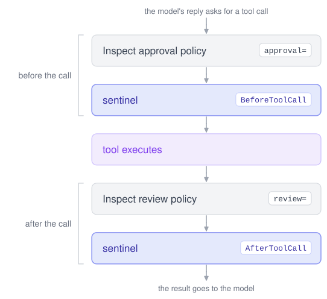

# Approval and Review – Inspect Sentinel

## Overview

Inspect has two other ways to oversee tool calls, and a sentinel runs alongside both:

- [Tool approval](https://inspect.aisi.org.uk/approval.html) (`approval=`) runs *approvers* before a tool call. An approver can approve the tool call, modify it, reject it, end the sample, or escalate to the next approver.
- [Tool result review](https://inspect.aisi.org.uk/review.html) (`review=`) runs *reviewers* after a tool call. A reviewer looks at the result and can let the sample continue, end it, or escalate to the next reviewer.

A sentinel runs at the same two points, and also before and after each call to the agent’s model. You can use approval, review and a sentinel on the same task. This page describes the order they run in and how their decisions differ.

## Order Around a Tool Call

[](diagrams/approval-order.excalidraw.svg)

When the agent makes a tool call, Inspect first checks the tool call’s arguments against the tool’s parameters. A tool call with invalid arguments fails here, and no approver, reviewer or monitor sees it. Then:

1.  The approval policy decides. If an approver rejects the tool call or ends the sample, the sentinel doesn’t run for that tool call. If an approver modifies the tool call, the sentinel sees the modified version.
2.  The sentinel runs at the `BeforeToolCall` stage. Its protocol can let the tool call proceed, reject it, modify it, end the sample, or escalate.
3.  The tool runs.
4.  The review policy decides. If a reviewer ends the sample, the sentinel doesn’t see the result.
5.  The sentinel runs at the `AfterToolCall` stage, with the result. Its protocol can let the result go to the agent’s model, end the sample, or escalate.

A tool call that an approver or the sentinel rejected has no result, so it is not reviewed and doesn’t reach the `AfterToolCall` stage.

## When to Use Each

| Use | When |
|----|----|
| Approval | You want a fixed policy for which tool calls need a person’s approval, matched by tool name and arguments, such as asking a person about every [bash()](https://inspect.aisi.org.uk/reference/inspect_ai.tool.html#bash) tool call. |
| Review | You want to end the sample based on what a tool returned, with Inspect’s reviewers or your own. |
| Sentinel | You want monitors that score each step, protocols that act on those scores, a record of every score in the log, or oversight of the agent’s model calls as well as its tool calls. |

Approval and review are the simpler choice for a fixed policy. Use a sentinel when you want to measure oversight: every score is in the log, so you can change a threshold and see which tool calls it would have caught. See [Replay](./replay.html.md) for running a sentinel over existing logs.

## Vocabulary

Approval, review and a sentinel use different words for similar decisions:

| Meaning | Approval | Review | Sentinel |
|----|----|----|----|
| Let it go ahead | `approve` | `continue` | `proceed` |
| Run a changed tool call | `modify` | (not available) | `modify` |
| Don’t run the tool call, and tell the agent | `reject` | (not available) | `reject` |
| End the sample | `terminate` | `terminate` | `terminate` |
| Pass to the next decider | `escalate` | `escalate` | `escalate` |

The text the agent receives also differs. When an approver rejects a tool call, the agent receives the approver’s `Approval.explanation`. A sentinel `Decision` has two texts: its `explanation` is recorded in the log and never shown to the agent, and its `message` is what the agent receives on a `reject`. If there is no text, the agent receives “Tool call not approved.” in both cases. See [Protocols](./protocols.html.md) for writing decisions.

## Using Both on One Task

This task has an approval policy that asks a person about every [python()](https://inspect.aisi.org.uk/reference/inspect_ai.tool.html#python) tool call. It also has a sentinel with the `no_network()` rule from the [Tutorial](./tutorial.html.md#a-rule), which rejects [bash()](https://inspect.aisi.org.uk/reference/inspect_ai.tool.html#bash) commands that use the network. Save it in the repository’s `examples/` directory, next to `no_network.py`:

    examples/approval_and_sentinel.py

``` python
from example_samples import COUNT_ROWS
from inspect_ai import Task, task
from inspect_ai.agent import react
from inspect_ai.approval import ApprovalPolicy, auto_approver, human_approver
from inspect_ai.tool import bash, python
from no_network import no_network


@task
def approval_and_sentinel() -> Task:
    return Task(
        dataset=[COUNT_ROWS],
        solver=react(tools=[bash(timeout=60), python(timeout=60)]),
        sandbox=("docker", "compose.yaml"),
        message_limit=20,
        approval=[
            ApprovalPolicy(human_approver(), "python"),
            ApprovalPolicy(auto_approver(), "*"),
        ],
        sentinel=no_network(),
    )
```

Run it where you can answer the approval prompts:

``` bash
inspect eval examples/approval_and_sentinel.py --model openai/gpt-5-mini
```

Each [python()](https://inspect.aisi.org.uk/reference/inspect_ai.tool.html#python) tool call waits for a person’s approval. Each [bash()](https://inspect.aisi.org.uk/reference/inspect_ai.tool.html#bash) tool call is approved by [auto_approver()](https://inspect.aisi.org.uk/reference/inspect_ai.approval.html#auto_approver) and then goes to the rule. In the log, the approval decisions and the sentinel’s decisions appear next to each tool call.

An approval policy passed to [eval()](https://inspect.aisi.org.uk/reference/inspect_ai.html#eval) or with `--approval` replaces the task’s approval policy and leaves the sentinel as it is. Likewise, `eval(sentinel=...)` and `--sentinel` replace the sentinel and leave the approval policy as it is. See [Configuration](./configuration.html.md) for overriding the sentinel.
