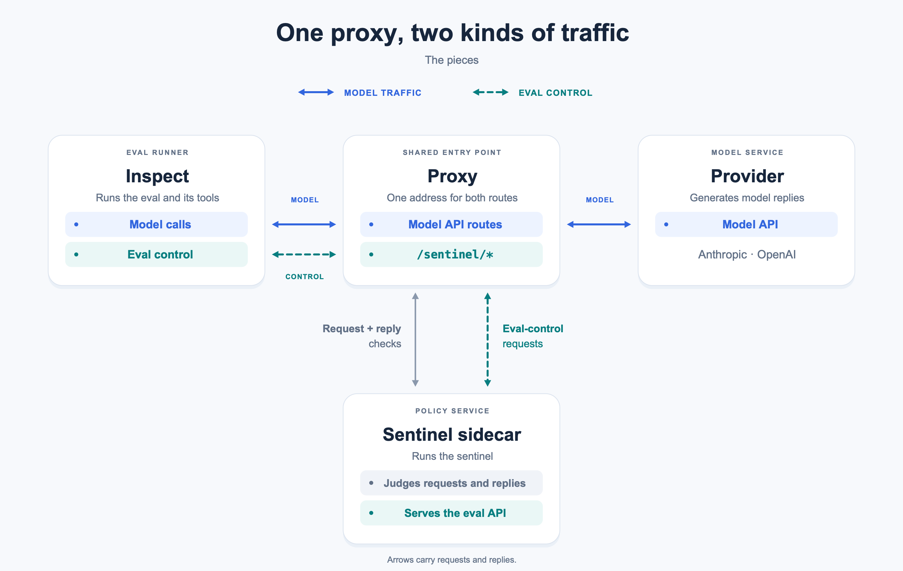

# Inspect working with a sentinel sidecar

This is the design for [PR 11](sidecar-plan.md#pr-11-inspect-client-for-the-sidecar). It describes what Inspect does when its model calls go through a proxy that has a sentinel sidecar behind it.

It is written to be read from the top. Each section starts with the short version.

Each part is marked:

- **In the plan**: already agreed in [sidecar-plan.md](sidecar-plan.md) or [sidecar.md](sidecar.md).
- **Proposed**: suggested here, not yet agreed.
- **To decide**: an open question, listed at the end.

## The short version

Up to this point in the implementation, nothing in Inspect knows the sidecar is there. An eval that sends its model calls through one gets none of the in-process behaviour. A rejected turn reaches Inspect as an HTTP error, which fails the sample. The sentinel gets no facts about the task or the sample. And nothing it decides reaches the transcript.

When the sentinel runs inside Inspect, a rejection goes into the conversation and the agent carries on. Through a sidecar, Inspect can't do that yet.

This PR teaches Inspect to notice the sidecar and work with it. An eval author changes nothing. Their task, their agent and their command line stay the same.

## The pieces



- **Inspect** runs the eval: the task, the samples, the agent and its tools.
- **The proxy** sits between Inspect and the model provider. Envoy, LiteLLM and Middleman are examples.
- **The sidecar** runs the sentinel. The proxy hands it each request and each reply, and the sidecar says what may go on.
- **The provider** is the model API, such as Anthropic or OpenAI.

Inspect talks to the sidecar in two ways:

1. **Inside its model calls.** Inspect adds two headers to each request. The sidecar adds a `sentinel` field to each reply.
2. **Through a small endpoint.** Inspect calls the sidecar directly under `/sentinel/`, through the proxy's own address. It uses this at the start of a task, at the end of a sample, and when a reply arrives without the `sentinel` field.

## 1. Finding the sidecar

**Short version:** at the start of each task, Inspect asks the proxy once whether a sidecar is there. If it isn't, nothing else in this document happens.

**In the plan.** Inspect sends `GET /sentinel/info`. A sidecar answers:

```json
{"service": "inspect_sentinel", "versions": [1], "release": "whole"}
```

Inspect goes on only if `versions` holds a version it knows.

Anything else means "no sidecar":

- no answer
- an error
- an answer from something that isn't a sidecar
- no version Inspect knows

Inspect then runs the eval as it does today. It logs nothing louder than a debug line, because most proxies have no sidecar.

**Proposed: where the probe goes.** The probe goes to the root of the model's base URL, not on the end of it.

| Model base URL | Probe |
| --- | --- |
| `https://proxy.example/v1` | `https://proxy.example/sentinel/info` |
| `https://proxy.example` | `https://proxy.example/sentinel/info` |

Envoy and LiteLLM both forward `/sentinel/` at the root. An OpenAI base URL usually ends in `/v1`, so adding `/sentinel/info` to the end would miss the sidecar.

**Proposed: which endpoint, and how often.**

- Inspect probes the endpoint of the task's assigned model: the model the eval runs with, such as `--model`.
- It probes once per task.
- Other models are not probed and get none of Inspect's headers. Examples are a model given to a role, or a grader model a scorer calls.
- Nothing is shared between tasks in this PR.

More than one sidecar in a task is question J.

Models are shared between tasks inside Inspect. So the sidecar's state for a task lives with the task, not with the model.

## 2. Registering the task

**Short version:** the sentinel is given each task's facts: the task's name and description, plus each sample's input and metadata. A task gets registered in one of two ways:

1. **Dynamic registration, by Inspect.** Inspect sends the task's facts at the start of the task. This is the usual way.
2. **Pre-registration, by an admin.** The admin writes the task's facts into the sidecar's configuration before the eval runs. This is an advanced setup, described under "Pre-registration" below.

Inspect calls `register_task` either way. A pre-registered task runs only samples predefined by the admin, though the client can choose to run only a subset of them.

**In the plan.** Inspect calls `register_task` with:

- the eval's id
- the task's name, description and metadata
- each sample selected for this run, after `--limit`, `--sample-id` and the like: its id, input, description and metadata

The sidecar gives one of four answers.

| Answer | What it means | What Inspect does |
| --- | --- | --- |
| Registered, `fixed: false` | The sidecar stored the facts. | Starts the task. |
| Registered, `fixed: true` | An admin registered this task beforehand, in the sidecar's tasks folder. | Starts the task. |
| `registration_refused` | The sidecar runs only the tasks its admin registered, and this isn't one. | Fails the task before any sample starts, with an error that names the task and says the sidecar runs only the tasks its admin registered. The error is shown as the eval runs and written to the task's log. |
| `registrations_full` | The sidecar already keeps as many registrations as it takes. | Treats it as a failure, like an endpoint that can't be reached: the `required` or `optional` setting below decides. |

**When the endpoint is down.** Inspect has a setting for an endpoint that can't be reached or that fails:

- `required`, the default: the task fails before any sample starts, with an error saying the sidecar couldn't register it, and why.
- `optional`: Inspect warns, and runs the task without the sentinel knowing the samples' facts.

A refusal is different. The deployment has said the task may not run there, so the setting doesn't apply.

### Pre-registration

An admin can register tasks beforehand, in the sidecar's configuration. A task registered this way is called predefined. Inspect still calls `register_task` for it. The sidecar matches the call to the predefined task by the task's name, and keeps the admin's facts.

It is fine for Inspect to register a predefined task when:

- **it runs the admin's samples, or any subset of them.** If the admin registered 50 samples and the researcher runs samples 1 and 2, that works. The sidecar answers with `fixed: true`, which says the task was already registered, for information only. Inspect starts the task as usual.

It is not fine when:

- **it selects a sample the admin didn't register.** Today the sidecar refuses that sample's first model request. Question A below proposes failing such a sample before it starts.
- **it changes a sample's input or metadata, under a sample id the admin registered.** The sidecar doesn't detect this. The sentinel is given the admin's facts, not Inspect's. Catching it is not yet designed.

This is an advanced setup, described in sidecar.md section 9:

- [The tasks folder](sidecar.md#the-tasks-folder) shows how an admin writes the tasks.
- [Advanced: a sidecar that runs only the tasks in its folder](sidecar.md#advanced-a-sidecar-that-runs-only-the-tasks-in-its-folder) shows a sidecar that runs only predefined tasks.

**To decide:** what happens to a selected sample that isn't in the admin's file (question A below).

## 3. Each model call

**Short version:** after a successful probe, Inspect adds a header to the agent's model calls. The sidecar uses it to tell which sample, and which attempt, a call belongs to.

**Proposed: which calls get it.** `x-inspect-context` goes only on calls that are:

- **agent turns**, the calls a sentinel inside Inspect would judge. A scorer's, an approver's or a compaction summary's calls are not.
- **to the endpoint the probe found a sidecar at**, the assigned model's (section 1).

`x-irid` is unchanged: Inspect sends it on every model call, as it does today.

**In the plan.**

| Header | What it holds |
| --- | --- |
| `x-irid` | Inspect's id for this model call. Inspect already sends it today. |
| `x-inspect-context` | Which sample this call is for, as JSON. |

`x-inspect-context` looks like this:

```json
{
  "version": 1,
  "eval_id": "eval_789",
  "task": "data_exfiltration",
  "sample_id": 1,
  "epoch": 2,
  "sample_uuid": "sample_123",
  "attempt": "attempt_1"
}
```

- `sample_uuid` stays the same when Inspect retries a failed sample.
- `attempt` is new for each retry of the sample.

The proxy removes both headers before the request reaches the provider.

**In the plan: Inspect's completion cache is off.** While a sidecar is active, Inspect doesn't reuse cached model replies. A cached reply was judged for an earlier run, so it says nothing about this one. The provider's own prompt caching is unaffected.

## 4. What comes back

**Short version:** every reply Inspect gets falls into one of four cases. Inspect handles each as it would if the sentinel ran inside Inspect.

**Case A: the reply goes on.** The reply carries `outcome: proceed`.

Some calls may have been taken out or changed. The field's `proposed` holds the model's turn as the model wrote it. Inspect then:

- keeps the model's own turn in the conversation
- answers each call that was taken out with an approval error, as in process
- runs each changed call with its new arguments, while the model's turn keeps the original

**Case B: the whole turn is rejected.** Every call in the turn was rejected, so the proxy sends an error, with the field and `outcome: reject`. The field's `withheld` holds the model's turn.

Inspect turns that error into an ordinary model output. The output holds the model's turn, and each call gets an approval error. The agent then goes on, as it would in process.

This is a change. Today, Inspect only sees an HTTP error. It retries only when the sidecar is set to answer with 503.

**Case C: the run is ended.** The field says `outcome: terminate`. Inspect ends the sample, as in process: the sample's limit is recorded as `operator`, and the sample is still scored.

**Case D: no field.** See the next section.

**In the plan: where the field is.** It depends on the provider format, and on whether the reply is streamed.

| Format | Not streamed | Streamed | On an error |
| --- | --- | --- | --- |
| Anthropic Messages | top level of the reply | the last `message_delta` event | beside `error` |
| OpenAI Chat | top level of the reply | the last chunk | `error.provider_specific_fields.sentinel` |
| OpenAI Responses | top level of the reply | `response.completed`, or `response.incomplete` when the reply was cut short | `error.provider_specific_fields.sentinel` |

Inspect has to read the field while it reads the stream. The provider SDKs drop it when they put the stream together.

**Proposed: the transcript.** Each monitor and protocol report in the field becomes a `SentinelEvent`, as it does in process. How each report is tied to Inspect's messages and calls is question E below.

## 5. When the field is missing

**Short version:** a reply without the field doesn't mean the call was allowed. Inspect asks the sidecar what happened.

Some ways the field goes missing:

- the proxy gave up waiting for the sidecar and sent its own error
- the sidecar couldn't be reached, and the proxy let the reply through unjudged
- the connection dropped before the reply ended

**In the plan.** Inspect calls `request_result` with the request's `x-irid`.

The sidecar's answers:

| Answer | What Inspect does |
| --- | --- |
| `decided`, with the outcome | Acts on it, as in section 4. |
| `judging` or `awaiting_reply` | Waits a while, then asks again (question D). |
| `not_judged`, with a reason | Records that the call wasn't judged, and why. |
| `dropped` or `unknown` | Records that the judgment is unavailable. The sidecar no longer has the call's records (`dropped`), or never saw the call (`unknown`). The call may have been judged, so this is kept apart from a call the sidecar says it didn't judge. |

**Proposed: a fuller answer.** Today `request_result` gives the outcome and the records, but not the field's step-by-step decisions. It should give the same information as the field, so Inspect can act exactly as it would on the field. This is a change on the sidecar's side.

## 6. The end of a sample

**Short version:** before any scoring, Inspect copies the sentinel's store into the sample. After the final scoring, it tells the sidecar the sample is over.

**Scoring can happen during a sample, not only at its end.** For example, `react` with more than one attempt scores each answer the model submits, to decide whether to stop (`agent/_react.py`). In process, that scorer reads the sentinel's live store. Through a sidecar, the store has to be fetched first.

**Proposed.**

1. Before any scoring, Inspect calls `sample_result` and copies the store into the sample's own store, so scorers read the latest. Scoring happens in two places in Inspect, and both need it:
   - `score()` (`scorer/_score.py`), which an agent such as `react` calls during the sample;
   - the final scoring, where the task runner calls each scorer itself (`_eval/task/run.py`).
2. Inspect scores the sample.
3. After the final scoring, `end_sample`: the sidecar drops the sample's state.

Inspect skips `end_sample` when it will retry the sample, so that the retry keeps the sentinel's state.

**To decide:** what happens when `sample_result` fails (question D), and samples that have no result to fetch (question I). A failed fetch must never look like a sample in which the sentinel had nothing to say.

## 7. Streams

**Short version:** PR 11 works with a sidecar that holds whole replies. Early release waits for PR 12.

**Decided.** PR 11 is built and tested for `release: whole`, where the proxy holds the whole reply until it is judged. A whole reply can still travel as a stream: Inspect reads the stream, and the `sentinel` field is in its last event (section 4).

`release: early`, where text arrives while the rest is held, is [PR 12](sidecar-plan.md#pr-12-inspect-incremental-streaming). That covers a refusal arriving as an error event after some text, streams that are cut off, cancellation, and partial output shown while streaming.

**Proposed: a sidecar set to `early` before PR 12.** The probe answer says `"release": "early"`. Inspect stops the task with an error at the start, saying the sidecar releases replies early, which Inspect doesn't support yet.

Running as if there were no sidecar would be unsafe. Inspect's completion cache would come back on, and a cached tool call could run without the sidecar ever seeing it.

## Not built

**A response header.** If some proxy can't pass the `sentinel` field through, the sidecar could add a header saying the request was judged. No proxy we know of needs one, so none is designed.

## Questions to decide

Each question says what's going on, why it matters, and what we propose or still need to settle.

### A. What if a researcher picks a sample the admin didn't register?

- *What's going on:* an admin pre-registered a task with samples 1 to 50, and a researcher runs sample 51.

- *Why it matters:* today the task starts as normal, and sample 51 only fails at its first model call, after its setup work.

- *Proposed:* the sidecar's answer to `register_task` lists the unknown samples, so Inspect fails just those, before they start, with a clear message.

### B. Where should Inspect act on the sentinel's decisions?

- *What's going on:* the sidecar's decision on each tool call arrives with the model's reply, before any tool runs.

- *Why it matters:* Inspect already has code that acts on a decision just before a tool runs, used when the sentinel runs inside Inspect.

- *The choice:* act on the decisions as soon as the reply arrives, or carry them to the moment each tool runs and reuse that code.

### C. What if a task has a sentinel inside Inspect and a sidecar too?

- *What's going on:* a sentinel can run inside Inspect, set with `--sentinel`, while another runs in a sidecar behind the proxy.

- *Why it matters:* both would judge the same calls, and they could disagree.

- *Proposed:* stop the task with an error at the start, until someone needs both.

### D. How long should Inspect wait for the sidecar's answer?

- *What's going on:* sometimes the sidecar is still judging when Inspect asks what happened to a call.

- *Why it matters:* waiting forever stalls the eval, and giving up too soon loses a real decision.

- *To settle:* how long to wait, what to do while the reply is still on its way (`awaiting_reply`), and how to clean up when a sample errors or is cancelled.

### E. How should the sentinel's decisions show in the transcript?

- *What's going on:* inside Inspect, each monitor's report becomes an event in the transcript, the step-by-step record in the log viewer.

- *Why it matters:* through a sidecar, the transcript should look the same, so people read it the same way.

- *To settle:* how each report in the `sentinel` field becomes an event, how it links to its message and tool call, and how to show a report the sidecar trimmed.

### F. What if a task has a very large dataset?

- *What's going on:* registering a task sends every selected sample's input to the sidecar when the task starts.

- *Why it matters:* a large dataset makes that one big upload, and samples added while the task runs aren't in it.

- *To settle:* whether to send samples in batches, and how to register samples added later.

### G. Should a locked-down sidecar refuse calls from tasks it doesn't know?

- *What's going on:* a sidecar can be set to run only the tasks an admin registered.

- *Why it matters:* it refuses to register any other task, but it still judges that task's model calls, and calls from clients that never registered.

- *To settle:* whether it should refuse those calls too. This would be a sidecar change, not an Inspect one.

### H. Is fetching the store before every scoring too slow?

- *What's going on:* some agents score their own answers as they go, to decide whether to try again (section 6).

- *Why it matters:* each of those scorings needs a fresh copy of the sentinel's store from the sidecar, which is one more network call.

- *To settle:* whether that cost matters for agents that score often, and what a scorer sees if a fetch fails.

### I. What if there's nothing to fetch?

- *What's going on:* two cases are normal: a sample that never called the model, and a sidecar started with `--no-eval-results`, which shares no results.

- *Why it matters:* a scorer that reads the sentinel's store would find empty values and think the sample was clean.

- *To settle:* how a scorer can tell "nothing was shared" from "nothing happened". A sample that never called the model can simply skip the fetch.

### J. What if a task's models sit behind more than one sidecar?

- *What's going on:* a task can use several models, such as a grader alongside the agent's model, and each could go through a different proxy.

- *Why it matters:* with two sidecars, Inspect would need to know which one holds the store, and how to combine them.

- *Proposed:* for now Inspect probes only the endpoint of the task's assigned model (section 1), so a task has at most one sidecar.

### K. What about model calls that aren't the agent's?

- *What's going on:* scorers often ask a "grader" model to judge an answer, and those calls can go through the same proxy.

- *Why it matters:* inside Inspect, the sentinel never watches a grader, but a sidecar would judge its calls without knowing whose they are.

- *To settle:* whether Inspect should mark such calls, and whether the sidecar should leave them alone.
