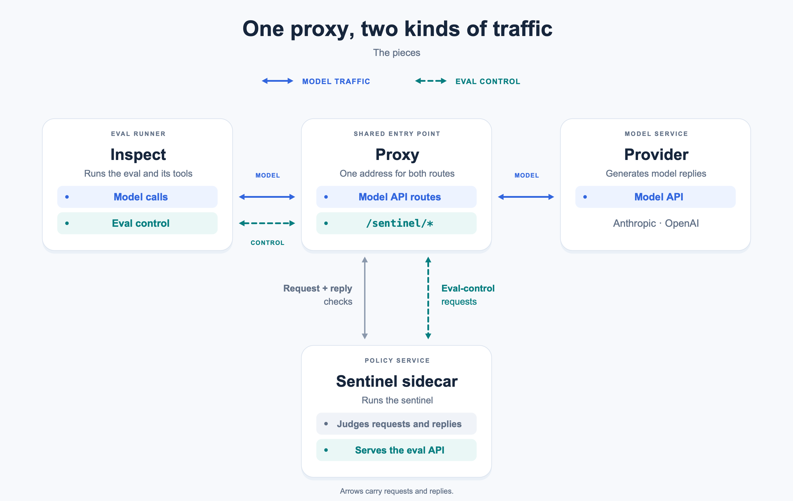

# Inspect working with a sentinel sidecar

This is the design for [PR 11](sidecar-plan.md#pr-11-inspect-client-for-the-sidecar). It describes what Inspect does when its model calls go through a proxy that has a sentinel sidecar behind it.

It is written to be read from the top. Each section starts with the short version.

Each part is marked:

- **In the plan**: already agreed in [sidecar-plan.md](sidecar-plan.md) or [sidecar.md](sidecar.md).
- **Proposed**: suggested here, not yet agreed.
- **Decided**: settled in this design.
- **Waiting on**: something still needed from someone, named with it.
- **Deferred**: proposed, and left for a later change, named with it.

## The short version

Up to this point in the implementation, nothing in Inspect knows the sidecar is there. An eval that sends its model calls through one gets none of the in-process behaviour. A rejected turn reaches Inspect as an HTTP error, which fails the sample. The sentinel gets no facts about the task or the sample. And nothing it decides reaches the transcript.

When the sentinel runs inside Inspect, a rejection goes into the conversation and the agent carries on. Through a sidecar, Inspect can't do that yet.

This PR teaches Inspect to notice the sidecar and work with it. An eval author changes nothing. Their task, their agent and their command line stay the same.

## The pieces



- **Inspect** runs the eval: the task, the samples, the agent and its tools.
- **The proxy** sits between Inspect and the model provider. Envoy, LiteLLM and Middleman are examples.
- **The sidecar** runs the sentinel. The proxy hands it each request and each reply, and the sidecar says what may go on.
- **The provider** is the model API, such as Anthropic or OpenAI.

Inspect talks to the sidecar in two ways:

1. **Inside its model calls.** Inspect adds a header to the agent's model calls, saying which sample each is for. The sidecar adds nothing to the replies: Inspect gets the provider's own reply, or an error in the provider's format.
2. **Through a small endpoint.** Inspect calls the sidecar directly under `/sentinel/`, through the proxy's own address. It uses this at the start of a task, after every agent call to ask what was decided, and at the end of a sample.

## Words this document uses

Three words mean more than one thing around Inspect and the sentinel. This document uses each in one sense only, and says where in the stack it happens. **Client side** is Inspect, where the eval runs. **Server side** is the proxy and its sidecar.

**Judging a step.** The sentinel looks at one step, such as a model call, its reply, a tool call or a tool result, and reaches a decision on it. Judging has two parts:

- a **suspicion rating**: what a monitor reports about the step, from 0.0 to 1.0. It is evidence, and decides nothing.
- a **protocol decision**: what a protocol does with the ratings: proceed, modify, reject, terminate or escalate.

Judging happens wherever the sentinel runs: client side when the sentinel runs inside Inspect, server side when it runs in the sidecar. A monitor can ask a model for its rating. This document calls that model the **judge model**, and it runs with the sentinel.

**Scoring.** Inspect grading a sample: a scorer gives the sample a **score**, such as correct or incorrect. Scoring is always client side, in Inspect, and the sentinel never scores. It usually happens after the agent finishes, and sometimes during a sample (section 6). A scorer can ask a model to grade an answer. This document calls that model the **grader**. Its calls can pass through the proxy, but they are not the agent's.

**The stores.**

- **The sample store**: Inspect's key-value store for one sample in one epoch. It is client side, always. It exists only while that sample runs, and its final contents are saved in the eval log. Tools, solvers and scorers use it.
- **Monitor state**: what a monitor or protocol keeps between steps, with `context.store_as()`, such as a count of failed calls. When the sentinel runs inside Inspect, it is a slice of the sample store, client side, named by the monitor's place in the sentinel. Through a sidecar, it is server side, kept for each run: one sample in one epoch, named by the `sample_uuid` in `x-inspect-context`. The sidecar drops it at `end_sample`, or a day after the run's last request.
- **The sidecar's records**: server side. What the sentinel reported for each model call, by the call's `x-irid`. They reach Inspect through `request_result`, which Inspect calls after every agent call. When the sentinel runs inside Inspect, the same history is the transcript's `SentinelEvent`s, client side.

## 1. Finding the sidecar

**Short version:** at the start of each task, if the model's base URL was set, Inspect asks the proxy there once whether a sidecar is there. If it isn't, nothing else in this document happens.

**In the plan.** Inspect sends `GET /sentinel/info`. A sidecar answers:

```json
{"service": "inspect_sentinel", "versions": [1], "release": "whole"}
```

Inspect goes on only if `versions` holds a version it knows.

**Proposed: one setting for the sidecar client, `sentinel_proxy`** (`--sentinel-proxy` on the command line). It has three modes.

| Mode | What Inspect does |
| --- | --- |
| `off`, the default | Doesn't probe, and runs as today. |
| `auto` | Probes quietly, only where a base URL was set, and uses a sidecar it finds. If the probe can't tell, Inspect carries on as today. |
| `required` | Fails the task at the start unless a sidecar Inspect supports answers. |

What each probe answer means:

| Probe answer | Under `auto` | Under `required` |
| --- | --- | --- |
| a sidecar, with a version Inspect knows | use it | use it |
| a sidecar, with no version Inspect knows | fail the task | fail the task |
| a 404, or an answer that isn't a sidecar | no sidecar: run as today | fail the task |
| a 401 or 403, a 5xx, or a timeout | can't tell: run as today for this call, with a warning the first time, and probe again on the next call | fail the task |

**Off unless set.** An eval that doesn't set `sentinel_proxy` sends exactly the requests it sends today: no probe, no header, and no call under `/sentinel/`. A deployment with a sidecar sets `auto` or `required` for its evals, for example in its runner, or with `INSPECT_EVAL_SENTINEL_PROXY`. `auto` can't guarantee that the sidecar is used, so a deployment that relies on its sidecar sets `required`.

**Proposed: credentials.** The probe and every call under `/sentinel/` reuse the authentication configured for the model's endpoint, in whatever form Inspect uses for that model. The proxy checks them as it checks a model call.

**Decided: the eval's token.** Every call under `/sentinel/` after `register_task` also carries the eval's `eval_id` and the eval's token (section 2), as parameters. The sidecar answers it only for that eval's requests and samples. Inspect keeps the token in its own process: it is never put into a model request, a sandbox or the eval log, so an agent that can reach `/sentinel/` can't read the eval's results ([sidecar.md, the eval's token](sidecar.md#the-evals-token)).

**Not in PR 11: a separate port for the endpoint.** A sidecar can serve its endpoint for evals on a port of its own, with its own token. Inspect can't find that from the model's address, so PR 11 doesn't support it.

**Proposed: where the probe goes.** The probe goes to the root of the model's base URL, not on the end of it.

| Model base URL | Probe |
| --- | --- |
| `https://proxy.example/v1` | `https://proxy.example/sentinel/info` |
| `https://proxy.example` | `https://proxy.example/sentinel/info` |

Envoy and LiteLLM both forward `/sentinel/` at the root. An OpenAI base URL usually ends in `/v1`, so adding `/sentinel/info` to the end would miss the sidecar.

**Proposed: which endpoint, and how often.**

- **Under `auto`, Inspect probes only an endpoint whose base URL was set,** in any of the ways inspect_ai's `model_base_url()` reads one: `--model-base-url`, the model's `base_url` argument, the provider's base URL environment variable (such as `OPENAI_BASE_URL` or `ANTHROPIC_BASE_URL`), or `INSPECT_EVAL_MODEL_BASE_URL`. A provider's own default address is never probed, because a sidecar can only sit behind a proxy that Inspect was pointed at. An eval that calls a provider directly sends the same requests as today. The probe covers inspect_ai's Anthropic provider, its OpenAI provider, and its OpenAI-compatible providers (`openai-api/<service>/<model>`, and the providers built on it, such as Together, vLLM, Ollama and OpenRouter), each only where the base URL was given or set in the environment rather than left at the provider's own address. A model of any other provider is never probed, so under `required` it fails the task, and under `auto` it is left unjudged, which the probe's reason says.
- **Under `required`, the assigned model's endpoint is probed whatever its address,** so a task that relies on a sidecar fails if it is pointed at the provider directly.
- **At task start, Inspect probes the endpoint of the task's assigned model:** the model the eval runs with, such as `--model`. So `required` fails the task before any sample runs.
- **Any other endpoint is probed the first time an agent call goes to it,** such as a model given to a role that the agent hands work to. Inspect can't know these up front, because an agent can pick a model at any point.
- **Each endpoint is probed once per task,** per endpoint and credentials, and the answer is kept for the rest of the task when it is definite: a sidecar, a 404, or an answer that isn't a sidecar. A probe that can't tell is tried again on the next agent call to that endpoint, so one failure at task start doesn't leave a sidecar unused for the whole task.
- **An endpoint only graders, approvers, compaction or monitors use is never probed,** because no agent call reaches it.
- **An endpoint with no sidecar behind it gets plain model calls,** with none of Inspect's headers, as today.
- Nothing is shared between tasks in this PR.

Why it works this way, and what it costs, is question J.

Models are shared between tasks inside Inspect. So the sidecar's state for a task lives with the task, not with the model.

## 2. Registering the task

**Short version:** the sentinel is given each task's facts: the task's name and description, plus each sample's input and metadata. A task gets registered in one of two ways:

1. **Dynamic registration, by Inspect.** Inspect sends the task's facts at the start of the task. This is the usual way.
2. **Pre-registration, by an admin.** The admin writes the task's facts into the sidecar's configuration before the eval runs. This is an advanced setup, described under "Pre-registration" below.

Inspect calls `register_task` either way. A pre-registered task runs only samples predefined by the admin, though the client can choose to run only a subset of them.

**In the plan.** Inspect calls `register_task` with:

- the eval's id
- the task's name, description and metadata
- the ids of the samples selected for this run, after `--limit`, `--sample-id` and the like, and the number of epochs

Before each epoch of a sample, and before each retry, Inspect then calls `complete_registration` with the sample's input, description and metadata (F below).

**Decided: the token.** Inspect makes `token`, a random secret for the eval, before its first registration, sends it in that `register_task`, and presents it in every later call for the eval: `complete_registration`, `request_result`, `sample_result`, `end_sample`, and `register_task` for the eval's other tasks. The sidecar keeps the token at the first registration and hands it back, so a first registration whose answer was lost is sent again with the same token and gets it back; a sidecar that keeps another token for the eval answers `unauthorized`. When the sidecar keeps no token for the eval, as after a restart or once the token expired, `complete_registration` answers `unknown_task`, and Inspect registers the task again with the same token, which the sidecar keeps again (F below).

The sidecar gives one of five answers.

| Answer | What it means | What Inspect does |
| --- | --- | --- |
| Registered, `fixed: false` | The sidecar stored the facts. | Starts the task. |
| Registered, `fixed: true` | An admin registered this task beforehand, in the sidecar's tasks folder. | Starts the task. |
| `registration_refused` | The sidecar runs only the tasks its admin registered, and this isn't one. | Fails the task before any sample starts, with an error that names the task and says the sidecar runs only the tasks its admin registered. The error is shown as the eval runs and written to the task's log. |
| `registrations_full` | The sidecar already keeps as many registrations as it takes. | Treats it as a failure, like an endpoint that can't be reached: the task fails, as below. |
| `unauthorized` | The sidecar keeps a token for this eval, and the call didn't present it. | Treats it as a failure: the task fails, as below. |

**When registration fails.** The endpoint may be down, may not answer, or may answer `registrations_full`.

- **Once a supported sidecar has answered the probe, registration is required, in both `auto` and `required`.** The task fails before any sample starts, with an error saying the sidecar couldn't register it, and why.
- **A refusal fails the task too.** The deployment has said the task may not run there.

A policy that lets a task run without registering can be added later, if one is needed.

### Pre-registration

An admin can register tasks beforehand, in the sidecar's configuration. A task registered this way is called predefined. Inspect still calls `register_task` for it. The sidecar matches the call to the predefined task by the task's name, and keeps the admin's facts.

It is fine for Inspect to register a predefined task when:

- **it runs the admin's samples, or any subset of them.** If the admin registered 50 samples and the researcher runs samples 1 and 2, that works. The sidecar answers with `fixed: true`, which says the task was already registered, for information only. Inspect starts the task as usual.

It is not fine when:

- **it selects a sample the admin didn't register.** The sidecar refuses that sample's first model call, and the sample fails without a retry (A below).
- **it changes a sample's input or metadata, under a sample id the admin registered.** The sidecar doesn't detect this. The sentinel is given the admin's facts, not Inspect's. Catching it is not yet designed.

This is an advanced setup, described in sidecar.md section 9:

- [The tasks folder](sidecar.md#the-tasks-folder) shows how an admin writes the tasks.
- [Advanced: a sidecar that runs only the tasks in its folder](sidecar.md#advanced-a-sidecar-that-runs-only-the-tasks-in-its-folder) shows a sidecar that runs only predefined tasks.

**Decided:** a selected sample that isn't in the admin's file fails with a sample error that isn't retried (question A below).

## 3. Each model call

**Short version:** after a successful probe, Inspect adds a header to the agent's model calls. The sidecar uses it to tell which sample, and which attempt, a call belongs to.

**Proposed: which calls get it.** `x-inspect-context` goes only on calls that are:

- **agent turns**, the calls the sentinel would judge if it ran inside Inspect. Calls made by a scorer's grader, an approver or a compaction summary are not.
- **to an endpoint where a probe found a sidecar**, whatever the model (section 1).

`x-irid` is unchanged: Inspect sends it on every model call, as it does today. It is unique to one logical model call. The provider SDK's own retries of a call reuse it, and the sidecar answers `request_result` for the latest attempt, which is the reply Inspect got.

**In the plan.**

| Header | What it holds |
| --- | --- |
| `x-irid` | Inspect's id for this model call. Inspect already sends it today. |
| `x-inspect-context` | Which sample this call is for, as JSON. |

`x-inspect-context` looks like this:

```json
{
  "version": 1,
  "eval_id": "eval_789",
  "task": "data_exfiltration",
  "sample_id": 1,
  "epoch": 2,
  "sample_uuid": "sample_123",
  "attempt": "attempt_1",
  "attempt_number": 1,
  "model": "openai/gpt-4.1-mini"
}
```

- `sample_uuid` stays the same when Inspect retries a failed sample.
- `attempt` is new for each retry of the sample.
- `attempt_number` is higher for each retry of the sample, so the sidecar can tell a late call of an earlier attempt from the current attempt's.
- `model` is Inspect's name for the model. The request names the model without Inspect's provider or service, so the sidecar gives a monitor this name as `step.model`, as inside Inspect, where it ends in the name the request gives.

The proxy removes both headers before the request reaches the provider.

**Proposed: Inspect's completion cache is off.** While a sidecar is active, Inspect doesn't reuse cached model replies. The sidecar judged a cached reply when it was first made, in an earlier eval, so its protocol decision says nothing about this one. The plan also allows having the sidecar judge a cached reply afresh. Turning the cache off is simpler. The provider's own prompt caching is unaffected.

## 4. What comes back

**Short version:** after every agent call that went to a sidecar, Inspect asks the sidecar what was decided. Every answer falls into one of four cases. Inspect handles each as it would if the sentinel ran inside Inspect.

**Decided: Inspect always asks.** No reply, refusal or stream event carries anything of the sidecar's. After every agent call that went to a sidecar, whether it came back as a reply or as an error, Inspect calls `request_result` at `POST /sentinel/v1`, with the eval's `eval_id` and token, the call's `x-irid`, and a `wait` ([sidecar.md, the methods](sidecar.md#the-methods)). It acts on the answer's `judgment` and writes it into the log before the agent is given anything.

**Case A: the reply goes on.** The judgment says `outcome: proceed`.

Some calls may have been taken out or changed. The judgment's `proposed` holds the model's turn, with each call taken out redacted and each changed call as it ran. Inspect then:

- keeps that turn in the conversation
- answers each call that was taken out with an approval error, as in process
- runs each changed call with its new arguments

**Case B: the whole turn is rejected.** Every call in the turn was rejected, so the proxy sends an error, and the judgment says `outcome: reject`. The judgment's `withheld` holds the model's turn, with each rejected call redacted, and its `usage` what the provider billed for the reply, which Inspect counts as it counts any model call's usage.

Inspect turns that error into an ordinary model output. The output holds the model's turn, and each call gets an approval error. The agent then goes on, as it would in process.

**Case C: the run is ended.** The judgment says `outcome: terminate`. Inspect ends the sample, as in process: the sample's limit is recorded as `operator`, and Inspect's scorers still grade the sample.

**Case D: no decision.** See the next section.

**Decided: rejected calls are redacted.** A rejected call's arguments never reach Inspect. In `withheld` and `proposed`, each call a decision acted on (a rejected call, the call a `terminate` was decided at, or every call of a turn ended at `AfterGenerate`) has its id and function, arguments `{}`, and no view or parse error, and the turn's `redacted` lists their ids. Inspect holds those calls redacted in its conversation and log, with the approval error as the result. The eval log then shows that a call was rejected, and to which function, but not its arguments. On each later request, the sidecar puts the model's original call back in place of each redacted call before the request goes on, so the provider always gets the model's own turn, signed thinking included. A changed call that Inspect holds as it ran is given the model's original arguments back by the sidecar too. A monitor's explanation in the records can still quote a call's arguments ([sidecar.md, redacted calls](sidecar.md#redacted-calls)).

**Decided: the status carries nothing for Inspect.** The HTTP status of a model call is for clients other than Inspect, and for the provider SDKs' own retries. Inspect never reads the decision from it. A refused turn is answered with the sidecar's `--reject-status`, 400 by default. With an Inspect client, that must be a status the provider SDKs don't retry themselves. They retry 408, 409, 429 and every 5xx, so under such a status a refusal is retried away inside the SDK, and Inspect sees only the retry.

**Proposed: the transcript.** Each monitor and protocol report in the judgment becomes a `SentinelEvent`, as it does in process. How each report is tied to Inspect's messages and calls is in E below.

## 5. When there is no decision

**Short version:** an answer without a decision doesn't mean the call was allowed. Inspect records what the sidecar says happened.

Some ways a call ends up without a decision:

- the proxy gave up waiting for the sidecar and sent its own error
- the sidecar couldn't be reached, and the proxy let the reply through unjudged
- the connection dropped before the reply ended

**Proposed: what Inspect does with each answer.** The model call came back either as a reply or as an error.

| Answer | What it means | With a reply | With an error |
| --- | --- | --- | --- |
| `decided` | the sidecar judged the call | acts on the decision, as in section 4 | a rejection or a `terminate`: acts on it, as in section 4. A `proceed`: the reply itself was lost on the way, so the call stays a failed call, and Inspect retries it as it does today |
| `judging` | it's still being judged | asks again (question D) | asks again (question D) |
| `awaiting_reply` | the sidecar judged the request and hasn't been handed the reply | the proxy passed the reply on without the sidecar, which hands it to the sidecar first otherwise: as for `dropped` | the sidecar never received the reply: as for `unknown` |
| `not_judged`, with a reason | the sidecar saw the call but couldn't judge it | uses the reply, since the proxy chose to let it through, and records why it wasn't judged | fails the sample with that reason |
| `dropped` | the sidecar once held the call's records, and no longer keeps them. The sidecar's judging may not have finished | `auto`: uses the reply, and records the protocol decision as unavailable. `required`: fails the sample | fails the sample |
| `unknown` | the sidecar never saw the call for this eval | as for `dropped` | fails the sample |
| no answer | `request_result` itself failed | as for `dropped` | fails the sample |

- **Ordinary retries stay.** Inspect still retries the provider and network failures it retries today. Once `request_result` confirms that the sidecar couldn't judge a call that came back as an error, the sample fails, with no extra retry on top.
- **None of these is permission to go on.** `dropped`, `unknown` and a failed lookup say nothing about what the sentinel decided. Under `auto`, the reply is used as it would be with no sidecar, and the transcript says the sidecar's protocol decision is unavailable.

## 6. The end of a sample

**Short version:** before Inspect scores a sample, it copies the monitor state from the sidecar (server side) into the sample store (client side). After the final scoring, it tells the sidecar the sample is over.

**Scoring can happen during a sample, not only at its end.** For example, `react` with more than one attempt scores each answer the model submits, to decide whether to stop (`agent/_react.py`). When the sentinel runs inside Inspect, the monitor state is already in the sample store, where that scorer can read it. Through a sidecar, the monitor state is server side, so it has to be fetched first.

**Proposed.**

1. Before any scoring, Inspect calls `sample_result` and copies the monitor state into the sample store, so Inspect's scorers read the latest. Scoring happens in three places in Inspect, and all of them need it:
   - `score()` (`scorer/_score.py`), which an agent such as `react` calls during the sample;
   - the final scoring, where the task runner calls each scorer itself (`_eval/task/run.py`);
   - interim scoring, where `inspect ctl task score` scores a running eval's samples on request, from outside them (inspect_ai's `design/ctl/interim-scoring.md`).

   A fourth place needs no copy: `inspect score` re-scores a finished eval from its log (`_eval/score.py`), after the sidecar may have dropped the run. It reads the monitor state saved in the log with the sample store, which is why the copy has to happen before the final scoring. A sample saved without being scored, as a failed sample is, is copied before it is saved, so that its log holds the monitor state, as it does inside Inspect. A failed copy leaves the marker in the store, saying why the monitor state is missing.
2. Inspect scores the sample.
3. After the final scoring, `end_sample`: the sidecar drops the run's monitor state, and the rest of what it keeps for the sample.

Inspect skips `end_sample` when it will retry the sample, since a sample the eval has ended is refused from then on. The retry starts with empty monitor state in the sidecar, as it starts with an empty sample store in Inspect's own process. Inspect copies only from the sidecars the attempt being scored called, so a retry that calls none is scored on that empty store, never on what a sidecar kept from an earlier attempt.

**Waiting on:** Meridian's answer to I, on whether this copy is wanted at all. A failed copy must never look like a sample in which the sentinel had nothing to say.

## 7. Streams

**Short version:** PR 11 works with a sidecar that holds whole replies. Early release waits for PR 12.

**Decided.** PR 11 is built and tested for `release: whole`, where the proxy holds the whole reply until the sidecar has judged it. A whole reply can still travel as a stream: Inspect reads the stream as it would the provider's, and asks `request_result` once it has ended (section 4).

`release: early`, where text arrives while the rest is held, is [PR 12](sidecar-plan.md#pr-12-inspect-incremental-streaming). That covers a refusal arriving as an error event after some text, streams that are cut off, cancellation, and partial output shown while streaming.

**Proposed: a sidecar set to `early` before PR 12.** The probe answer says `"release": "early"`. Inspect stops the task with an error at the start, saying the sidecar releases replies early, which Inspect doesn't support yet.

Running as if there were no sidecar would be unsafe. Inspect's completion cache would come back on, and a cached tool call could run without the sidecar ever seeing it.

## Not built

**`x-should-retry`.** The Anthropic and OpenAI SDKs also obey a response header that isn't part of HTTP, `x-should-retry: true` or `false`, and retry or not as it says, whatever the status. The sidecar doesn't set it, so the status alone decides whether an SDK retries a refusal (section 4). Whether the proxies pass the header on to the client hasn't been probed.

## The proposals in detail

Each item says what this design proposes. Where something is still needed from someone, the item says so under **Waiting on**. Where a proposal follows a design doc of Meridian's, the item cites it. The letters match the references in the sections above.

### A. A sample the admin didn't register

- The sidecar refuses the sample's first model call with a 400. Inspect then asks `request_result`, as after every call, which answers `not_judged` with the reason `unregistered`.

- Inspect raises `SampleRefusedError`, a new sample error in inspect_ai that means the sample can't run here. It is never retried, since a retry would be refused the same way. It is never scored, even with `score_on_error`, since the sample never ran. It counts toward `fail_on_error`, like any other sample error.

- Today inspect_ai retries every sample error while retries remain (`SampleAttempt` in `_eval/task/run.py`), so this is a small change to its sample loop.

### B. Where Inspect acts on the sidecar's protocol decisions

- Inspect acts when the reply arrives, once `request_result` has answered. It puts each call the sidecar took out back into the model's turn, redacted, from the judgment's `proposed`, with an approval error, and runs each changed call with its new arguments ([sidecar.md, the judgment](sidecar.md#the-judgment)). Inspect's approval already works this way for bridged agents, which run their own tools (inspect_ai's `docs/approval.qmd`). Taking only the rejected call out of the reply, so the rest of the turn runs, is Meridian's plan for the bridge and the sidecar ([pr-series.md, "Rejecting one call, not the whole turn"](pr-series.md#then-hosts-in-process-bridge-sidecar)).

- Two differences from a sentinel inside Inspect, to be stated in the user docs:
  - An approver never sees a call the sidecar took out. Inside Inspect, an approver sees every call before the sentinel judges it.
  - The sidecar judges every call of a turn together, before any of them runs, so a `terminate` ends the sample before any call in that turn runs.

### C. A sentinel inside Inspect and a sidecar on the same task

- Both run, as layers. The sentinel inside Inspect is the outer layer: first on the way out, last on the way in.
  - On a request, the sentinel inside Inspect judges first, and can end the sample before the request reaches the proxy. Then the sidecar judges it.
  - On a reply, the sidecar judges first, since the reply passes through the proxy. Inspect applies the sidecar's protocol decisions (B), then the sentinel inside Inspect judges the reply and each call that's left.

- The transcript says which sentinel made each report (E).

- A monitor inside Inspect that calls its judge model through the same proxy has those calls judged by the sidecar, like any client's, unless the operator turns on K's exemption.

### D. Waiting while the sidecar is still judging

- Inspect calls `request_result` with `wait`, in seconds. While the latest attempt is `judging`, the sidecar holds its answer until the state changes or `wait` passes, whichever comes first, and waits at most 30 seconds. While the answer is still `judging`, Inspect calls again. Only `judging` is waited on: a state this version of Inspect doesn't know, as from a newer sidecar, is taken as an answer, the judgment being unavailable.

- Inspect offers the same settings as for a sentinel inside it, which is none. While Inspect waits, the sample's token, turn and working limits are paused, and its time limit still applies, as they are while a sentinel inside Inspect runs. That follows Meridian's decision that a sentinel's monitors count as waiting, not working (inspect_ai's `design/working-time-concurrency.md`). The one limit on judging itself is the sidecar's `--time-limit`, which is the operator's and off by default.

- This pauses the limits only while Inspect asks. The time the sidecar spends judging inside the model call, before the reply comes back, is still charged to the agent. Giving that time to Inspect as waiting is a to do, [#162](https://github.com/meridianlabs-ai/inspect_sentinel/issues/162) ([sidecar.md, section 8](sidecar.md#what-holds-something-else-in-the-sidecar)).

- A sample that errors or is cancelled stops asking at once. `end_sample` goes where Inspect already records every way a sample can end, exactly once (inspect_ai's `design/sample-lifecycle.md`).

### E. The sidecar's reports in Inspect's transcript

- Each suspicion rating and protocol decision in the judgment becomes a `SentinelEvent`, as it does inside Inspect. This follows Meridian's aims that the same monitors give "the same decisions and events in inspect_ai's host and in the proxy host" ([proxy-host.md](proxy-host.md#8-testing)), and that the sidecar's records carry "the step id and conversation, as `SentinelEvent` does, so the two can be shown in one viewer" ([pr-series.md](pr-series.md#then-hosts-in-process-bridge-sidecar)).

- Inspect asks for the judgment by the `x-irid` of the model call it sent, so it knows which call, and which assistant message, each report belongs to. Within the turn, reports match their tool calls by the tool calls' own ids. Inspect writes the events with its own ids.

- A report trimmed by a sidecar started with `--no-eval-results` says it was trimmed, so it never looks like a monitor that had nothing to say.

- Each event records where it came from: inside Inspect, or a sidecar. For a sidecar, it also records the proxy address, the endpoint version and release mode from the probe, the call's `x-irid`, whether the report was trimmed, and the models the step's monitors and protocols called, by role, from the judgment's `models`. These go in the event's `metadata`, under `sentinel_sidecar`, so inspect_ai's log format doesn't change; a trimmed report has an empty `function`. `sentinel_proxy` isn't recorded in the log either, so `inspect eval-retry` is told it again. Typed log fields for both follow the first PR ([#167](https://github.com/meridianlabs-ai/inspect_sentinel/issues/167)), as changing the log format means regenerating the schema in inspect_ai, ts-mono and inspect_scout.

- The sidecar takes a role's model from its own configuration, not from the eval's model roles ([sidecar.md, section 8](sidecar.md#what-holds-something-else-in-the-sidecar)). When a step's monitors used a role the eval also set, to another model, Inspect warns once, naming both models.

- Later work, with the sidecar's record log ([sidecar.md](sidecar.md#10-operations)): which sentinel the sidecar runs, and its judge models' calls. Both are in the log when the sentinel runs inside Inspect. The models are named in each event, but not their calls.

- To do ([#163](https://github.com/meridianlabs-ai/inspect_sentinel/issues/163)): the usage of the judge models' calls, recorded under their roles in the eval's usage, as inside Inspect ([sidecar.md, section 8](sidecar.md#what-holds-something-else-in-the-sidecar)).

### F. Registering a task with a large dataset

- `register_task` sends the task's facts, the ids of the samples selected for this run, and the number of epochs.

- Before each epoch of a sample makes its first agent call, and before each retry, Inspect calls `complete_registration` with the sample's id, input and metadata. The facts are the same every time, and sending them again changes nothing for a sidecar that still has them. But it lets a later epoch or a retry find a sidecar that has lost the task. So Inspect reads each sample only when it runs, as it does anyway, and a large dataset is never sent in one request. Inspect is built not to hold a large dataset in memory (inspect_ai's `design/hf-lazy-dataset.md`), and a task can add samples while it runs (`design/sample-source.md`). A sidecar that no longer keeps the task's registration, because it restarted or the registration expired, answers with `unknown_task`. Inspect then registers the task again and completes the sample's registration once more, as the endpoint asks ([sidecar.md](sidecar.md), section 9). If that fails too, the sample fails. This doesn't recover a sample that is already running when its sidecar restarts, or whose task's registration expires during a day with no request from any of the task's samples. Its registration was completed earlier, so its next call isn't preceded by another. Under the default strictness, `open`, its calls go on being judged without the task's facts, and after a restart with fresh monitor state, so the copy before scoring holds only what the sentinel kept since the restart. Under `known_tasks` and `registered_only`, its calls are refused as `unregistered`, and the attempt fails. Registering again wouldn't make that attempt whole: after a restart, the sidecar has also lost the run's history and monitor state ([shared and durable state](sidecar-plan.md#follow-up-shared-and-durable-state)). But the error is one `retry_on_error` retries, and a retry starts afresh: it completes the sample's registration again, finds the task gone, and registers it again. An attempt the sidecar lost is never scored on what the sidecar holds for it since, which began afresh: its copy before scoring marks the monitor state as lost, so a scorer that reads it is told so, as when retries are off or spent and `score_on_error` scores the sample anyway. Only a task in the sidecar's tasks folder, whose `complete_registration` answers `fixed`, turns `unregistered` into a refusal that is never retried: the folder doesn't hold the sample, and never will.

- A sample a task adds while it runs, with `enqueue_sample`, extends the registration rather than completing it, which a `registered_only` sidecar refuses (G). A task the admin registered beforehand is unaffected, since the tasks folder already holds every sample.

### G. How strict a sidecar is about calls it can't place

- A sidecar setting, `strictness` (`strictness:` in the `server` stanza, `--strictness` on the command line), with three levels:
  - `open`, the default and today's behaviour: every call is judged. A call that names a task the sidecar doesn't hold is judged without the task's facts.
  - `known_tasks`: a call that names a task the sidecar doesn't hold is refused. A call that names no task, such as a naked agent's, is judged as today.
  - `registered_only`: a call that doesn't name a task the sidecar holds is refused, including non-eval traffic, and a grader's calls unless K's exemption is on. So a model-graded scorer whose model is reached through the proxy fails at every sample.

- Only `x-inspect-context` marks a call as an eval's, and the client sets it. So `known_tasks` stops a client whose registration went wrong, but not one that leaves the header off. Meridian's trust model for Inspect says the same of any input the agent can influence: "Reaching a transport is not authorization" (inspect_ai's `design/sandbox-trust-model.md`). This is a sidecar change, not an Inspect one.

- Later work, with PR 15's trusted run identity ([sidecar-plan.md](sidecar-plan.md#pr-15-trusted-run-identity-and-termination-scopes)): telling non-eval traffic apart from a client that can't be trusted, by credential.

### H. Copying monitor state before each scoring

- **Waiting on:** Meridian's answer to I. If scorers aren't to read monitor state through a sidecar, there is nothing to copy.

- If they are, Inspect copies the monitor state into the sample store before every scoring, in all three places that score during an eval (section 6), including interim scoring (inspect_ai's `design/ctl/interim-scoring.md`). Each copy is a call through the proxy. If that cost shows up, Inspect copies only when a model call has gone through since the last copy, since monitor state changes only when the sidecar judges a step.

- One difference from a sentinel inside Inspect: the copy gives the sample store only the monitor state at the moment of scoring. There is no `StoreEvent` for each change, and nothing that survives checkpoint and resume, which Meridian's reference lists as what monitor state gets inside Inspect ([sentinel-reference.md, State](sentinel-reference.md#state)).

### I. Whether Inspect's scorers read monitor state through a sidecar

- **Waiting on:** Meridian.

- Meridian's design docs note that a scorer can read what a monitor keeps ([sentinel.md, State](sentinel.md#state); also [sentinel-reference.md, State](sentinel-reference.md#state) and sentinel-deployment.md). It works because a sentinel inside Inspect keeps its monitor state in the sample store. Nothing uses it today. The sidecar's `sample_result` exists to keep it working through a sidecar.

- If no: Inspect copies nothing, section 6 is only `end_sample`, and H goes away.

- If yes: Inspect copies before scoring (H), and scorers read monitor state through a helper. After each copy, Inspect writes a marker saying whether the copy succeeded. The helper raises when it failed, because the sidecar never saw the sample (`unknown_sample`) or doesn't send results (`--no-eval-results`). A plain `store_as` would read default values instead, which look like a sample in which nothing was flagged. Inspect can't mark the missing keys themselves, since it never learns their names.

### J. Models behind more than one proxy

- When an eval sets `sentinel_proxy`, Inspect probes each endpoint the agent uses whose base URL was set (section 1), because inside Inspect the sentinel judges every agent call: "a call is the agent's whatever model it uses" (Meridian's [generate-stages.md](generate-stages.md#the-rule)). It probes the assigned model's endpoint at task start, and any other on the agent's first call to it, once per endpoint and credentials, as inspect_ai already probes a LiteLLM proxy once per base URL and key (`design/litellm-proxy.md`). An endpoint that only graders, approvers, compaction or monitors use is never probed, since no agent call reaches it.

- Inspect's headers go only on agent calls to an endpoint where a sidecar answered. Every other endpoint gets plain model calls, as today.

- Each sidecar gets its own `register_task`, `complete_registration` and `end_sample`, with a token Inspect made for that sidecar alone, which it presents only there. `request_result` goes to the sidecar the call went to. A registration that fails mid-run fails that sample, not the task.

- `required` covers only the assigned model's endpoint. An agent call to another endpoint with no sidecar behind it goes through unjudged. Inspect says so: a warning once per model, and a note in the sample's transcript the first time each attempt calls it.

- **Waiting on:** Meridian's answer to I, for monitor state from more than one sidecar. If it is copied, it is copied from each sidecar, and Inspect fails the sample if two sentinels write the same key, a sentinel inside Inspect and one in a sidecar included: the copy would otherwise overwrite the value the sentinel inside Inspect carries on from. A key already in the sample store is taken for the sentinel inside Inspect's only when the task has one. A scorer that reads monitor state with `store_as()` before the sidecar has written any, as a scorer run between an agent's attempts can, puts the model's defaults into the store, and the copy must not take those for another sentinel's state. With both kinds of sentinel on one task, such a key the sentinel inside Inspect doesn't keep still fails the sample; telling the two apart needs the keys the sentinel inside Inspect keeps, which it doesn't declare.

### K. Model calls that aren't the agent's

- **Deferred:** not built in PR 11. The exemption below follows as its own change, after the client, once what Inspect signs and how the key reaches both sides are settled. It is off by default, so nothing in PR 11 depends on it.

- Inside Inspect, the sentinel never judges a grader's calls, a scorer's, or a monitor's own model calls (Meridian's [generate-stages.md, "What is in and out"](generate-stages.md#what-is-in-and-out)). Through a sidecar, a grader's calls go without `x-inspect-context`, and the sidecar judges them like any client's, as today. That stays so until the operator turns on the exemption below.

- Inspect's own side requests go without the header too. The OpenAI provider checks once whether the account may have reasoning summaries, with a small Responses call (`reasoning_summaries()` in `model/_providers/openai.py`). Under `registered_only` that call is refused, and Inspect takes the refusal to mean summaries aren't available, so it turns them off for the run.

- The operator lists the models that serve roles other than the agent's, such as the grader, in the sidecar's configuration. The list is fixed for the run, and nothing the client sends can change it, since no method can loosen a decision ([sidecar.md](sidecar.md#a-client-that-cant-be-trusted)). This follows Meridian's plan that the proxy side marks such calls ([pr-series.md](pr-series.md#then-hosts-in-process-bridge-sidecar)).

- The list exempts a model, not a caller, so the sidecar honours it only for a call that carries a proof from Inspect's host. The proof is a signature over the call, single use, short-lived, and scoped to one sample and one role, so a leaked proof is useless.

- The exemption is off by default. Inspect keeps the signing key on its host, out of anything it passes into a sandbox, as a best effort. An operator turns the exemption on only for a deployment that trusts its client.

- Later work, with PR 15's trusted run identity: where the key lives, who issues it, and how it is rotated, so that it is safe even where the client can't be trusted. Until then, the key isn't safe from the agent with the `local` sandbox, where the agent runs on Inspect's own machine, or on a host that can't itself be trusted.
