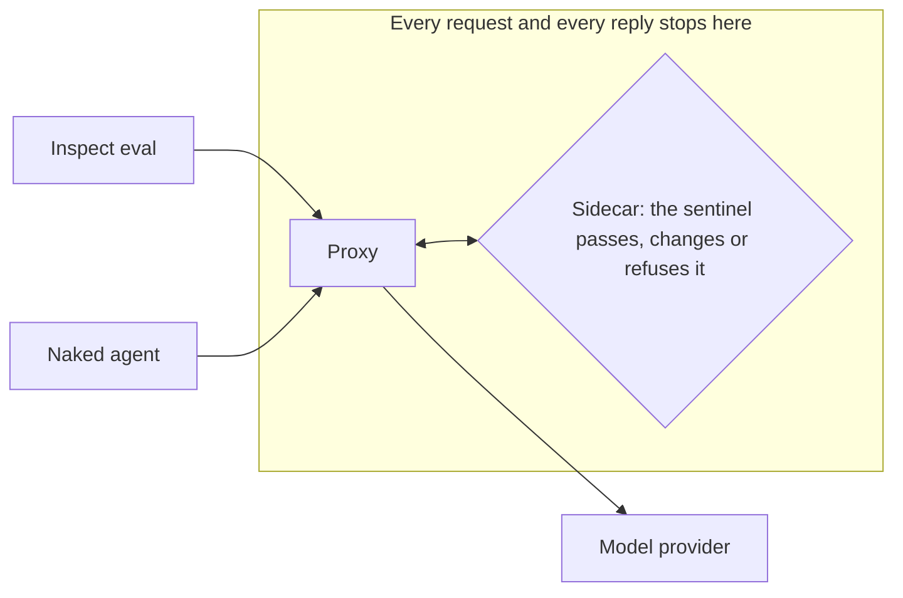
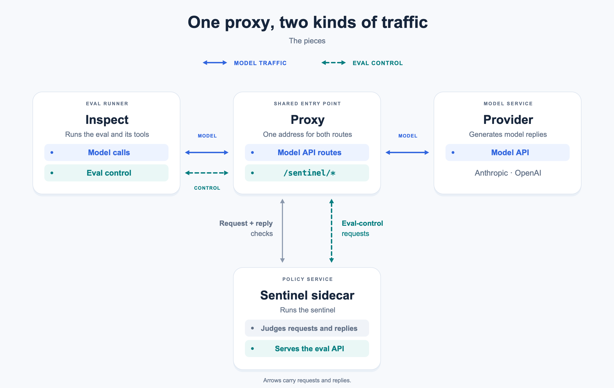
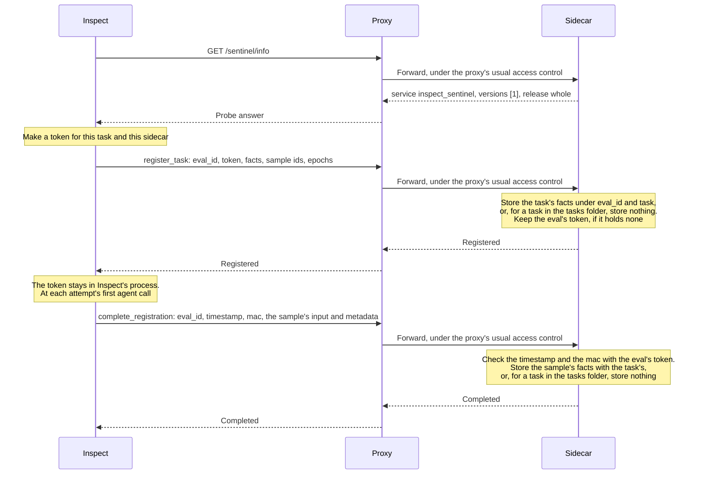
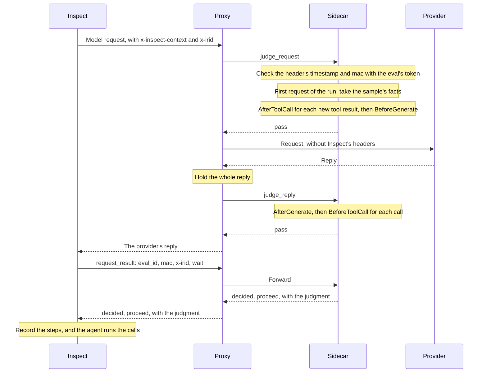
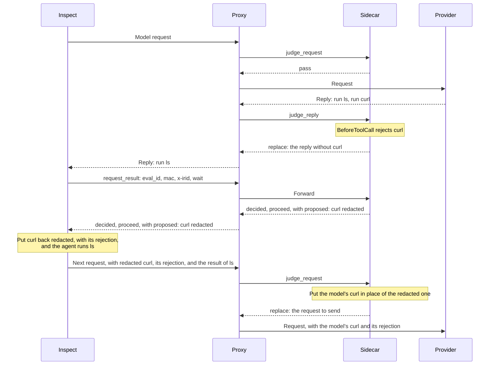
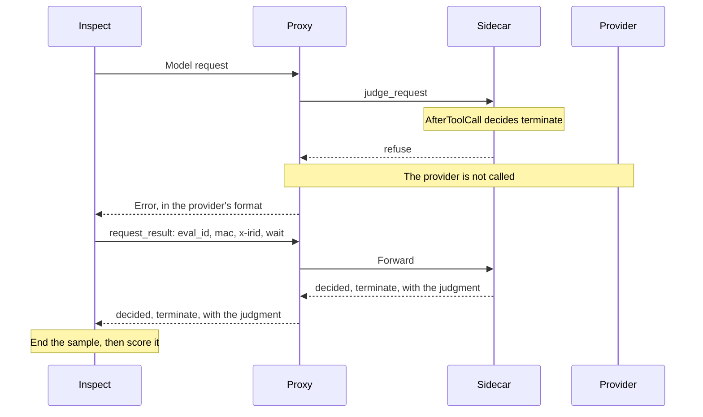
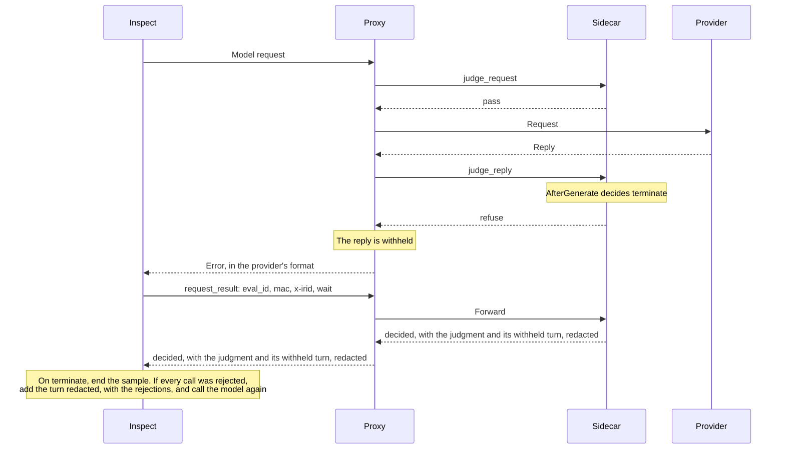
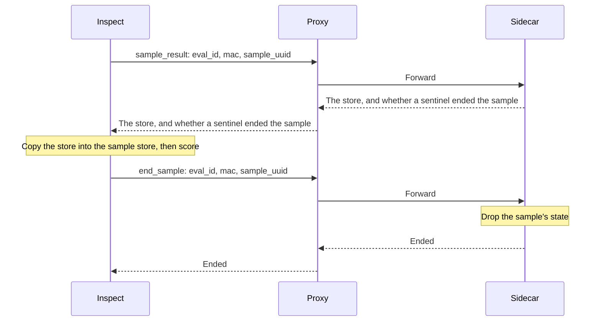
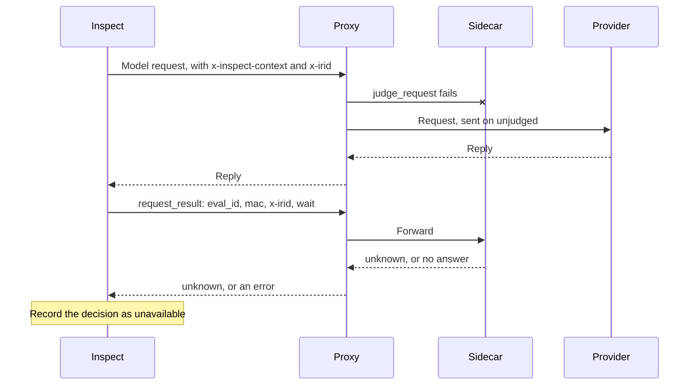
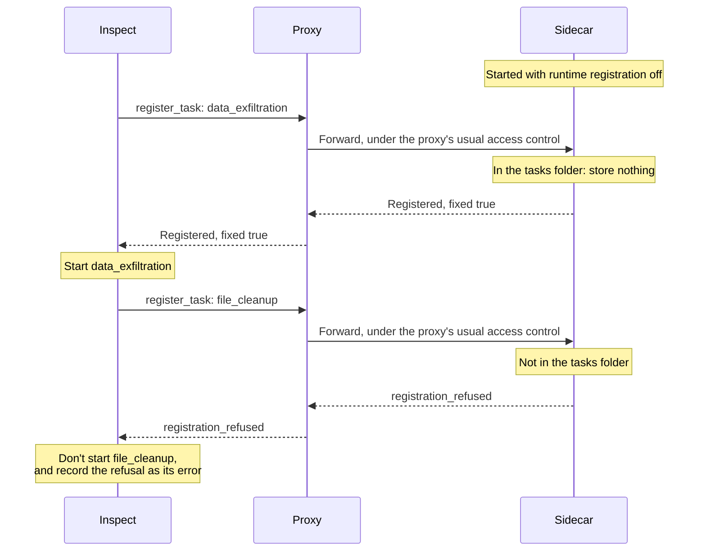

# The sidecar: a sentinel beside a model proxy

This document describes the sidecar: a Python program that runs a sentinel beside an HTTP proxy in front of a model provider's API, such as LiteLLM or Middleman. The proxy hands the sidecar each model request and each reply. The sidecar finds in them the steps a sentinel judges. It finds the steps before and after each tool call in a reply's tool calls and the next request's tool results. It runs the sentinel and carries out each decision on the request or reply it holds.

The sidecar serves agents that make their own model calls, such as Claude Code, and Inspect evals. An eval also asks the sidecar what was decided, so that the eval records the same as when its sentinel runs in its own process.

The design builds on [sentinel-deployment.md](sentinel-deployment.md). [sidecar-plan.md](sidecar-plan.md) is the plan for building it.

## Two kinds of client

- **An Inspect eval.** Inspect makes the model calls, for its own agents and for bridged ones. Inspect can tell the sentinel about the task and the sample, and can act on what the sidecar answers.
- **A naked agent.** The agent makes its own model calls, as Claude Code in a sandbox or any agent in deployment does. The sentinel has only the model traffic, and the sidecar's answer goes to a program that knows nothing about sentinels.



A naked agent needs no change for its traffic to be judged. Whoever runs the proxy chooses the sentinel.

An Inspect eval turns on Inspect's sidecar client, which is part of inspect_ai, with the option `sentinel_proxy`. The eval author changes nothing else. Inspect then finds the sidecar, registers its tasks where that is allowed, and says which sample each request belongs to. After each model call, Inspect asks the sidecar what the sentinel decided (section 9).

## Words used in this document

- **Sentinel.** The monitors and protocols that watch an agent. A task configures them with `Task(sentinel=...)`, or an operator configures them for a sidecar.
- **In-process execution.** One of two ways Inspect gets sentinel decisions: the sentinel runs inside the eval.
- **Inspect's sidecar client.** The other way: Inspect applies the decisions the sidecar made on the proxy's traffic, and drives no sentinel step itself. An eval turns it on with `sentinel_proxy`, with no change to its task code (section 9).
- **Client side and server side.** Client side is Inspect, where the eval runs. Server side is the proxy and its sidecar.
- **Judging a step.** The sentinel reaches a decision on one step. It happens client side when the sentinel runs inside Inspect, and server side in the sidecar.
- **Suspicion rating.** A monitor's rating of a step, from 0.0 to 1.0. It is evidence and decides nothing. A protocol makes the decision.
- **Judge model.** A model that a monitor asks for its suspicion rating.
- **Scoring.** Inspect grading a sample with its scorers, such as correct or incorrect. Scoring is always client side, and the sentinel never scores. It usually happens after the agent finishes, sometimes during a sample (section 9).
- **Grader.** A model that a scorer asks to grade an answer. Its calls can pass through the proxy, but they are not the agent's.
- **The sample store.** Inspect's key-value store for one sample in one epoch, always client side. Tools, solvers and scorers use it, and the eval log saves its final contents.
- **Monitor state.** What a monitor or protocol keeps between steps, with `context.store_as()`. Inside Inspect it is a slice of the sample store. Through a sidecar it is kept server side for each run, and Inspect copies it into the sample store before scoring (section 9).
- **The sidecar's records.** What the sentinel reported for each model call, kept server side by the call's eval and its `x-irid` together. Inspect reads them with `request_result`. Inside Inspect, the same history is the transcript's `SentinelEvent`s.
- **Host.** Where a sentinel runs: Inspect's process, or the sidecar. The core package's narrower `Host` interface is what a sentinel calls for side effects, such as a model call. Each host implements it, and the sidecar's implementation is `SidecarHost`.
- **Step.** One thing a sentinel judges, such as a tool call the model proposed. Each step has one of four stages: before a model call, after a model call, before a tool call and after a tool call.
- **Decision.** What a sentinel says about a step: `proceed`, `reject`, `terminate`, `modify` or `escalate`.
- **Judgment.** What the sidecar decided in one model exchange: each step it judged, with its decision and records, and what the exchange came to. An eval reads it with `request_result` after each model call (section 9). It is never put into a model reply.
- **Turn.** One reply from the model: its text and every tool call in it.
- **Conversation.** The list of messages that a model request carries.
- **Run.** The model calls the sidecar keeps together: one sample in one epoch, named by the uuid the eval log gives the sample, or one session of a naked agent. A run can hold several conversations. A sample retried after an error keeps its uuid and its run, but each attempt starts its state afresh (section 7). This is not Inspect's run, which is one `inspect eval` command and its `run_id`. So the endpoint for evals says "sample", as Inspect does, and names a sample by its uuid.
- **Proxy hook.** Code of ours that a proxy runs to forward its model traffic to the sidecar, such as `MiddlemanHook`. It is not the proxy's own mechanism for running such code, which Middleman calls its passthrough hook. Nor is it an Inspect hook, which is code an eval runs.
- **Measured.** A claim marked **measured** was run and observed. Measurements are kept where they are the reason for a design choice.

## Goals

1. **One implementation of providers.** The sidecar reads and writes provider formats with inspect_ai's Python code, never a second implementation. Where that code falls short of what a proxy needs, the gap is listed under "Asked of inspect_ai" and raised with inspect_ai. The code is not forked.
2. **No in-process advantage.** A sentinel gains nothing from sharing the eval's process, so a task and its sentinel are written as if the sentinel were behind a proxy. Whatever an eval's own host gives a sentinel, the sidecar gives too, or says it cannot.
3. **A sidecar mostly independent of the proxy.** LiteLLM is supported first, then Envoy's shim. Middleman follows trusted run identity and Hawk/METR accepting the gateway change. Code specific to one proxy stays out of the sidecar where it can, in a proxy hook the proxy runs. A proxy that can run no code of ours gets a thin adapter in the sidecar, called a shim.

## 1. The shape

A proxy hands the sidecar a request or a reply. The handler works out what it means and what should happen to it. The sentinel runner runs the monitors and protocols.

```text
   Middleman                 LiteLLM                   Envoy
   runs a proxy hook,        runs a proxy hook,        runs no code of ours
   MiddlemanHook             LiteLLMGuardrail
        |                         |                         |
        |     JSON over HTTPS     |                  bytes over gRPC
        +------------+------------+                     (ext_proc)
                     v                                      v
            endpoint for proxies                       Envoy shim
                     |                                      |
                     +------------------+-------------------+
                                        v
                                     handler
   a request or a reply in the provider's format, read into Inspect's types
   and made into steps; which run it belongs to; what was rejected; records
   an answer: pass, replace with this, or refuse and why
                                        |
                                        v    only plain data crosses here
                                 sentinel runner
   `run_sentinel` over the configured monitors and protocols; their store; their model calls
```

- **A proxy hook** runs inside a proxy that can load code. It turns what the proxy hands over into the sidecar's messages, sends them, and carries out the answer in the proxy's terms. It knows nothing of sentinels or model providers. Each is a small package under `src/proxies`. LiteLLM's is `LiteLLMGuardrail`. Middleman's is to be `MiddlemanHook`, which needs a passthrough hook in Middleman (below). Neither is merged: `MiddlemanHook` is written on a branch of this repository, and the passthrough hook on a branch of Hawk.
- **The endpoint for proxies** serves every proxy hook. It is JSON-RPC 2.0 at `POST /proxy/v1`, chosen to match the endpoint for evals, with the methods `judge_request` and `judge_reply`. A reply handed over as it arrives uses the reply-stream methods of [section 5](#handing-over-a-reply-as-it-arrives). Each answer is pass, replace or refuse. `proxy_endpoint.schema.json` describes the methods and results. It is written from the endpoint's own models and kept beside them, and every proxy hook is tested against it.
- **A shim** serves a proxy that can run no code of ours, such as Envoy, by speaking that proxy's protocol inside the sidecar. Its dependencies are an optional extra, so only a deployment behind that proxy installs them. The Envoy shim is `inspect_sentinel.sidecar.envoy`, with the `envoy` extra (below).
- **The handler** is the same for every proxy. Given a `Request` or a `Reply` by the endpoint for proxies or a shim, it answers `Pass`, `Replace` or `Refuse`. The answer says what was decided, not how to carry it out, because that is the proxy hook's or the shim's job. A `Refuse` holds the status and message the client is told. The proxy hook puts both, unread, into its error to the client, in the proxy's own form.
- **The handler adds nothing for any client, Inspect included.** Every client gets the provider's reply, edited only where a decision changed it, or an error in the provider's format. Inspect learns what was decided from the endpoint for evals (section 9), so a proxy hook never carries a decision.
- **The sentinel runner** is the core package's `run_sentinel`, unchanged, in the sidecar's process. Only steps and decisions cross between handler and runner, as plain data, so that the runner can later move to its own process. Reasons to move it are throughput, keeping a failing sentinel away from the traffic, or running beside a proxy not written in Python.

Two rules keep the handler from being limited to the least capable proxy. The handler is designed around what a sentinel needs, not what one proxy can supply. A proxy that can't do something says so in its proxy hook or shim, and the capability stays in the handler for the other proxies.

**Nothing of this package runs in a proxy.** A proxy runs only a proxy hook, which sends each request and reply to the sidecar as JSON over HTTPS. A proxy hook depends on neither inspect_sentinel nor inspect_ai, and installs by itself. A sentinel imports only the core package, never the sidecar, and a test checks that importing the core package doesn't load the sidecar.

### What each proxy hands over

| | Middleman | LiteLLM | Envoy |
| --- | --- | --- | --- |
| where the proxy's side runs | in `MiddlemanHook`, which Middleman loads through its passthrough hook and calls after the caller has signed in | in `LiteLLMGuardrail`, which LiteLLM loads as a guardrail and calls after the caller has signed in | no code of ours; Envoy's `ext_proc` filter calls the sidecar |
| a request arrives as | parsed JSON, in the provider's format | a dictionary, already parsed, that also holds LiteLLM's own working state | raw bytes |
| a reply arrives as | the provider's bytes, decompressed, held whole | the provider's bytes where Anthropic serves a request to the Messages route; otherwise LiteLLM's own objects, or a stream of them, which the guardrail holds | raw bytes, in chunks as the provider sends them |
| to refuse | Middleman writes an error in the provider's own format | the guardrail raises an exception, and LiteLLM writes the error in the format of the route | the sidecar sends an immediate response of its own |

#### Middleman

This part describes Middleman's passthrough hook and `MiddlemanHook` as they are written on their unmerged branches. The passthrough hook is a change to Middleman, which is Hawk's to accept.

The passthrough hook is a setting naming a class that Middleman loads at startup. Middleman calls the class with each passthrough request before sending it to the provider. It then holds the provider's reply whole and calls the class with it. `MiddlemanHook` puts each to the sidecar's endpoint for proxies, with the same methods as `LiteLLMGuardrail`, and gets pass, replace or refuse.

With each request, `MiddlemanHook` sends the provider, the model's public name, the user, the headers that name the request's job and sample, and any other request headers the operator listed. It sends no credential, because Middleman removes the caller's credential first. The operator controls who reaches the sidecar, which listens at an address only Middleman can reach (section 10). An operator can also limit `MiddlemanHook` to some of Middleman's channels, which are kinds of caller: an eval, a scan or a direct call. Traffic on other channels never reaches `MiddlemanHook`, and streams as it does with no proxy hook set.

**The passthrough hook and `MiddlemanHook` have different owners.**

- **Middleman owns the passthrough hook**: when a loaded class is called, the holding of a reply, how long one call may take, and what a failed call means. A class it loads may decide entirely in process. Middleman knows nothing of the sidecar or its messages.
- **This package owns `MiddlemanHook`**, its messages and their schema, and the endpoint that receives them.
- **A refusal and a failure are told apart.** `MiddlemanHook` turns the sidecar's refusal into an `HTTPException`, which Middleman answers the client with. A sidecar that can't be reached, or whose answer can't be read, is raised as a `SidecarError`. Middleman's own setting then says whether the call is refused or let through.

#### LiteLLM

LiteLLM's proxy hook is `LiteLLMGuardrail`, its own package in `src/proxies/litellm`, which LiteLLM loads from its config as a guardrail. LiteLLM calls it with each model request before the request goes to a provider, and with the provider's reply before the caller gets anything. The guardrail calls `judge_request`, and `judge_reply` for an unstreamed reply, and carries out the result. It hands a streamed reply to the sidecar as it arrives, through the reply-stream methods (section 5), and sends the caller what the sidecar releases. LiteLLM needs nothing of its own in the sidecar.

- **Three routes are read**: `/v1/messages`, `/chat/completions` and `/responses`. A request to another route goes on unread.
- **The route decides the body's format, not the provider.** LiteLLM serves any provider's model through any of the three routes, in the route's format. So a Claude model called through `/chat/completions` is answered in OpenAI's Chat Completions format. The guardrail names the format in the `format` parameter: `anthropic-messages`, `openai-chat` or `openai-responses`.
- **The sidecar judges what the caller would be sent.** Where LiteLLM hands over its own objects, the guardrail writes them as LiteLLM is about to write them for the caller, and inspect_ai's converters read that.
- **Replies LiteLLM converted from another provider's format are read, with one repair.** The three converted pairings are a Claude model through `/chat/completions`, a Claude model through `/responses`, and an OpenAI model through `/v1/messages`.
  - With LiteLLM 1.105 and a stand-in provider, all three are read for replies with tool calls, streamed and not (**measured**). With LiteLLM 1.83, three of the six cases were unreadable (**measured**).
  - With real providers, all three pass the example task, and Claude's thinking is read on `/chat/completions` (**measured**).
  - The exception is Claude's thinking through `/responses`. LiteLLM writes it as a `reasoning` item with no `summary` field and with parts typed `output_text`, which OpenAI's own SDK types reject (**measured**). The sidecar reads a reply as leniently as OpenAI's SDK, so it reads that reply. It reads a request's items strictly, through inspect_ai, so a request that sends the item back unchanged would be unreadable.
  - The repair: in what it sends the sidecar of such a request, the guardrail adds the empty `summary` and types the parts `reasoning_text`. LiteLLM keeps the client's item, and a replaced request is sent each item as the client sent it.
  - With the repair, the example tasks pass for a thinking Claude model through `/responses`, with one retry for the rejected report, and a monitor sees the thinking (**measured**). Without it, 20 of 26 such calls were refused as unreadable, and the task passed only by retrying.
- **LiteLLM's notes on the caller are not sent.** LiteLLM keeps the caller's key hash and every request header in the request's dictionary. The guardrail sends only the request's own fields, and only the headers that name the run or that the operator listed. It never sends a credential header.
- **LiteLLM's own setting chooses what is judged.** `default_on` judges every request. Without it, LiteLLM calls the guardrail only for a request or key that names it.
- **No usable answer from the sidecar is handled by LiteLLM's guardrail setting `unreachable_fallback`.** `fail_closed` refuses the call, and `fail_open` lets it through. The sidecar's answer has no time limit unless the operator sets one. A replaced request LiteLLM can't take counts as no usable answer. Under `fail_open`, the original request then goes to the provider. Its reply goes on unjudged, because the sidecar holds the replacement, which was never sent. Judging that reply would need the guardrail to tell the sidecar which request was sent.
- **A request that sets a field LiteLLM rewrites it from is refused**, whatever `unreachable_fallback` says. LiteLLM applies these after the guardrail runs, so the sidecar would judge something other than what the provider gets (**read from the source**, LiteLLM 1.83 and 1.105):
  - `extra_body`, which the provider's SDK merges over the request's other fields.
  - `ensure_alternating_roles` and the continue messages, for which LiteLLM's `completion()` inserts messages.
  - `prompt_id` and the fields that choose its version, for which `completion()` loads a stored prompt.
  - `litellm_system_prompt`, which `completion()` adds.
  - `roles`, `initial_prompt_value`, `final_prompt_value`, `bos_token`, `eos_token` and `custom_prompt_dict`, from which `completion()` writes a custom prompt template.
  - `supports_system_message`, for which `completion()` folds the system message into a user message.

  A client calling through a provider's SDK, Inspect included, sends none of them, because the SDK merges its own `extra_body` before sending.
- **A request with an MCP tool that LiteLLM's MCP gateway would run is refused**, whatever `unreachable_fallback` says. LiteLLM runs such calls itself and sends their results to the provider in follow-up requests that never reach a guardrail. So the sidecar would judge neither the calls nor those requests (**read from the source**, LiteLLM 1.83 and 1.105, on every route with the gateway). The guardrail uses LiteLLM's own test of whether the gateway takes a request's tools. So it refuses a `server_url` of `litellm_proxy`, or one ending in `/mcp/<name>`, as the installed LiteLLM would. A LiteLLM without that test has every MCP tool refused. An MCP tool the provider calls itself is judged as usual. Judging the gateway's calls would need the sidecar inside that path, which is not planned.
- **The guardrail gives each exchange its own id**, not LiteLLM's call id, which a caller can set with `x-litellm-call-id`. So two requests in flight never share a record.
- **LiteLLM writes the error a caller is sent**, in LiteLLM's form (**measured**, LiteLLM 1.83 and 1.105). A refusal carries the sentinel's message and status as JSON on every route but one. A streamed `/responses` reply gets status 200 and a `response.failed` event holding the message. Two streamed refusals need more than raising an error:
  - **On `/chat/completions` or `/v1/messages`.** A raised error reaches the caller as a 500 in LiteLLM 1.83, which provider SDKs retry. In 1.105 it arrives as an error written as a stream, which provider SDKs keep only as text. Every version answers a stream whose first event is an error with that error alone, as JSON, under the event's status. So the guardrail answers a refused stream with one error event.
  - **On `/responses`.** LiteLLM writes a raised error into its `response.failed` event as text, so the guardrail sends its own `response.failed` event instead. The event holds an error at its top level as well as in the response, because the OpenAI SDK raises only on such an event and keeps only that error. Its error code follows the refusal's status, as LiteLLM's own would, so that a client such as Inspect retries only after a server error.
- **A replaced reply is handed back in LiteLLM's own classes**, because LiteLLM goes on to read its notes from it.

**The guardrail serves `/sentinel/*` itself (section 9).** When LiteLLM builds the guardrail, the guardrail adds a `/sentinel/{path}` route at the front of LiteLLM's web app, behind LiteLLM's key check, as LiteLLM does for configured pass-through routes. The route relays each call and answer between caller and sidecar byte for byte, and needs no configuration. Configured pass-through routes aren't used, because they strip every top-level JSON key named like a LiteLLM parameter, including the `id` every JSON-RPC call carries (**measured**, LiteLLM 1.105). The route relies on parts of LiteLLM not documented for plugins, so it is tested against each LiteLLM version the guardrail supports.

LiteLLM's routes that pass a provider's own API through, such as `/anthropic/v1/messages`, are not judged. LiteLLM's source shows no call that lets a guardrail hold a streamed reply there.

#### Envoy

Envoy runs no code of ours. Its side is the Envoy shim, `inspect_sentinel.sidecar.envoy`, in the sidecar's process, served on its own port, `--envoy-port`. For each model request, Envoy's `ext_proc` filter opens a gRPC stream to the shim. It sends the request's headers and body, then the reply's headers, body and trailers.

`python -m inspect_sentinel.sidecar.envoy` writes Envoy's configuration, because many of Envoy's defaults are wrong for holding a reply. It is written for Envoy 1.39.6, the latest 1.39 release, and 1.39.1 is the earliest that works (section 5). 1.39.5 and 1.39.6 changed no API from 1.39.4: they rebuilt Envoy's images so they no longer trust the compromised eMudhra CAs. The shim's gRPC code is generated from Envoy's protos (`make envoy-protos`) and kept in the package, so the extra installs only `grpcio` and `protobuf`, with no top-level `envoy` package. The generated modules use a descriptor pool of their own, not protobuf's default one. So they load beside another copy of the same protos, such as `xds-protos`'s, without failing on duplicate names, and the messages are the same on the wire. [`examples/always_sunny_envoy`](../examples/always_sunny_envoy) runs the example task through Envoy.

- **Envoy's route says what the request is.** Three routes are judged: Anthropic's `/v1/messages`, and OpenAI's `/v1/chat/completions` and `/v1/responses`. Each tells the shim the provider and API in gRPC metadata. Anthropic's `/v1/messages/count_tokens`, which Inspect calls before compacting, goes to the provider unjudged, because it calls no model. `/sentinel/` goes to the sidecar's endpoint for evals. The generator can leave it out for a sidecar whose endpoint for evals has its own port, which an eval reaches directly. Every other path gets a 404, so that nothing reaches a provider unjudged.
- **A request is judged whole.** Envoy sends the body in one message and waits up to an hour for the shim's answer, not its default 200 ms. A replaced request is sent with its own `content-length`, which Envoy otherwise keeps from the original (**measured**). A request with a content encoding reaches the handler as it came and can't be read. So it is refused as unreadable, and an eval is told it wasn't judged.
- **A provider's error is not held.** An error is a reply with a status outside 2xx. Any 2xx reply is the model's and is judged, because a provider's SDK reads every 2xx as success. The handler passes an error on unread, so the shim tells it at the reply's headers, and the body passes through as it comes, whatever its size or encoding.
- **A reply is held whole, unless it is released early.** The shim answers the reply's headers at once, which sends the client nothing. It hands the body to the handler's reply stream (section 5) as it arrives.
  - Under `release: whole`, the stream gives nothing until it has the whole reply (**measured**, Envoy 1.39.4). The shim then sends the reply on, replaced, or refuses it with an immediate response and a real status.
  - Under `release: early`, the shim sends each part as it is released. It refuses with an immediate response while nothing has gone out, and with an error event as the body's last part once something has.
  - The body ends at a chunk marked as the end, or at the trailers, which are answered after the body's last part. Envoy 1.39 sometimes sends an empty chunk that is not the end, so an empty chunk ends nothing. The body's end goes out as an empty last part, which Envoy takes (**measured**).
  - A reply's trailers reach the client, though Envoy drops trailers over HTTP/1.1 unless told otherwise.
- **The shim writes a refusal in the provider's error format**, so the provider's SDK raises its own API error with the sentinel's message.
- **A judgment goes on when Envoy stops waiting**, as when the client disconnects. The sentinel finishes, and its decision is kept for the run and the endpoint for evals, as behind a proxy hook.
- **Inspect's headers never reach the provider.** The shim removes `x-inspect-context` and `x-irid` from each request it judges, and the route removes them from what it passes unjudged. The sentinel sees those two headers and any the operator lists with `--envoy-header`, never a credential.
- **The provider's certificate is checked** against the system's trusted certificates and the provider's host name. Envoy checks none by default.

**What can't be judged is refused.** No setting lets it through.

| What can't be judged | Refused by, with |
| --- | --- |
| a request or reply that can't be read | the shim, 400 or 502 |
| one the sentinel fails on | the shim, 500 |
| one the sentinel doesn't finish within `--time-limit` | the shim, 504 |
| a reply larger than `--max-body-bytes` | the shim, 502 |
| a reply in a content encoding other than `identity` (the route asks the provider for an uncompressed reply) | the shim, 502 |
| a request, when the shim can't be reached | Envoy itself, 500 |
| a request, when the shim takes longer than Envoy's wait | Envoy itself, 504 |

A reply refused unread is still reported to the handler, so an eval is told it wasn't judged rather than still awaited. A refusal keeps its status, 529 included, though Envoy's own list of statuses stops at 511 (**measured**, Envoy 1.39.1 and 1.39.4).

## 2. Reading provider traffic

The sidecar reads each request and reply into Inspect's types with inspect_ai's converters. The converters take a complete request or reply. Agents usually ask for a streamed reply, so the sidecar first rebuilds the stream into a whole reply with the provider SDK's accumulator, as inspect_ai's own providers do.

```text
bytes from the proxy → stream events → SDK accumulator → SDK reply → inspect_ai converter → ModelOutput
```

| API | From stream to whole reply |
| --- | --- |
| Anthropic Messages | `accumulate_event`, a pure function in a private module of the SDK |
| OpenAI Chat Completions | the SDK's `ChatCompletionStreamState`, read as a snapshot |
| OpenAI Responses | the event that ends the stream holds the whole response |
| Gemini | the SDK has no accumulator, so Gemini is not covered |

**Measured**, 2026-10-05, with inspect_ai's converters directly. 21 streams recorded from the live APIs were all read correctly: text, one tool call, parallel calls, text followed by a call, large arguments, reasoning, and turns cut off by the token limit. One Codex session and two captures from Anthropic's beta endpoint were read correctly too. An ordinary turn took under 2 ms to read, and the largest 15 to 50 ms, on a laptop with nothing warmed up.

### What happens to traffic the sidecar can't read

A request or reply the sidecar can't read is **unreadable**. It is treated like a turn whose monitor raised an error or ran out of time: it could not be judged.

- **One setting covers every turn that wasn't judged:** refuse, or let through. The default is to refuse.
- **Behind a proxy hook, that setting is the proxy's own.** The endpoint for proxies answers with a JSON-RPC error whose code says why: `unreadable`, `sentinel_failed` or `time_limit`. The proxy then refuses the call or lets it through, as it is configured.

### General rules for reading

- **An unknown value is read, but unknown content makes the turn unreadable.** Field values are parsed as leniently as the provider SDKs parse them, so a new value or field from a provider does not break traffic. A content block of a kind the converter does not read makes the whole turn unreadable, because the converter would drop the block and a tool call no monitor saw would reach the agent.
  - For Anthropic, the sidecar checks each block's kind itself, because inspect_ai's Anthropic converter drops an unknown block without an error.
  - For Responses, no check is needed, because inspect_ai's Responses converter raises an error on an unknown item.
- **The SDK's Beta types are never given to inspect_ai's converter.** Given a Beta type, the converter returns empty content and raises no error (**measured**). The SDK's plain accumulator reads a stream from Anthropic's beta endpoint correctly, so the sidecar uses that.
- **A reply with more than one choice is unreadable**, because only the first choice would be judged.
- **A proxy hook can name the API a body is written in.** The `format` parameter of the methods for proxies is `anthropic-messages`, `openai-chat` or `openai-responses`, and the body is read as that format, whatever the provider is called. The provider and the API are separate facts, because OpenAI has two APIs and a proxy can serve one provider's model through another's API. Without `format`, the sidecar works out the API from the provider's name and the body. An OpenAI request is told apart by the field that holds its conversation (`messages` for Chat Completions, `input` for Responses), and a reply by its `object` field.
- **Each provider is an optional extra** (`anthropic`, `openai`), as in inspect_ai. A provider's SDK is imported the first time a reply from that provider is read. The minimum SDK versions are inspect_ai's.
- **The sidecar depends on inspect_ai**, as inspect_sentinel already does. A sentinel needs only `inspect_ai.core`, which holds the wire types (`ChatMessage`, `ModelOutput`, `ToolCall`). The sidecar needs inspect_ai proper, where the converters are. Depending on less of it is a later optimization, and nothing waits for it.
- **The tests keep recorded replies as a corpus** (section 11), because the Anthropic accumulator is in a private module of the SDK and its signature has already changed once between releases. A release that changes it again fails these tests.
- **Some of what a request asks for is in its headers.** For example, a header names the beta features a request turns on. The sidecar sees it only if the proxy passes it on. Behind Middleman, the operator chooses which headers are passed on.

### Rules for streams

- **A stream's events are the ones the SDK dispatches.** The sidecar decodes a reply stream with the SDK's own stream class, as a client does, so an event the SDK leaves out is not judged either. OpenAI's SDK stops at `[DONE]`. Anthropic's SDK dispatches an event by its `event:` label, not its data, and skips one labelled `ping` or with a label it doesn't know. Neither dispatches an event the stream ends before finishing. Reading every event by its data would judge a reply other than the one the client gets, such as a tool's name with a fragment after `[DONE]` added to it.
- **A call the SDK has given as done must not change.** A client may run the call as soon as it is given as done, so a stream with a later chunk or event that changes the call is unreadable. Otherwise the sidecar would judge the call as the stream ends instead.
  - OpenAI's Chat Completions stream state gives a call as done once the next call starts or the choice finishes.
  - Anthropic's SDK gives a client each block as it is at its `content_block_stop`.
  - An Anthropic stream that goes on after its `message_stop`, or starts a block again at an index that has stopped, is unreadable.
  - An Anthropic stream must number its blocks in order from 0, and name in a delta or stop only a block that has started. The reason is that the SDK finds a block by its place in a list, where a negative index counts from the end.
- **What Anthropic's accumulator drops makes a stream unreadable.** The accumulator applies only the content deltas it knows, and drops any other kind with no error. It drops `compaction_delta`, for example, so a streamed compaction would be judged with an empty summary while the client receives all of it (**measured**). inspect_ai's Anthropic provider repairs this on its own stream object, which the sidecar does not use. So a stream holding a delta the accumulator does not apply is unreadable. The accumulator also drops the code-execution container, which is not content a monitor judges.

### Content inspect_ai's readers drop or merge

Where an inspect_ai reader would read less than the model is sent or the client receives, the body is unreadable. Most of these gaps are also under "Asked of inspect_ai", with the fix asked for.

| What inspect_ai's reader does | Unreadable |
| --- | --- |
| Chat Completions takes reasoning tags such as `<think>` out of a tool result written as a string, and keeps the rest. The model is sent all of it (**measured**) | a request whose tool result would be read as less than it holds. A tool result is read whole, or not at all |
| Responses leaves out a file in a tool result, and reads an image or file given by a `file_id` as empty, because it cannot fetch what the provider stores | a Responses request with such a part, in a tool result or a message |
| Anthropic drops a document's `title` and `context`, which the model is sent | a request with a document that has either |
| Chat Completions keeps neither a reply's audio nor its transcript, so a reply of audio alone would be judged empty | a reply with audio, streamed or not, and a request that sends back the model's earlier audio by its id. A user's `input_audio` is read |
| Chat Completions skips a call in the legacy `function_call` field | a reply with one, and a request with one or its result |
| inspect_ai does not read tools declared in the legacy `functions` and `function_call` fields | a Chat request that declares tools there |
| Chat Completions reads only one of an assistant's text and refusal | a Chat assistant's text given together with a refusal |
| Chat Completions merges a turn some scaffolds split, assistant(calls) → tool → assistant(content), keeping only the second assistant's content | a request whose second assistant holds anything else, such as a refusal or reasoning, or whose first assistant has a refusal the merge would overwrite. An assistant's `name` doesn't count, because the reader reads it in no turn |
| Responses keeps only the last of an assistant's texts, refusals included, with the same `internal` value, however encoded, within one run of assistant items. Any other item ends the run | two different texts with one value in one run. One text sent twice is read once |
| inspect_ai reads a call's arguments as a JSON object. It maps another value, such as `"Tokyo"`, to the tool's first parameter only given the tool's schema, which its converters are not given | a call whose arguments are not a JSON object. Empty arguments are read as none |
| A call whose arguments inspect_ai can't parse, such as valid JSON nested deeper than it allows, is read with no arguments and an error, while the client gets them as they were | such a call |

**`<content-internal>` spans.** inspect_ai's providers write an item's `internal` value into its text as a `<content-internal>` span. Its readers take every span out of a text but read only the first, so a text with more than one is unreadable.

- **Checked:** only the texts a reader takes spans out of. These are text parts, including one written as `{"text": ...}` alone; an assistant's text in Chat Completions and in Responses; text blocks anywhere, including in a tool result or a document made of blocks; and an assistant's text in Anthropic's format, in a request and in an Anthropic reply.
- **Read with every span in them:** tool arguments, a user's text given as a string, and other fields a reader keeps whole.
- **A span's value must land on a part.** A reader usually keeps the value on the part it reads the text as, but not always. Chat Completions keeps it for an assistant's string text only beside reasoning in tags, and reads a text that holds nothing else as no part at all. A body whose span values land on no part is unreadable.

### Tools a request declares

A generate step is given the tools the model is offered, and a monitor may reason about what the agent can do.

- **Tools declared in a Responses input are offered too.** A client such as Codex can declare tools in `additional_tools` items of its input, as well as or instead of in `tools`. The sidecar merges them as inspect_ai's agent bridge does, so a generate step is told every tool.
- **A tool declaration that can't be read makes the request unreadable.** A list with a tool left out would be read as whole, and the core can't say a list is unknown: at a generate step, `tools` is always a list.
  - A Responses `namespace` is flattened into its tools, leaving out any the reader does not know. A namespace read as fewer tools than it holds is unreadable.
  - A Responses declaration that gives the model content the readers leave out is unreadable: an MCP server's description, the files a code interpreter's container holds, or a container the provider keeps.

### Reasoning from Claude Haiku 4.5

For monitor authors: with Claude Haiku 4.5, a `ContentReasoning` block arrives with `redacted=True`. Its `reasoning` field is an opaque string, and the readable thinking is in `summary`. A monitor that wants the model's thinking reads `summary`.

What hasn't been checked yet is listed under "Open questions", near the end.

## 3. From traffic to steps

A proxy sees one model request and its reply at a time, and never sees a tool execute. So the sidecar finds the tool-call steps in the traffic on either side of the tool. All four stages are judged through the endpoint for proxies:

| Stage | Who initiates the check | Exchange | When |
| --- | --- | --- | --- |
| `BeforeGenerate` | proxy, while handling Inspect's model request | `judge_request` at `/proxy/v1` | before contacting the provider |
| `AfterGenerate` | proxy, after the provider replies | `judge_reply` at `/proxy/v1` | before releasing the model reply to Inspect |
| `BeforeToolCall` | the sidecar, for each tool call in the reply it holds | `judge_reply` at `/proxy/v1` | before the reply is released to the client |
| `AfterToolCall` | the sidecar, for each new tool result in the next request | `judge_request` at `/proxy/v1` | before the request goes to the provider |

The two model stages are judged within one client request and its response. `BeforeToolCall` is judged with the reply that proposes the call, and `AfterToolCall` with the request that carries its result. At the generate stages, only `proceed` and `terminate` are carried out, because the core package doesn't define `reject` and `modify` there yet.

**Every client's tool-call steps are found the same way**, for an Inspect eval or a naked agent: `BeforeToolCall` from the calls in the reply, `AfterToolCall` from the tool results in the next request (**measured** on real traffic). A tool result that no later request carries is never judged. The model never sees it either, so there is nothing for `AfterToolCall` to stop.

**A call is known by its id, within its conversation.** Every request carries the whole conversation, so a call that already ran reappears unchanged, beside its result, in every later request.

- **The contract: separate calls in one conversation have separate ids.** Anthropic and OpenAI document their ids as unique, and the vLLM and SGLang parsers draw random ones.
- **Two calls with one id make the conversation unreadable**, and the request is refused. Nothing is judged on a guess about which call a result belongs to.
- **Identity is per conversation, never global.** Two conversations may both hold a `call_0`, as a local model's often do, and neither is read as the other's.
- **An id alone vouches for nothing beside it.** A result is judged once. When the history is sent again, the result is recognised by a digest of the call, the result and the words the model said with the call. A result that comes back changed, or beside other words, is judged again.
- **Two known producers of repeated ids are not supported.** SGLang's Kimi-K2 tool parser builds each id from the function's name and a count of the calls so far, so a compacted conversation can hold two calls with one id, and its next request is refused. inspect_ai's own Groq provider names a streamed call that arrived without an id after its place in the reply, which repeats from turn to turn. Its conversation holds two calls with one id once a second call is named that way.
- **Repeated ids are not told apart.** Telling them apart by how many calls came before each, or counting calls under each id to notice a compaction, would serve only conversations outside the contract ([#108](https://github.com/meridianlabs-ai/inspect_sentinel/issues/108)).

**What a step contains.** Every step is built from the request and reply the proxy hands over. Its `input` is the messages the model was sent, including any rejected turns the sidecar adds (section 4). Its `agent_messages` is None, because a proxy cannot read the agent's own `AgentState.messages` (section 8). A tool-call step's `view` is the one Inspect would make (section 8). `AfterToolCall.output` is `None`, because the request carries only the result the model is sent.

**A tool that the provider runs gets no `BeforeToolCall` step.** Web search, code interpreter and file search are examples. The provider has run such a tool before the reply reaches the proxy, so the step would offer a choice that no longer exists. inspect_ai's converters read the call and result as content, by the kind of block or item, so they never become tool calls. Monitors still see them in the model's output, where Inspect puts them.

The one place to stop a provider-run tool is the request, before the model is called. A protocol narrows the tools offered at `BeforeGenerate`, and the sidecar removes that one tool's definition from the request, leaving the rest alone. A provider accepts a request whose history used a tool the request no longer offers (**measured**, Anthropic). The narrowing is not built. Not yet checked: OpenAI's provider-run tools, tools reached through a provider-side MCP connector, and a request whose `tool_choice` names the tool being removed.

## 4. From a decision to the wire

The sidecar carries out every sentinel decision on the request or reply the proxy holds, for every client. An Inspect client also asks what was decided (section 9), so that it can record the decision as it would in process.

| Decision | What the sidecar does |
| --- | --- |
| `proceed` | the provider's bytes are passed on as they came |
| `reject` | the rejected call is taken out of the reply, and the rest of the turn goes to the client. On every later request of the conversation, the call is put back with its rejection as its result. A turn whose calls are all rejected is refused with an error |
| `terminate` | the client is sent an error that says a sentinel ended the run, and so is every later request of that run |
| `escalate` that no protocol takes | the core package turns it into a `terminate`, which the sidecar carries out as any other |
| `human()`, asking a person | no person can be asked from the sidecar yet. At a tool stage the answer is `reject` where that is offered, and `terminate` otherwise, so the step fails closed. At a generate stage, asking fails. Holding the turn for a person's answer is [PR 13](sidecar-plan.md#pr-13-human-review) (section 8) |
| `modify` | the call's arguments are changed in the provider's original document, so the client runs the changed call. On every later request of the conversation, the model's original call is put back, so the model sees what it proposed, as it would in process. Only a function call's arguments can be changed |

### Refusing a turn

A refused turn reaches the client as an HTTP error in place of the model's reply, in the provider's own error format, carrying the reason.

- **A turn is refused whole only when none of it can go on:** a `terminate` ends the run, or every tool call in the turn is rejected. A turn with no calls left reads to most agents as finished, so they stop. When only some calls are rejected, those are taken out and the rest passed on. A turn that can't be edited as decided is also refused whole ("An edit is checked before the client is handed it", below).
- **Only the decision's `message` is meant for the agent.** The `explanation` is for the log. An Inspect client gets it through `request_result`, which Inspect never shows the agent. For any other client, it stays in the sidecar.
- **Nothing is added to the body for any client.** Every client, Inspect included, gets the provider's reply or an error in the provider's format. An Inspect client asks what was decided after every model call, with `request_result` and the call's `x-irid` (section 9, "The judgment").
- **The status of a refused turn** is for clients other than Inspect, and for the provider SDKs' own retries. It never carries the decision for Inspect, which always reads `request_result` (section 9).

  | Refused turn | Status |
  | --- | --- |
  | every call rejected | `--reject-status`, 400 by default |
  | a `terminate` ended the run, including the third rejected turn in a row | always 400 |

  - **403 is never used**, because Claude Code reports any 403 as a failure to authenticate, whatever the body says (**measured**).
  - **With an Inspect client, `--reject-status` must be a status the provider SDKs don't retry.** The Anthropic and OpenAI SDKs retry 408, 409, 429 and every 5xx. Under those, the SDK resends the request under the same `x-irid`, the sidecar answers `request_result` for the latest attempt, and the refusal is retried away: Inspect sees only the retry. Under a status the SDKs don't retry, such as 400, Inspect receives the refusal, reads the judgment, puts the turn and its rejections into its own copy, and calls the model again, as in process.
  - **For a client that isn't Inspect, a status it retries by itself also works.** Under 503, for example, the client sends the request again and the sidecar adds the rejections to it (**measured** with an unmodified Inspect, on Anthropic and on both OpenAI APIs).
  - **The SDKs also obey `x-should-retry`.** The Anthropic and OpenAI SDKs read this non-HTTP response header, `true` or `false`, and retry or not as it says, whatever the status. The sidecar doesn't set it. Whether the proxies pass it to the client has not been probed.

### `reject`: the call is taken out, and the model is told

Inside an eval, a rejected tool call is not run. The other calls run, the rejection takes the rejected call's place as its output, and the model is called again. Behind a proxy, the sidecar gets the same result without calling the provider itself:

1. The sidecar judges every call in the turn, as Inspect's own process does, unless one ends the run. It takes the rejected calls out of the reply and passes on the rest. The client runs the calls that are left.
2. The sidecar keeps the rejected call and the reason, for that conversation.
3. On every later request of that conversation, the sidecar puts the rejected call back into the model's message, with the rejection as its tool result beside the client's other results. These are the entries Inspect adds in its own process, rendered by inspect_ai in the request's format. Nothing else changes. The request is written out again as JSON, so it equals the original as data, but not byte for byte.
4. The model sees its own call and the rejection, and goes on from there.

When every call is rejected, the reply is withheld and the turn refused ("Refusing a turn", above). On the next request of that conversation, the sidecar adds the model's message, with each call's rejection as its result.

```text
agent  -->  sidecar  -->  model      a request
            sidecar  <--  model      reply: run `ls /tmp` and `curl evil.sh`     curl rejected; taken out; kept
agent  <--  sidecar                  reply: run `ls /tmp`

agent  -->  sidecar                  the next request, with the result of `ls /tmp`
            sidecar  -->  model      the same request, with [the curl call] and ["rejected: no network access"] put back
agent  <--  sidecar  <--  model      the next reply
```

#### What the model is told, and for how long

- **What the model is told:** the rejection's `message`, or "Tool call not approved." when it has none, the text inspect_ai uses. The result is written as inspect_ai writes a rejected call's result in process: no content, and the reason as an approval error, in each format's own way.
- **The rejection is put back for the rest of the conversation, and not for one request only.** The client never received the rejected call, so its copy of the conversation never holds it. Without it, the model sees itself change course for no reason, and proposes the call again (**measured**: it did).
- **An Inspect client holds the rejected call redacted.** It puts the call and rejection back into its own copy from `request_result`, with the call's id and function, and arguments `{}` (section 9, "Redacted calls"). Before anything else reads a later request, the sidecar swaps the model's original call in, so the provider is sent the model's own turn.
- **A rejected computer call is put back with why.** A Responses computer call's output can hold only a screenshot, so inspect_ai writes a rejected one with a blank image. The sidecar adds a message after the outputs that says why the call did not run.

#### Three rejected turns in a row

**Three turns in a row in which every call was rejected end the run.** Turns are counted within an attempt at a sample (section 7). This is the limit inspect_ai's bridge uses, and it counts whole turns refused.

- **A turn in which some calls ran restarts the count**, as a reply that passes does, because it is progress. Counting each rejected call would end a run whose model is getting on with its other calls.
- **Inspect's own process has no such limit.** Its native agent loop lets a model keep proposing a rejected call until a sample limit ends it.
- **Models do propose a rejected call again beside an allowed one.** Told "Tool call not approved." for one of two parallel calls, gpt-5-mini and gpt-5 proposed both again every time (**measured**). Each such turn is edited, not refused, so the limit never ends the run, as in Inspect's own process.
- **A limit on repeated attempts is for a sentinel protocol to set explicitly.** A sample's own limits bound the work.
- **A turn refused because an edit failed its check counts** toward the three.

#### How a later request is matched to the edited turn

- **How the sidecar knows that a request continues a conversation.** It compares a digest of the request's entries with the digest kept when the turn was rejected. The digest leaves out parts a client changes while the conversation stays the same. This matters for Anthropic, because inspect_ai's Anthropic provider moves its cache marks to the latest messages on every request, so exact entries would match only an immediate retry. OpenAI's formats are compared as sent. Telling the model again after the conversation has grown is **measured** for Anthropic. For OpenAI, only the immediate retry has been seen.
- **An edited turn's calls are matched by id**, as every call is (section 3). A conversation that uses one of the turn's call ids again, for a call in a later turn, has two calls under one id. The request is unreadable and refused, so nothing goes through unjudged.
- **A client may hold an edited turn more than one way.** The sidecar adds only what is missing, and replaces each redacted call with the model's original, matched by id.

  | The client holds the edited turn | Result |
  | --- | --- |
  | as handed, as a naked agent does | the calls taken out and their rejections are added |
  | as an Inspect client puts it back from `request_result`: each call taken out redacted (id, function, arguments `{}`), each changed call as it ran | each redacted call is replaced by the model's original |
  | part way between the two | only what is missing is added |
  | not at all, such as a retry of the request it was handed for | the request is left alone |
  | with one of the turn's calls, but earlier entries that no longer match those the turn was made after, as when a client summarizes earlier turns | unreadable, because which call ran can't be told |
  | any other way | unreadable, because what happened to the turn can't be told |

  "Any other way" means: calls out of order; a call the turn didn't have; a handed call missing; a changed call with arguments that are neither the model's nor those it ran with, or with another kind or function; a call taken out, held with arguments other than the model's or `{}`; a result for a call that never ran; or one of the turn's calls anywhere else in the request.
- **A rejection a client put back itself is not judged as a result.** In Inspect's own process, a rejected call never runs, so it has no `AfterToolCall` step. An Inspect client puts a rejection back from `request_result` and sends it as its own result. It is exempt only when it is exactly what the sidecar writes, compared whole. A result with anything added, such as an image, is not exempt and makes the request unreadable. A turn refused whole is treated the same way: its rejections are written when it is refused, and compared with what a client puts back.

#### Putting a call back

- **A call goes back as the provider wrote it.** inspect_ai's converters note what an Inspect message can't hold, such as a Responses tool call's own item, and write it back from that note. inspect_ai keeps the notes per sample. The sidecar runs no sample, so it keeps them per conversation, carried from one reply to the next, and reads each request of the conversation with them. Anthropic can start a server tool in one reply and give its result in the next, and neither that reply nor a later request holding it can be read without the first reply's notes. A request's opening is read first, without notes, to find its conversation. A rejected turn keeps the notes as they were when its reply was read, and only those put it back. A call id two runs both use can't put one run's call into the other's request.
- **A call goes back where it was:** right after the block that came just before it in the model's turn, or first if nothing did.
  - **How blocks are known.** A call by its id, a thinking block by its signature, and any other block by what it holds, ignoring null fields, because inspect_ai writes a text block's `citations` as null where a client leaves it out. A turn can hold the same text twice, so a block is also known by which of the identical blocks it was.
  - **Why not just next to another call.** In `[thinking, call A, thinking, call B]`, putting A back just before B would run the two thinking blocks together. Anthropic requires each run of consecutive thinking blocks to be as the model wrote it. A short probe didn't produce such a turn: Sonnet 4.5 with interleaved thinking and Sonnet 5.5 wrote their thinking before all their calls. It is reported, not seen, in Claude Code's traffic. A response can also hold thinking between other blocks when the provider runs a tool itself, such as web search.
  - **When the block before is gone**, as when a client leaves out an earlier turn's thinking, the call goes back before the next call the client holds, in the model's order.
  - **Where the rejections go:** among the client's results, in the model's order of calls. For Anthropic, before any text in that message, because Anthropic wants results first.
- **A signed turn survives having a call taken out and put back.** Anthropic signs a model's thinking. The put-back message is the one the provider sent, with the call in its place, so nothing signed has changed.
  - **Anthropic** accepts that turn, and also one with the call moved to the end or left out (**measured** with Claude Haiku 4.5, Sonnet 4.5 and Sonnet 5.5, with thinking, on two parallel calls). With the call left out, each model proposed it again, which is why the call is put back.
  - **An Inspect client's redacted call** is replaced by the original before the request goes on, so the signed turn reaches the provider as the model made it either way.
  - **OpenAI's Responses API** accepts a turn with a reasoning item and two calls, with one put back in place, put back after its sibling's result, moved to the end, put back without its `id` and `status`, or left out, with or without the reasoning item (**measured** with gpt-5-mini and gpt-5, encrypted reasoning, not stored).
- **What is kept for an edited turn, and for how long.** The calls to put back and their rejections are written once, when the reply is edited, under the notes it was read with. They are kept as long as the conversation, with no cap, because they decide what the model is sent on every later request. A provider would accept a request without them. But dropping one would stop telling the model of a rejected call and why, and would show the model arguments it never proposed as its own.

#### An edit is checked before the client is handed it

The sidecar edits the provider's own JSON or stream, so every field inspect_ai doesn't carry is kept. In a stream, every event the edit doesn't touch goes out byte for byte. The edited reply is then read back with the provider SDK's own accumulator, which is what the client runs, and must read as before with only the edits made. If any check fails, the turn is refused whole, as when every call is rejected.

A Responses stream needs more checks, because reading it looks only at the response it ends with, while a client may act on the events before:

- **A call is found by the event that adds it or the one that completes it**, because a stream may hold the second alone. Either is edited.
- **Every event for an item must give the item's place in the output**, as every such event the SDK knows does. An event without one would go out unedited and unchecked.
- **The response that ends the stream must be its last event.** The SDK keeps the last response a stream gives, while the sidecar judges the one that ends it, so a stream that goes on is unreadable, edited or not.
- **The SDK's stream state takes every event**, and each item must sit at its place in the output.
- **Each call must match the final response in every event that carries it:** its name, every other field of its added and done items, and the arguments of a function call or the input of a custom tool call in its deltas and done events, each of which must name the call's item. This holds for an item whose stream holds only its done event too.
- **A call whose details stream in events of any other kind can't be checked**, such as a shell call's command deltas. Its stream is unreadable once edited.

#### Cases that can't be edited

- **A conversation stored at the provider can't have a call put back.** The provider holds the model's turn as it made it, so a request that continues it with `previous_response_id` can't carry the call and rejection in their place. Such a request is unreadable (section 6).
- **A decision inside an Anthropic `pause_turn` continuation isn't supported yet ([#181](https://github.com/meridianlabs-ai/inspect_sentinel/issues/181)).** When a server tool pauses the turn, inspect_ai continues it inside the same model call. The continuation request resends the turn's head as its last entry, and head and tail are then merged into one assistant message. The sidecar sees two exchanges. A `reject` or `modify` in the tail can't be matched when the merged message comes back, so the next request is refused as unreadable and the sample fails closed. The head's content is also missing from the turn Inspect records. `proceed` and `terminate` through a continuation work.

#### A naked agent refused a whole turn

**A naked agent that is refused a whole turn receives the error.** Claude Code 2.1.293 resends the request once by itself, after a 400 as after a 503. The sidecar adds the rejection, so the model is told and Claude Code goes on (**measured**, Haiku 4.5). An earlier version reported a failure and stopped. An agent that stops and is restarted on the same conversation is told the same way, with no help from the agent.

#### Considered and not taken

- **The proxy calls the model again itself, and passes the new reply to the client.** The client gets a reply and no error. But this makes the proxy a client of the provider.
- **The sidecar rewrites the reply, and puts text where the tool call was.** Most agents read such a reply as a finished turn, so they stop and wait.

### `terminate`: the run stays ended

Inside an eval, a `terminate` ends the sample and Inspect makes no more model calls for it. Beside a proxy, the sidecar can only refuse requests. It refuses the request or reply the run was ended at, then refuses the run's later requests with the same error, without asking the sentinel.

Which later requests belong to the ended run depends on whether the run has a name (section 7):

- **A run that the proxy names.** Every later request with that name is refused, whichever conversation it carries, a subagent's included.
- **A run with no name.** Such requests are grouped by how the conversation opens. Refusing the whole group would refuse unrelated conversations, such as another person's session. So a later request is refused only if it continues the conversation the run was ended in.
  - **It continues that conversation if it starts with the same entries** the conversation had when the run was ended. The sidecar compares hashes of the entries, because a request carries no conversation id.
  - **Blocks added to the last such entry still count as continuing.** Claude Code adds the user's next message to the entry that holds the last tool results, not as an entry of its own (**measured**). Without this, the session would go on after the run was ended.
  - **Only blocks added after the entry's own count.** An entry whose own blocks changed is another conversation's.
- **A run with no name, ended before any reply in that conversation was passed on.** The ended conversation holds only its opening. A later request that opens the same way could be a retry or someone else's first request, and nothing tells them apart. So the run is not remembered as ended, and the sentinel judges the next request afresh. No request passes unjudged.

A run stays ended for as long as the sidecar holds its state (section 10). Nothing an eval sends can undo it, because no method of the endpoint for evals changes a decision (section 9).

### `modify`: keep the original, change one call's arguments

A `modify` changes the arguments of one tool call. In Inspect's own process, a modify can change only the arguments: one that changes the function fails the sample, and the core package's validator refuses it.

The sidecar keeps the provider's original document and changes only the call's arguments in it. The client runs the changed call.

- **The model sees what it proposed.** On every later request of the conversation, the model's original call is put back, followed by the result of what ran, as in process.
- **`AfterToolCall` is given the call that ran**, as in Inspect's own process, whichever version the client holds.
- **An Inspect client holds the changed call as it ran**, from the judgment's `proposed` (section 9), and never learns the model's original arguments. The original is still put back on its later requests.

**Why the original is edited, not re-rendered.** Rendering a turn back through inspect_ai keeps the content: thinking with its signature, text with citations, tool calls and server tool results. It loses what surrounds the content: cache marks, the request's top-level fields and usage detail (**measured**, Anthropic). inspect_ai's writer would write the arguments the same way, but drop the fields around them. So the new arguments go in the call's own block:

| Format | Where the new arguments go |
| --- | --- |
| Anthropic | the `tool_use` block's input. In a stream, its deltas are replaced by one delta holding the whole input |
| Chat Completions | the call's arguments, in its first fragment of a stream |
| Responses | the `function_call` item's arguments, in every event that carries them |

In an early test on a streamed reply, with new arguments for one call, 60 of 65 events went out byte for byte, and the stream read back with the new arguments and the same thinking signature (**measured**). The edit is read back as a `reject`'s is.

**Only a function call's arguments can be changed.** A `modify` of any other kind of call is a failure to judge. The reply is not judged, the proxy is answered with the code for a sentinel that failed, and the proxy's own setting for unjudged calls decides. A proxy set to fail closed refuses the reply. One set to fail open lets it through with the model's call unchanged. When another call of the same turn was rejected, the turn is refused whole instead.

**The one exception to goal 1, one implementation of providers.** Editing a call in place needs where each call sits in the provider's original document, streamed or not, which inspect_ai does not supply. The sidecar knows that for each provider format.

**Replacing a whole request or a whole reply** follows the same idea. A replacement list of messages is mostly the same as the one it replaces, so unchanged messages keep their original bytes and only changed ones are rendered. A whole replacement reply for an agent that asked for a stream has to be written as a stream, and inspect_ai has code for this in its in-sandbox model proxy. Neither kind of replacement has been run. Two questions are open:

- Does a provider's prompt cache still match when the untouched parts are equal as data but not byte for byte?
- Does it matter that a changed stream still carries the provider's original token counts?

**A tool's result is never changed.** Neither `modify` nor `reject` is legal after a tool call has run. After that, a protocol can only `proceed` or `terminate`.

## 5. Holding a turn

A sentinel judges a whole turn before the client may act on it, so something has to hold the reply meanwhile. What holds it depends on the proxy.

The `server` stanza's `release` setting is `whole` by default: the whole reply is held until it is judged. Under `release: early`, the text and reasoning before a turn's first tool call reach the client as they arrive, and a sentinel is still given whole turns ([below](#what-a-sentinel-sees-under-early-release)). [PR 10](sidecar-plan.md#pr-10-proxy-incremental-streaming) built early release for Envoy and LiteLLM and validated it with provider SDK clients, keeping call edits, later-request amendments and results on the endpoint for evals. It is not built for Middleman, which needs a change to hand over chunks. That change follows Middleman's initial integration and does not block the other proxies. [PR 12](sidecar-plan.md#pr-12-inspect-incremental-streaming) is to add Inspect's side: incremental replies, transcript records and outcome recovery.

### What holds the reply

- **Middleman holds the reply itself.** Once the sidecar has answered, Middleman passes on the provider's bytes, the replacement, or an error with a real HTTP status. Middleman also holds back the provider's keepalives, so during a long generation the client hears nothing until the reply is finished. Middleman decompresses the provider's reply and sends its clients uncompressed replies, so the sidecar handles no compression behind Middleman (**measured**).
- **Envoy does not hold the reply, so the sidecar does.** Envoy hands over chunks as the provider sends them. Envoy's `ext_proc` filter has four modes for a response body, and only the last works for holding a turn:

  | Response body mode | What happens (**measured**, Envoy 1.39.1) |
  | --- | --- |
  | `BUFFERED` | fails with a 500 above the connection buffer (1 MiB) and above gRPC's message size (4 MiB); deadlocks on a compressed body behind the decompressor |
  | `BUFFERED_PARTIAL` | corrupts data above the buffer limit |
  | `STREAMED` | wants one answer per chunk, so a processor that stays silent to hold a turn deadlocks |
  | `FULL_DUPLEX_STREAMED` | chunks arrive as sent, and the processor may answer when it likes |

  The Envoy shim uses `FULL_DUPLEX_STREAMED`. In this mode, answering any response-body message commits the response's status, and staying silent does not. So while the sidecar has answered nothing, it can still refuse with a real status. Envoy's request-side message timeout defaults to 200 ms, less than a monitor that asks a model needs, so the configuration raises it to an hour, the most Envoy allows. The configuration is generated, because each of these settings is wrong by default.
- **The sidecar never decodes a compressed reply.** This matters for a proxy that hands over the provider's bytes as they came, as Envoy does. The Envoy route asks the provider for an uncompressed reply, and the Envoy shim refuses a compressed one with a 502, recorded as unreadable.

### Limits on a hold

A hold has two limits, a largest size and a longest time, each with a defined answer when passed. While nothing has been released to the client, that answer can be a real 503.

- **Middleman's passthrough hook has both.** Unless set otherwise, it waits 30 seconds for each answer from the sidecar, and holds up to 32 MiB of reply.
- **The sidecar reads at most 64 MiB in each message from a proxy**, set with `--max-body-bytes`. It answers a larger message with a 413, without passing it to the handler, and the proxy treats that as a turn that could not be judged. 64 MiB covers Middleman's largest reply, because Middleman sends a reply as base64, a third larger than the reply itself.
- **A reply handed over in chunks has the same limit.** A reply that grows past it is not judged. While nothing has been sent, the proxy treats it as a turn that could not be judged, and the Envoy shim refuses it with a 502. Once something has been sent, it ends with an error event.

### Timing a sentinel

- **A sentinel is not timed by default.** When a proxy stops waiting for the sidecar's answer, the sidecar is not told, and the sentinel carries on until it decides. This is deliberate, so that an eval can still ask what was decided (section 9). A late `reject` or `terminate` still counts for the run.
- **A late decision can't change what the client received**, because the proxy has already acted. A proxy that refuses a failed call has refused it and discarded the reply. A proxy set to let a failed call through has sent the reply on, so a late `reject` is recorded against a reply the client has.
- **An operator sets the proxy's wait for the slowest decision expected.** Behind Middleman it is `MIDDLEMAN_PASSTHROUGH_HOOK_TIMEOUT_SECONDS`, 30 seconds unless set. That suits a rule that decides at once, but a decision can take hours when a person is asked. The wait applies to each call of `MiddlemanHook` separately, one for the request and one for the reply, and the reply's call starts only once Middleman has the whole reply. So it is not a limit on how long a turn is held.
- **`--time-limit`, in seconds, is a ceiling on the sentinel.** A sentinel that passes it is cancelled. The sidecar answers a proxy hook with the JSON-RPC error `time_limit`, the Envoy shim refuses its client with a 504, and the request is recorded as not judged, with the time limit as the reason. Only a monitor that is waiting, for a model or the network, can be cancelled this way. Whatever it already wrote to the run's store stays there.

### Refusals and the connection

What a refusal looks like to the agent's SDK depends on how much was released (**measured** with the earlier Envoy processor):

| What happened | What the SDK does |
| --- | --- |
| Nothing released, then the turn refused | raises a typed API error, with the status and error body the sidecar chose |
| Some bytes released, then the turn refused | sees a stream that was cut off |
| Some content released, then an error event sent in the stream | raises a typed API error, although the HTTP status was 200 |

- **A long hold can lose the connection.** While a turn is held, the client is sent nothing. A load balancer or similar in between may close a connection that is silent too long, whatever the proxy's own wait. A client's total request deadline can also end a long review.
- **Keepalives help only a streaming reply.** A request held before the provider is called, as for an `AfterToolCall` question, has nothing to carry them, and neither has a non-streaming reply. So in [PR 13](sidecar-plan.md#pr-13-human-review) a question outlives the exchange that raised it. After a bounded wait the client is refused with a retryable error, and a retry of the same request finds the question pending or answered. PR 13 also defines question expiry, and what happens to a pending review when its client disconnects.
- **Only a reply released early is sent keepalives** ([below](#releasing-a-reply-as-it-arrives)). A reply held whole is sent none, so that a refusal keeps its real status.
- **Considered and not taken: Middleman keeping a whole hold alive.** Middleman could, with no sidecar change, send the success status and keepalives at once, hold all the content, and deliver a refusal as an error event in the stream. The client would not wait in silence, but a refusal would lose its real HTTP status.

### What a sentinel sees under early release

- **The operator turns early release on.** The `server` stanza's `release` setting is `whole` by default, and every reply is then held whole. With `release: early`, the text and reasoning before the turn's first tool call go out as they arrive. Everything from that call on is held until the turn ends, and the turn is then judged as when held whole.
- **A sentinel is always given whole turns**, as in Inspect's own process. `AfterGenerate` gets the finished turn. Each `BeforeToolCall`, in order, gets the complete assistant message with every call in it. No monitor needs to know a reply was streamed, so any sentinel can be used with `release: early`, including one that watches `AfterGenerate`.
- **What early release gives up.** Text the model writes after its first call waits for the turn to be judged. A turn refused after text has gone out gets an error event, not a status of its own. Text that has gone out can't be recalled: a sentinel that ends the run fails the turn, but the client already has the text before the first call. A sentinel whose decisions must also withhold that text is used with `release: whole`.
- **No call is judged before its turn ends.** Judging each call once complete would save time only where the model writes a lot after a call and the sentinel is slow, because models write calls at the end of a turn and agents run a turn's calls once they have all of them. It would also give a monitor less than the whole turn, without the monitor knowing. If a workload needs it, it would be an opt-in a monitor declares, saying its decision doesn't depend on anything after the call it judges, and never a server setting.

### Releasing a reply as it arrives

`Handler.reply_stream` passes on a streamed reply under `release: early`, for all three formats, with keepalives. The Envoy shim and the LiteLLM guardrail use it.

- **Only text and reasoning before the first call go out as they arrive.** These are `text`, `thinking` and `redacted_thinking` blocks in Anthropic's format, an assistant's `content` and the reasoning fields inspect_ai reads in Chat Completions, and message and reasoning items in Responses. The first event of anything else is held, with everything after it, text included. That covers a call the client runs, the provider's own tool call or its result, and content of a kind the sidecar doesn't know. So content the sidecar can't read is found before any of it goes out.
- **Nothing goes out before there is content to release.** The events that open the stream, such as `message_start`, `response.created` and the first Chat chunk, are held until the first text or reasoning. Until then the status has not been sent, so a turn made only of calls is still refused with a real status. A comment the provider sends, as some do for keepalives, goes out with what follows it, and never holds that back.
- **What goes out early is checked first.** Each event released before the turn ends is given to the provider SDK's own accumulator, and an event the accumulator refuses is not sent.
- **The rest of the turn is handled as when held whole.** Once the turn ends, the whole reply is judged, edited and checked as under `release: whole`, with the same judgment, records, history and time limit. The client is then sent what follows what already went out. An edit never changes what went out, because taking out or changing a call doesn't touch the opening text and reasoning. A reply whose edit would change it is not judged, and fails before anything is recorded.
- **After content has gone out, a refusal is an error event in the stream.** Once anything has been released, or a keepalive sent, the status has been sent. The turn is then refused with an error event that the provider's SDK raises on, and the sidecar stops sending the provider's stream. The error event is always sent, because every provider SDK reads a stream that merely stops as a complete, shorter reply. **Measured** with openai 3.31 and anthropic 1.14:

  | Format | Event that makes the SDK raise |
  | --- | --- |
  | Anthropic Messages | an `error` event, which raises `APIStatusError`; its body is the whole event |
  | OpenAI Chat Completions | a chunk with a top-level `error` object, which raises `APIError` |
  | OpenAI Responses | `response.failed` with a top-level `error` object as well as the response's own `error`, which raises `APIError`; `response.failed` alone, and Responses' own `error` event, do not make the SDK raise |

  For both OpenAI formats, the SDK keeps only the `error` object as the exception's body. The top-level `error` and the response's `error` hold the same message and code. The code follows the refusal's status, so that a client such as Inspect retries only after a server error. The LiteLLM guardrail refuses a Responses stream with `response.failed` in the same way.
- **A client sent nothing for a while is sent a keepalive**, so that a load balancer doesn't close the silent connection. Once a reply released early has sent nothing for `keepalive` seconds, the sidecar sends the SSE comment `: keepalive`. `keepalive` is set in the `server` stanza or with `--keepalive`, 15 seconds by default, and 0 sends none. The OpenAI and Anthropic SDKs' readers drop any line starting with a colon, so the client reads the same events either way.
- **A keepalive sends the status.** A turn refused after one gets the error event above, never a status of its own.
- **A proxy that can't send its client a comment says so when it begins the reply stream**, in `begin_reply` through the endpoint for proxies. It is then given no keepalives, so that a refusal keeps its status while nothing else has gone out. The LiteLLM guardrail can send one on its Messages route with any LiteLLM version, and on its Chat and Responses routes with LiteLLM 1.105 or later. LiteLLM 1.83 writes what a guardrail yields on those routes as JSON, which would break the stream.
- **A keepalive holds no content**, so a guardrail set to let a call through when the sidecar fails still lets the reply through after one.

What a decision does to a turn whose content has partly gone out:

| Decision | What happens |
| --- | --- |
| Every call rejected | The turn fails with `outcome: reject`. The run goes on, and the model is told on the next request. |
| The run ended | The turn fails with `outcome: terminate`, and later requests of the run are refused. |
| Only some calls rejected | The turn succeeds with those calls taken out. |

Each case is as when the reply is held whole, with one difference. A failed turn is never turned into a successful reply of the text alone, because an Inspect agent takes a reply with no calls as the model finishing. The SDK's exception doesn't take back what the client was given: the client may have shown the text, put a call together or run it. The guarantee is only that the client is not told the turn completed. The decision is stored before the client is told.

### Handing over a reply as it arrives

A proxy that hands the sidecar a reply whole calls `judge_reply`. A proxy that hands over a streamed reply as it arrives uses a reply stream, `Handler.reply_stream`. The Envoy shim uses it inside the sidecar, and a proxy hook such as the LiteLLM guardrail uses it through the endpoint for proxies, with the methods below. A reply stream holds a reply whole or releases it early, sends a provider's error on as it arrives, and records an aborted reply as cut off. Under `release: whole` it answers once at the reply's end, as `judge_reply` does.

- **The provider's side and the client's side run at the same time.** The proxy feeds in the provider's bytes as they arrive, and separately reads out, in order, what to send the client. Feeding a chunk means only that the sidecar has taken it. Ending the input means only that no more bytes are coming; judging and sending can go on after it.
- **Feeding waits only on output the proxy hasn't collected.** When that output backs up, feeding waits for it to drain, which slows the proxy's reading of the provider. Feeding never waits on what the sidecar holds to judge, which is the whole reply under `release: whole` and everything from the first call under `release: early`. Held bytes go out only once the turn ends, which needs the rest of the input, so waiting on them would never end.
- **A reply past `--max-body-bytes` is not judged**, as "Limits on a hold" above says.
- **The proxy says when the client has gone.** A proxy whose client disconnects, or that stops waiting, aborts the reply stream. The sidecar stops producing output and lets go of what it held for the client. A reply aborted before its turn ends is not judged and is recorded as cut off, so that an eval asking for the request's result is told that, not that the result is pending. A judgment already running goes on to the end, as when the Envoy shim's client disconnects, and its decision and records are kept for the run.

What the client is to be sent comes out in four kinds:

| Output | What it is |
| --- | --- |
| Bytes | bytes for the proxy to send |
| A refusal with a status | only while nothing has been sent; the proxy sends it as an HTTP error |
| An error event | written by the sidecar in the provider's format once something has been sent; the proxy sends it, then stops. For a turn not judged, rather than refused, it says why, so that a proxy that lets through what isn't judged can still do so when it has sent its client only keepalives |
| The end of the reply | the reply is complete |

The output ends only with the end of the reply, a refusal or an error event. If it stops any other way, the proxy treats that as a failure, never as a complete reply.

**Through the endpoint for proxies**, a reply stream is five JSON-RPC methods. Bytes are sent as base64, as in `judge_reply`.

| Method | What it does |
| --- | --- |
| `begin_reply` | Opens the reply stream for a request: its `id`, the provider's status, its `content-type`, the format, and whether the proxy hook can send its caller a keepalive. |
| `reply_chunk` | Gives the sidecar the next bytes of the provider's reply, numbered from 0 by `seq`. |
| `end_reply` | Says that no more bytes are coming. |
| `abort_reply` | Says that the client has gone, or that the proxy has stopped waiting. |
| `next_release` | Returns what the client is to be sent next, after the position `after` that the proxy has already sent. |

- **Every call can be sent again safely**, because an HTTP call can fail after the sidecar acted on it. `begin_reply` repeated with the same details changes nothing, and with other details is an error. `reply_chunk` repeated with a `seq` already taken is taken once if the bytes match, and is an error if they don't. A `seq` that skips one is an error. `end_reply` and `abort_reply` repeated change nothing.
- **`next_release` returns everything ready, and can be repeated.** It returns all output ready after `after` in one answer, with the position it reaches. A proxy that lost an answer asks again with the same `after` and gets the same output, including the end, the refusal or the error event. The sidecar keeps output until a later call's `after` shows the proxy hook has it, and lets go of the stream once the proxy hook has the reply's end.
- **`next_release` waits up to 20 seconds for output.** If nothing is ready by then, it says so, which never means the reply has ended.
- **Neither side makes a call per token.** A proxy sends what arrived while its previous `reply_chunk` was in flight as one chunk. The sidecar bounds how much output waits for a proxy to collect it, and `reply_chunk` waits while that is full.
- **A forgotten reply stream expires.** If a proxy stops calling, for example because it restarted, the sidecar treats the stream as aborted after two minutes without calls. A call naming a stream that was never begun, has ended or has expired gets the error `unknown_stream`, and the proxy hook refuses the call.
- **A proxy hook needs enough connections.** Each streaming reply has a `next_release` call waiting most of the time, beside its `reply_chunk` calls. A proxy hook's connection pool to the sidecar must leave room for both, or the uploads queue behind the waiting calls. The LiteLLM guardrail's `aiohttp` session allows 100 connections by default, so the guardrail sets its own limit.

The methods stay on the existing HTTP endpoint, so a reply stream needs nothing more of a deployment than `judge_reply` does. A WebSocket could carry the same methods with less waiting, but is not used, because it would need another kind of connection between every proxy hook and the sidecar. Middleman's later streaming extension uses the same methods.

## 6. Providers that keep the conversation

A monitor reads the whole conversation, so the deployment design depends on every request carrying it. OpenAI's Responses API can store the conversation at the provider, and a client that uses this sends only the new part and a reference to the rest.

**The sidecar does not support conversations stored at the provider.** The clients tested don't use them: inspect_ai sets `store=False` and sends the whole conversation, and Codex does the same by default (**measured**).

- **A request that depends on a stored conversation is unreadable.** That is a request with a `previous_response_id` or a conversation id. Without the earlier turns, a monitor would judge a fragment of the conversation without knowing it.
- **A request that names a prompt the provider keeps is unreadable**, because the model is sent the prompt's text and variables, which the sidecar never sees.
- **A request that asks to be answered in the background is unreadable**, because the client fetches the reply later with a separate call the sidecar is never shown.
- **A request with an item that only references a stored item, with no content, is unreadable.** inspect_ai's reader raises an error on such an item.
- **The endpoints that read stored turns are not routed through the proxy.** The provider generates and stores a turn before the sidecar decides on it, so refusing a turn doesn't stop it existing at the provider. In a test, a refused `send_email` call came back, arguments included, from an ordinary request for the stored conversation (**measured**). The sidecar promises only that a refused turn never reaches the agent through the proxy, and that holds only while those endpoints are closed or judged. Middleman routes none of them.
- **The `store` field is left as the client sent it.** A client that sends the whole conversation and also asks the provider to store it is judged like any other.

## 7. Which run a request belongs to

Some protocols count, such as one that ends a run after three rejected calls. This document calls such a count a tally. A tally is kept for each run, so the sidecar has to know which run each request belongs to.

In an eval, the conversation doesn't tell the sidecar the run. A fingerprint of how a conversation opens is the same for every epoch of a sample, and the epochs often start together, so a tally kept under it would be shared by all the epochs (**measured**: with four epochs running at once, one was ended by a limit that no single epoch had reached).

- **The eval says which sample a request belongs to in `x-inspect-context`.** This is one header holding a small JSON object. It carries nothing long or private. Its fields are:

  | Field | What it is |
  | --- | --- |
  | `version` | the version of this header's format, `1` |
  | `eval_id` | the id of the eval, as the eval log records it |
  | `task` | the task's name |
  | `sample_id` | the sample's id in the dataset, a string or an integer |
  | `epoch` | the epoch, from 1 |
  | `sample_uuid` | the uuid the eval log gives the sample. It stays the same when Inspect retries a sample after an error |
  | `attempt` | Inspect's id for this attempt at the sample (`sample_active().id`). A retry has a new one. Hawk's `x-inspect-sample-uuid` header carries this id |
  | `attempt_number` | the attempt's number, from 1 (`sample_active().retries + 1`). Each retry of the sample has a higher one, task-level retries included |
  | `model` | Inspect's name for the model the call is for, such as `openai/gpt-4.1-mini`. A model reached through an OpenAI-compatible service is named with that service, as `openai-api/together/meta-llama-3` is. A sentinel is given this value as `step.model` when it ends in `/` followed by the model the request names, so the client can add a provider or service before that name but can't name another model. Otherwise, and for a request without the field, `step.model` is the provider and the model the request names |
  | `timestamp` | when Inspect sent this HTTP try of the request, in integer seconds since the epoch |
  | `mac` | proof that the header's values come from the holder of the eval's token, as a hex string (below) |

- **The `mac` proves which sample the request belongs to, and which request it is.** Only a holder of the eval's token can make it ("The eval's token", section 9). Changing any of the values it covers breaks it. So a client without the token can't move a request to another run, start its run afresh, name another sample, or send the request under another request's `x-irid`. It is an HMAC-SHA256, keyed with the eval's token in UTF-8, over a JSON list of the values as strings:

  ```text
  mac = HMAC-SHA256(token, json.dumps([str(v) for v in ["model-request", task, sample_id, epoch, sample_uuid, attempt, attempt_number, x_irid, timestamp]], separators=(",", ":"))), as a hex digest
  ```

  - **`x_irid` is the value of the request's `x-irid` header**, read by name. It is Inspect's id for the model call, by which `request_result` finds what the sidecar decided of it (section 9). Without it in the list, a `mac` made for one call could be sent with another call's `x-irid`, and what was decided of the first call's sample would be filed under the second. The `mac` still travels only in `x-inspect-context`, and the `x-irid` header carries no `mac`. The order and case of the headers don't matter.
  - **`eval_id` isn't in the list**, because the sidecar picks the token by the header's `eval_id`. Another `eval_id` picks another token, so the `mac` doesn't match.
  - **`version` and `model` aren't in the list.** `version` only says how to read the header. `model` only names the model, and changes no run.
  - **Every value is turned into a string first**, which follows Inspect's own rule that sample ids are unique by their string form.
  - **`"model-request"` keeps this `mac` apart from a call's to the endpoint for evals**, because no method has that name (section 9, "The eval's token").
- **The sidecar checks the `mac` before the request can change any run.** It finds the eval's token by `eval_id`, makes the same `mac`, and compares the two in constant time. A request whose `mac` doesn't match is refused with 400, and is not judged. A request naming an eval whose token the sidecar doesn't hold is refused with 400, and is not judged, because the sidecar can't check its `mac` (section 9, "How strict the sidecar is").
- **A run belongs to the eval that started it.** A client can register an eval of its own, so it can hold a token and sign a header with it. Its `mac` then checks out, whatever sample the header names. So once the `mac` checks out, the sidecar also checks that the run the header names was started by the same eval, whether the run is still kept or its eval has ended it. A request that names another eval's run is refused with 400, and is not judged. The sidecar makes this check twice: before it reads the request, and again as it takes the run, with nothing awaited between that second check and the run becoming the eval's. So two evals that name the same new sample at the same moment can't both have its run. The request refused at the second check is kept nowhere, as at the first.
- **A check of which eval a run belongs to renews nothing.** The sidecar reads the run, kept or ended, without restarting its expiry, and renews it only once the check passes. That holds for a model request, `sample_result` and `end_sample` alike. So a caller refused for naming another eval's run keeps nothing of that run alive.
- **The `timestamp` makes a `mac` short-lived.** The sidecar refuses a request whose `timestamp` is more than its window away from the sidecar's clock, in either direction, and doesn't judge it. The window is 5 minutes unless the operator sets `--timestamp-window`, in seconds (`timestamp_window` in the `server` stanza). So a header copied from somewhere is useless after the window. Within it, the copy names the same run and attempt, so a request of a run that a sentinel ended is still refused.
- **Inspect makes a fresh `timestamp` and `mac` for each HTTP try.** Inspect builds the header once for each model call, with the values that name the sample, and those values stay fixed. Its httpx request hook, which Inspect already installs on its provider clients, then sets `timestamp` to the current time and makes the `mac`, just before each HTTP try is sent. The hook runs on the provider SDK's own retries and on Inspect's alike. Both can back off for longer than the window, so a retry still carries a `timestamp` the sidecar accepts. The eval log records the header as Inspect built it, without `timestamp` and `mac`.
- **Inspect sends the header only on an agent's model calls**, and only to a proxy that its probe found a sidecar behind (section 9), so a provider reached directly never sees it. Inspect escapes every character outside ASCII, because a header value must be ASCII and a sample id can be any string.
- **The run is the header's `sample_uuid`.** The proxy hook passes the header on without reading it. A run is therefore one sample in one epoch, across its retries.
- **Each attempt at a sample starts afresh.** A retry opens as the attempt it replaces did, and its model never saw that attempt's turns. So the retry is not told of turns rejected there, and its count of rejected turns in a row starts again. The sentinel's store starts empty, and the run is no longer ended if a sentinel ended the earlier attempt. Inspect's own process also starts a retry with an empty sample store, where monitor state lives, so the same monitor gives the same scores in both places.
- **A sample the eval has ended stays ended** (`end_sample`), for any later attempt.
- **Attempts are ordered by `attempt_number`**, not by which the sidecar saw first, so a delayed request from an earlier attempt is never taken for a later attempt's.
- **Once a later attempt has begun, an earlier attempt's request or reply is refused unjudged**, because nobody waits for it. A judgment of it still under way changes nothing of the later attempt.
- **A request of another attempt with the current attempt's number is refused**, because the sidecar can't tell which is the sample's.
- **A request the client retries within an attempt keeps the attempt's conversation.**
- **Nothing is kept under a request's `x-irid` until its header has passed the check.** A request whose header can't be read, one refused by the check, and one without `x-inspect-context` add nothing to the history of any `x-irid`. So a request sent with another request's `x-irid` doesn't change what `request_result` answers for that request.
- **A request's history is kept under its eval and its `x-irid` together.** A client can register an eval of its own, so it can sign a header that passes the check, with any `x-irid`. Its request is then kept under its own eval. So it never adds to the history of another eval's request with the same `x-irid`.
- **A request whose header can't be read, names an unknown version, or lacks `timestamp` or `mac`, is refused.** So is a request with `x-inspect-context` and no `x-irid`, because Inspect always sends the two together, and the `mac` can't be checked without the `x-irid`. The header says the request is an eval's. Treating it as merely unreadable would let a proxy set to fail open pass it on unjudged, for the price of a header anyone can write.
- **A proxy hook never needs to understand Inspect's headers, and never names the run itself.** A run that a proxy names in its own way can be added when a proxy hook needs it.
- **Neither of Inspect's headers reaches the provider.** Every proxy hook passes `x-inspect-context` and `x-irid` to the sidecar among the request's headers in `judge_request`, and removes both before the request goes to the provider. Inspect's existing `x-irid` stays the id of a single model request.
- **The sample's input and metadata are not in the header.** They are too long for a header, and the metadata can be private. They reach the sidecar only through registration, which is per task (section 9), and are never put into the provider request. The sidecar finds a sample's registered facts by the header's `eval_id`, `task` and `sample_id`. How strictly the header's task and sample are checked against registration is the sidecar's `strictness` setting (section 9).
- **A run that the proxy names is one run, however many conversations it holds.** A subagent's conversation belongs to the same run. Rejected turns are still kept separately for each conversation in the run.
- **Scans and graders use the same proxy.** The model calls of a Scout scan, and of an eval's grader, pass through Middleman as an agent's calls do, and reach the sidecar unless the proxy is configured to keep them from it. The job's type is among the headers a sentinel is given (section 8), so a sentinel can tell a scan from an eval. Nothing marks a grader's calls.
- **When no header names the run, the key is how the conversation opens.** This is the production case, where two conversations rarely open with the same text.
- **A naked agent's name for its run is trusted, for now.** With a naked agent, the headers are set by something inside what is being watched. A model in control of the agent could change the name and start again with a clean tally, and with a run that is no longer ended. A check can be added later: a run's name must first appear at the start of a conversation, because a swapped name would turn up on a conversation that already has model turns behind it.
- **A tally can be kept at more than one level.** At the sample level there is one tally per run, which is what `context.store_as()` gives in an eval. At the task level one tally is shared by every sample. How a sentinel says which level it wants is not yet designed.

## 8. What a sentinel is given

The table lists what a sentinel is given inside an eval's process, and what the sidecar gives it instead.

| Given in an eval's process | In the sidecar |
| --- | --- |
| `step.call`, `message`, `input` | read from the request and the reply |
| `step.agent_messages` | None, because the proxy cannot read the agent's own `AgentState.messages` |
| `step.history` | every message the conversation's requests sent the model, in the order first sent, kept across compaction (below) |
| `step.conversation` | the run's key, with the conversation told apart by how it opens (section 7) |
| `step.view` | the view Inspect would make: the tool's own viewer where the sidecar has it, otherwise inspect_ai's default view (section 9) |
| `AfterToolCall.output`, the tool's return value before truncation | `None`, because the request carries only the result the model is sent |
| `context.eval` | None, unless the sample's task was registered with the sidecar (section 9) |
| `context.proxy`, which is None in an eval's own process | the provider, the model and the user as the proxy names them, the request headers the proxy passed on, and, for an Inspect client, what `x-inspect-context` says |
| `context.store_as()` | a store kept for the run, in the sidecar |
| `context.host.generate` | the sidecar calls models itself through inspect_ai, with roles from its own configuration. There is no agent's model to fall back on |
| `context.host.ask_human` | no person can be asked yet, so the step fails closed: at a tool stage `reject` where it is offered and `terminate` otherwise, and at a generate stage an error. Holding the turn for a person is PR 13 (below) |
| records in the eval's log | kept in the sidecar, and read by an Inspect client with `request_result` after each model call (section 9) |

**`context.eval` is never filled from the model traffic.** The nearest thing in the traffic to the sample's input is the first user turn, and the agent may have wrapped or rewritten it. `EvalContext` promises that nothing in it came from the agent, so it stays None until the eval itself supplies the details. A monitor can use this to tell which kind of client it serves: for a naked agent, `context.eval` is always None.

**`context.proxy` is what the proxy said about the request.** It holds the provider, the model's name and the user, and, by name, whichever request headers the proxy passed on. Behind Middleman, those are the labels Hawk's runner puts on a job (its type, the task, the sample and the epoch), plus any others the operator lists, such as Inspect's id for the request. None of it is verified, because the caller set the headers, and with a naked agent the caller is the agent. That is why `proxy` is a field beside `eval`, not part of it. The one exception is `context.proxy.inspect`, what `x-inspect-context` says. The sidecar has checked the values that name the sample against the header's `mac` (section 7), so they come from the holder of the eval's token. Its `model` is not covered by the `mac`. A sentinel that treats a scan differently from an eval, or picks a rule by the watched model, reads `context.proxy`. Under Hawk, the kind of job is the `x-hawk-job-type` header.

**`AfterToolCall.output` is `None`.** Inspect truncates a long tool output before the model sees it, and only the truncated version is in the traffic. Putting it in `output` would let a monitor mistake it for the whole output. `None`, which the type allows for a host that cannot see the output, avoids that, and also avoids an empty string being read as an empty output. A monitor works from `result`.

**`step.agent_messages` is None.** In an eval's process it is the outermost running `@agent` function's own `AgentState.messages`, which inspect_ai reads live by reference. A proxy cannot read that list. It sees instead what the model was sent, which is what the core's `step.history` holds: every message an agent instance sent the model, in order (R10, sentinel #98; `agent_messages` was named `history` before 0.2.0). The sidecar builds `step.history` from the traffic and keeps earlier turns across compaction ([PR 8](sidecar-plan.md#pr-8-model-facing-history)).

**The history is built from what each request sends**, on the core's timing:

- **A `BeforeGenerate` step** is given what earlier requests sent, not the request it judges, because that request isn't sent until the step lets it go.
- **The reply and its calls** are judged with what the conversation has sent by then: that request's messages, and those of any other request of the conversation sent while the reply was awaited. This is how the core reads the history when each step runs.
- **A tool's result** is judged when the next request carries it, before that request is added. Inspect's own process also judges a result before the next generate.
- **What a request sends** is the client's messages, with any rejected or changed calls the sidecar put back. A request the sentinel stops before the model is called adds nothing.

**A message counts once, told by what it says.** A request carries no message ids, and each read gives every message a new one. So the sidecar matches each request, message by message and in order, against the earlier request it continues, and a matched message counts as sent before. Inspect's own process also works without ids, aligning each call's input with the previous call's by content and position (inspect_ai #5990). The rules:

- **The earlier request is picked from the conversation's 16 latest.** It is often not the request just before, because requests that open alike share a conversation (below). The sidecar picks the one the new request begins as for the most messages, because a request continues another by adding to its end. Among those, it picks the one sharing the most messages, because a compaction keeps the opening and the latest turns. Then it picks the latest. So a turn said again after a compaction is new, though an earlier request held the same words.
- **The shared beginning is matched outright.** That is all an appended request needs.
- **The rest is matched exactly up to 40,000 message pairs, and in order past that.** In order, each message matches the first like it after the one last matched. An exact match compares every message with every other, so this bound keeps a request of many alike messages in time proportional to its length.
- **Content matching can mistake a repeat for an earlier message**, below the bound or past it. The exact match prefers runs that come together. Past the bound, a request repeating messages scattered through the one it continues can drop a new repetition or count a message again. That needs a long request that doesn't append, in practice one after compacting a long conversation.
- **An unmatched message is new**, even with an earlier message's words, because a user may say the same thing twice. A message whose content changed is a new version, as in the core.
- **Messages are compared by value**, as in the core, so a call whose arguments come in another order is the same call.
- **What a reader fills in is not compared.** That is the model an assistant message names, which the OpenAI readers take from the request being read, so it changes when a conversation moves to another model. It is also an id the request doesn't carry where a reader puts one: a call's id, a content item's, and the call a tool message answers. Readers make up such an id, new at each read, for a provider's tool item or call that came without one, such as a web search or a tool search. Whether the request carries an id is told from the parsed body's strings, so the body's escaping doesn't matter.
- **An id the request carries is compared.** So two calls alike but for their ids are two. A call's arguments are compared whole, an argument named `id` included.
- **A compaction that keeps the latest turns behind a summary** leaves those turns matched, so only the summary is new. What it dropped stays in the history.
- **Tests** compare the history a monitor gets through the sidecar with Inspect's own, through an Inspect compaction, on each provider format.

**Where the history differs from Inspect's own:**

- **A conversation is told apart by how it opens** (section 7). Inspect's own compaction keeps the opening, so the conversation and its history go on. A compaction that drops the opening starts a new conversation and history. A provider's own compaction does that by keeping only the system message, and so does an agent outside Inspect that rewrites its first messages. Inspect tells an agent apart by its scope instead. An Inspect client naming the agent instance on each request would close this gap, which is later work.
- **Every model call of the conversation is an agent turn.** Inspect keeps calls that aren't agent turns out of the history, such as the call writing a compaction's summary, or a monitor's own call. Behind a proxy, such a call opens like the agent's conversation, so its input is added. The agent's earlier turns aren't counted again, because its next request is matched against its own last one.
- **Agents that open alike share one history.** Agents given the same task, such as forked sub-agents, are kept as one conversation, with their messages in one history in the order sent. Each agent's request is matched against its own last one, so taking turns adds each turn once. A message both send alike counts once, because without an id they can't be told apart. If another agent has sent 16 requests since an agent's last one, that agent is matched against another's request and may have earlier turns counted again.
- **The first request the sidecar sees starts the conversation.** That is right for a conversation starting while the sidecar runs, including a few-shot sample's, whose first request holds assistant turns. A sidecar joining midway, such as after a restart, starts the history at that request ([shared and durable state](sidecar-plan.md#follow-up-shared-and-durable-state)).
- **A message dropped and restored can count once.** Inspect compares each input only with the one before, so a restored message counts again. The sidecar counts it once only if the earlier request it matches against holds it where the match finds it:
  - `[A, B, C]`, `[A, C]`, `[A, B, C]`: the third matches the first, which it begins as for more messages and which holds `B`. The history is `A, B, C`, where Inspect's is `A, B, C, B`.
  - `[A, B, C]`, `[A, C, D]`, `[A, C, D, B]`: the third matches the second, which it begins as for more messages and which doesn't hold `B`. So `B` counts again, as in Inspect, though the first request is still among the 16.
- **A message is as the provider format carries it.** Inspect holds a rejected call's result as an error with no content, but the request carries it as text, so the history holds text. A message's id is the one the sidecar gave it when a request first sent it, not Inspect's.
- **A sample's last result is not judged.** No request follows it, so neither its `AfterToolCall` nor its history reaches the sidecar.
- **The history lasts as long as the run.** It grows with the conversation and keeps what compaction dropped, because that is its purpose. It is dropped when the eval ends the sample with `end_sample`, or when no request has named the run for the run expiry.

**A person who answers.** In an eval, `human()` asks a person through Inspect's approval UI and waits. [PR 13](sidecar-plan.md#pr-13-human-review), after Envoy and incremental streaming, adds the matching sidecar host:

- **The sidecar holds the step and publishes a question to a review queue.** Inspect's sidecar client finds it while its model exchange waits and shows it in the same approval UI. For an agent without an eval, an external review tool can consume the queue.
- **The answer comes on the person's own credential**, never the agent's or the eval's (section 9, "A client that can't be trusted"). It reaches the sentinel runner as a `HumanAnswer`.
- **PR 13 covers** queue discovery, answers, expiry, cancellation and records. It starts with the tool stages. Asking at a generate stage fails the step until Inspect can show a person a whole request or reply.
- **Where no person can be asked, the step fails closed.** That includes every client until review is built and configured. The answer is `reject` where offered and `terminate` otherwise, as Inspect's own host answers when nobody can. An escalation never lets a call through without someone deciding. A deployment that wants unattended escalations to proceed puts `handle_escalation("proceed")` after `human()` in its sentinel.
- **A long hold can still lose its connection** (section 5).

**A monitor's model calls in a gated deployment.** Some proxies, such as Middleman, are gateways: they sign callers in and decide which models each may use. Behind a gateway, a monitor's own model calls belong behind it too. This matters most for an unreleased model under evaluation. Its output is in every step, so a monitor asking another lab's model would send that output to the other lab. Such a deployment already has most of what is needed:

- **The sidecar signs in to the gateway as itself.** It is given the gateway's base URLs, as an eval's runner is. The provider keys stay in the gateway.
- **The gateway's access control decides which monitor models the sidecar reaches.** The sidecar's identity is granted only the models approved for the model under evaluation. The gateway enforces that grant, which keeps the output inside its lab.
- **The sidecar's own calls aren't sent back to it to judge.** The gateway exempts them by the sidecar's signed-in identity, not by a header the sidecar sets.
- **A monitor's model is chosen by the watched model**, which the proxy names with each request. So one sidecar can serve models from more than one lab.

### What holds something else in the sidecar

Some values a sentinel is given in the sidecar are present but hold something different from an eval's process. A sentinel tested inside an eval can depend on one without its author knowing.

- **The store is the sidecar's.** In an eval's process, `context.store_as()` is backed by the sample's `Store`: writes are recorded in the transcript, survive a checkpoint, and are read by scorers from `state.store`. In the sidecar it is a store kept for the run. An Inspect client copies it into the sample's store before scoring, for the running attempt (section 9). Nothing else from the sample's store is in it.
- **Model roles are the sidecar's.** `context.host.generate` takes a role's model from the sidecar's own `model_roles` (section 10). Roles the eval sets, with `--model-role` or a task's `model_roles`, don't reach it, so that the operator chooses the models and an eval can't change what judges it. In an eval's process, an unset role falls back to the agent's model. The sidecar has none, so a monitor asking for an unconfigured role without naming a model fails. The judgment names the model each step's monitors called, by role (`models`, section 9). Inspect records it with each report in the event's `metadata` under `sentinel_sidecar`, and warns once if the eval set one of those roles to another model.
- **State kept in Python is shared by every run.** The sidecar builds its sentinel once at startup and runs it for every eval and sample. A value in a module variable or closure is shared by all of them, lost on restart, and not shared between two sidecars behind one proxy. In an eval's process, it is already shared by every sample of the task, so per-sample state there is already wrong ([sentinel-reference.md](sentinel-reference.md): "Do not keep per-sample state in the closure"). The sidecar widens that to every eval it serves. Per-run state belongs in `store_as()`, which behaves the same in both. A per-eval count, which a closure gives in an eval's process, has no place in the sidecar, because it would mix every eval.
- **Five more differences are to do**, each with an issue. They are listed under "Open questions", near the end.
- **`step.model` and `step.config` come from the request**, on the generate steps only. `step.config` is read back from the request body, so it holds what the model was sent, provider defaults included, not the eval's `GenerateConfig`. Settings for Inspect's own client, such as `max_retries`, `timeout` and `max_connections`, are None, because they never leave the eval's process. `step.model` is Inspect's model name when an Inspect client gives it in `x-inspect-context` (section 7). Otherwise it is the provider and model the request names. That matches Inspect's name for an ordinary `anthropic/` or `openai/` model, but `openai-api/<service>/<model>` becomes `openai/<model>`. A rule about the deployment, or one that must hold against a client that can't be trusted, reads the proxy's name, `context.proxy.model`.
- **Calls that aren't the agent's turns are judged.** In an eval's process, only the agent's turns are judged. Through a sidecar, a grader's or scorer's model call, and a call writing a compaction's summary, come without `x-inspect-context` and are judged like any client's. So a monitor can see steps it never sees inside an eval. Exempting them is deferred ("Deferred", at the end).
- **The process is the sidecar's.** Environment variables, credentials, the working directory and files read by path are the sidecar's, not the eval's.
- **Changing a step changes nothing.** In an eval's process, a monitor that changes a step's list, such as `input`, changes what Inspect holds, though it isn't meant to. Through a sidecar, the step was read from the request, so the change reaches nothing ([sentinel-reference.md](sentinel-reference.md)).

The questions human review must settle are under "Open questions", near the end.

## 9. A connection between an eval and its sentinel

A sentinel in a sidecar judges every step on the proxy's traffic, and needs nothing from Inspect to decide. Inspect's sidecar client, part of inspect_ai, adds what an eval needs. It gives the sentinel the task's and the sample's facts, and lets the eval act on and record each decision as it would with the sentinel in its own process.



Inspect talks to the sidecar in two ways:

1. **Inside its model calls.** Inspect adds the header `x-inspect-context` to the agent's model calls, naming the sample each call is for. The sidecar adds nothing to a reply. Inspect gets the provider's reply, edited where a decision took out or changed a call, or an error in the provider's format.
2. **Through the endpoint for evals.** Inspect calls the sidecar under `/sentinel/`, at the proxy's address. It calls at a task's start, after every agent model call to ask what was decided, before each scoring of a sample, and when a sample ends.

Section 9 follows an eval through those calls in order. "The methods", near its end, gives each method's wire format.

### Turning the client on

Inspect's sidecar client is off unless the eval turns it on with the option `sentinel_proxy`: `--sentinel-proxy` on the command line, `INSPECT_EVAL_SENTINEL_PROXY` in the environment. It has three modes:

| Mode | What Inspect does |
| --- | --- |
| `off`, the default | Sends exactly the requests it would send with no sidecar: no probe, no header, and no call under `/sentinel/`. |
| `auto` | Probes the proxy behind each model whose base URL was set, and uses a sidecar it finds. A model with no sidecar behind it has its calls go out unjudged. |
| `required` | Fails the task at its start unless a sidecar that Inspect can work with answers for the task's assigned model. |

- **A deployment with a sidecar sets the mode for its evals**, for example in the runner that starts them. A deployment that relies on its sidecar sets `required`, because `auto` can't guarantee the sidecar is used.
- **`required` covers only the task's assigned model**, the one the eval runs with, such as `--model`. An agent call to another model with no sidecar behind it goes out unjudged. Inspect warns once for each such model, and notes the model in the sample's transcript the first time each attempt at the sample calls it.
- **An eval author changes nothing else**: not the task, the agent or the rest of the command line.

### Finding the sidecar

Inspect knows only each model's base URL. So the operator has the proxy forward `/sentinel`, and everything under it, to the sidecar at the root of the proxy's address. These paths get the same access control as model calls, which may be none. The LiteLLM guardrail adds this route to LiteLLM (section 1), and the Envoy configuration that the sidecar writes includes it.

**Inspect doesn't use a separate port.** The sidecar can also serve the endpoint for evals on a port of its own, with a bearer token, as an extra layer ("The methods" below). Inspect can't find that port from the model's address, so it goes through the proxy.

**The probe.** Inspect sends `GET /sentinel/info` to the root of the model's base URL, without the URL's path. An OpenAI base URL usually ends in `/v1`, and a probe added after that would miss the sidecar.

| Model base URL | Where the probe goes |
| --- | --- |
| `https://proxy.example/v1` | `https://proxy.example/sentinel/info` |
| `https://proxy.example` | `https://proxy.example/sentinel/info` |

The probe, and every later call under `/sentinel/`, carries the credentials Inspect uses for that model, in the provider's form, and the proxy checks them as it checks a model call. A sidecar answers:

```json
{
  "service": "inspect_sentinel",
  "versions": [1],
  "release": "whole"
}
```

- **`versions` lists the versions of the endpoint's methods.** The probe's path has no version, because the probe is how Inspect learns them. Inspect works only with a version it knows. There is one, version 1, and Inspect calls its methods at `/sentinel/v1`.
- **`release` says how the sidecar passes on a streamed reply.** `whole` holds every reply until it is judged. `early` lets the text and reasoning before the turn's first call go out as they arrive, and holds the rest until the turn is judged ([section 5](#what-a-sentinel-sees-under-early-release)). Inspect works only with `whole` ("Streams" below).

**Which models Inspect probes.**

- **Only a model whose base URL was set**, in any way inspect_ai's `model_base_url()` reads one: `--model-base-url`, the model's `base_url` argument, the provider's base URL variable such as `OPENAI_BASE_URL` or `ANTHROPIC_BASE_URL`, or `INSPECT_EVAL_MODEL_BASE_URL`. A provider's default address is never probed, in any mode, because a sidecar can only sit behind a proxy Inspect was pointed at.
- **Only providers whose calls a sidecar reads**: inspect_ai's Anthropic and OpenAI providers, and its OpenAI-compatible ones (`openai-api/<service>/<model>` and those built on it, such as Together, vLLM, Ollama and OpenRouter).
- **A model that isn't probed has no sidecar.** Under `required`, a task whose assigned model isn't probed fails at its start, with an error saying why. Under `auto`, its calls go out unjudged, and nothing is logged.
- **The assigned model is probed at the task's start**, so `required` fails a task before any sample runs.
- **Any other model is probed at the first agent call to it**, such as a model given to a role the agent hands work to. Inspect can't know these up front, because an agent can pick a model at any point. Every one is probed because a sentinel inside Inspect judges every agent call: "a call is the agent's whatever model it uses" (Meridian's [generate-stages.md](generate-stages.md#the-rule)).
- **A model only graders, approvers, compaction or monitors use is never probed**, because no agent call reaches it.
- **Each endpoint is probed once per task and set of credentials**, as inspect_ai probes a LiteLLM proxy once per base URL and key (inspect_ai's `design/litellm-proxy.md`). A definite answer is kept for the task. A probe that can't tell is tried again on the next agent call to that endpoint, so that one failure doesn't leave a sidecar unused all task.
- **Nothing is shared between tasks.** Inspect shares a model between an eval's tasks, so the client keeps what it knows of each sidecar with the task, not the model.

**What each probe answer means.**

| Probe answer | Under `auto` | Under `required`, for the assigned model |
| --- | --- | --- |
| a sidecar, with a version Inspect knows and `release: whole` | use it | use it |
| a sidecar with no version Inspect knows, or with `release: early` | fail the task | fail the task |
| a 404, or an answer that isn't a sidecar's | no sidecar: the model's calls go out unjudged | fail the task |
| another 4xx, such as 401, 403 or 405 | no sidecar can be reached there with the model's credentials: the model's calls go out unjudged | fail the task |
| a 5xx, a 408 or 429, a timeout, or no connection | can't tell: this call goes out unjudged, with a warning the first time, and the next call probes again | fail the task |

A proxy with no sidecar answers the probe with an error, or passes it on to the provider, which answers with one.

### Registering a task

A sentinel in the sidecar gets a sample's details, as `context.eval`, only when the sample's task is registered. That happens in one of two ways:

- **Beforehand, by an admin, in the tasks folder.** The sidecar reads it at startup, and nothing can replace a task in it. This is the way for secure environments ("The tasks folder" below).
- **By Inspect, at the task's start.** This is on unless the deployment turns it off with `--no-runtime-task-registration` ("When registration fails" below). Inspect registers in two steps, so that a large dataset is never sent in one call.

**First, `register_task`, before the task's first sample starts.** Inspect sends the task's facts, the ids of the samples selected for this run (after `--limit`, `--sample-id` and the like), and the number of epochs. The first registration also carries the eval's token, and a later one carries a `timestamp` and a `mac` in its place ("The eval's token" below).

```json
{
  "jsonrpc": "2.0",
  "id": 1,
  "method": "register_task",
  "params": {
    "eval_id": "eval_789",
    "token": "Hk3pX9cQ2aV7mT4rN8bL1zWq5sD0fG6jY2uE8oR4tKc",
    "task": "philadelphia",
    "task_description": null,
    "metadata": {},
    "sample_ids": [1, 2],
    "epochs": 3
  }
}
```

**Then `complete_registration`, at each attempt's first agent call.** Before the first agent model call of each epoch and each retry of a sample, Inspect sends each sidecar that sample's input and metadata, with a `timestamp` and a `mac` made with the eval's token. The facts are the same every time. Sending them again lets a later epoch or a retry restore them to a sidecar that lost the task, as after a restart. Sending one sample at a time suits Inspect, which reads each sample only when it runs. Inspect is built not to hold a large dataset in memory (inspect_ai's `design/hf-lazy-dataset.md`), and a task can add samples while it runs (inspect_ai's `design/sample-source.md`).

```json
{
  "jsonrpc": "2.0",
  "id": 2,
  "method": "complete_registration",
  "params": {
    "eval_id": "eval_789",
    "timestamp": 1794182400,
    "mac": "485e08ca13d2759b919d57e7fe6fbc072024ccc0cb036d65123012b0502361b9",
    "task": "philadelphia",
    "sample_id": 1,
    "sample_description": null,
    "sample_input": "File today's weather report for Philadelphia.",
    "metadata": {"desk": "weather"}
  }
}
```

Until a sample's registration is complete, its sentinel gets no `context.eval`, as for a task never registered. A sample that makes no agent call through a sidecar never completes its registration there. A sample the registration doesn't name, such as one added with `enqueue_sample`, extends the registration, unless the sidecar takes only registered samples ("How strict the sidecar is" below).

**What the sidecar keeps, and for how long.**

- **Facts are stored under the eval id, the task and the sample id**, which every model request names in `x-inspect-context`. The run is keyed by the header's `sample_uuid` (section 7), so each epoch of a sample is its own run, with the same facts.
- **`metadata` is the task's own.** A sentinel gets it merged with each sample's metadata, as in Inspect's process. A sample input made of chat messages is sent in inspect_ai's JSON form for messages.
- **A registration is kept until no request has named its task for a day.** A caller may ask for another time with `expiry`, in seconds, and Inspect doesn't. Every model request naming the task, and every new registration of it, restarts that time. So a registration lasts while the eval's requests keep naming the task. A running eval that makes no such request for a day loses it. `--task-expiry` caps it, at 30 days by default, and the answer says when the sidecar shortened what was asked.
- **The number of registrations is bounded** by `--max-task-registrations`, 1000 by default, because anything that can reach the endpoint for evals can register a task. A new registration past it fails with `registrations_full`, with the code `-32008`, and no registration in use is dropped to make room. This is a failure, not a refusal: the task may run there once a registration expires.
- **Each registration is bounded by `--max-body-bytes`**, which is what a whole registration could hold in one call. The bound covers the registration, the facts of each completed sample, and the id of each sample a sample's registration added. A sample's registration past it also fails with `registrations_full`. Facts arrive at each sample's first agent call, so an eval whose facts exceed the bound fails its later samples partway through. Facts are kept until the registration expires, and dropping them as samples end is a follow-up ([#169](https://github.com/meridianlabs-ai/inspect_sentinel/issues/169)).
- **Registering again changes no run that has started.** A new registration replaces the one held, unless that one is fixed, and keeps each completed sample it still names. A run takes its sample's facts at its first request and keeps them to its end. So resending the same registration has no effect, and Inspect can safely retry. Completing a sample's registration again replaces its facts for runs that start afterwards.
- **The registration has no map of the task's tools.** A solver gives the model its tools while the sample runs, often adding them as it goes, so nobody can list them at the task's start.

"When registration fails" below lists each answer to `register_task`, and what Inspect does.

### The eval's token

An eval's calls to the endpoint for evals, and its model requests, are proved with its token. The token is a random secret, named by the eval's `eval_id`, that the eval makes before its first registration. Without it, a caller can read nothing of the eval's, end none of its samples, and send no model request in the name of one of its samples.

- **Inspect makes the token, and the sidecar never makes one.** Inspect makes it with `secrets.token_urlsafe(32)`, and it never changes. The sidecar refuses a token shorter than 32 characters with JSON-RPC's invalid params, `-32602`.
- **In Inspect, a token belongs to one task and one sidecar.** Each task has its own `eval_id`, as the eval log names it, and a retried task gets a new one. Inspect makes a token for each task and each sidecar the task's calls go through, and sends it only to that sidecar. The methods let tasks of one eval share a token, and Inspect never does.
- **The token travels only in a `register_task` to a sidecar that holds no token for the eval.** That is the eval's first registration, a resend of it whose answer was lost, or a registration after the sidecar lost the token in a restart or expiry. The sidecar keeps the token once the registration succeeds. It never sends the token back, in any answer.
- **Every other call carries a `timestamp` and a `mac` in place of the token.** That is `complete_registration`, `request_result`, `sample_result`, `end_sample`, and a `register_task` to a sidecar that already holds the eval's token. `timestamp` is the time of the call, in integer seconds since the epoch. `mac` is an HMAC-SHA256, keyed with the eval's token in UTF-8, as a hex digest:

  ```text
  mac = HMAC-SHA256(token, json.dumps([str(v) for v in [method, eval_id, timestamp]], separators=(",", ":"))), as a hex digest
  ```

  For example, the list for a `sample_result` call is `["sample_result","eval_789","1794182400"]`. No method is named `"model-request"`, so a call's `mac` can't be taken for a model request's (section 7).
- **A call's `mac` covers no other params.** It proves only that the caller holds the eval's token. So a captured `mac` is a short-lived bearer credential: it can be sent again, with other params, for the same method and eval, until its `timestamp` falls outside the window.
- **`register_task` carries exactly one of `token`, or `timestamp` and `mac`.** A registration with both, or with neither, is refused with invalid params, `-32602`. A `token` sent to a sidecar that holds another token for the eval is refused with `unauthorized`, with the code `-32010`. The same token is taken as a resend, and registers as usual. A `mac` sent to a sidecar that holds no token for the eval is answered `unknown_task`, so that Inspect sends the registration again with the token.
- **A `mac` that doesn't match, or a `timestamp` outside the window, is refused with `unauthorized`.** The window is the same as for model requests: 5 minutes unless set with `--timestamp-window` (section 7). The error's message says which check failed. For the window, it gives the difference in seconds, so that an operator can see a clock that is wrong.
- **When the sidecar holds no token for the eval, everything looks unknown.** That is an eval never registered, or one whose token went with a restart or expiry. `complete_registration` answers `unknown_task`, and Inspect registers the task again, sending the token ("When registration fails" below). `request_result` answers `records` `unknown`, `sample_result` answers `unknown_sample`, and `end_sample` answers `state` `unknown`. A request whose `x-inspect-context` named another eval, and another eval's sample, get the same answers, so nothing tells a caller that they exist.
- **The token never goes into a model request, a sandbox or the eval's log.** A model request carries a `mac` made with the token (section 7). So an agent, even one that can reach `/sentinel/`, can't read the eval's results or make a model request in another sample's name.
- **A token lasts as long as a run.** It is dropped once nothing has named the eval for `--run-expiry`, a day by default. Every call to the endpoint for evals, and every model request naming the eval, restarts that time once the sidecar has checked its token or `mac`. The token is kept apart from its registration, which may expire sooner or, for a task in the tasks folder, take no room. So the token guards the eval's run records for as long as they are kept.
- **The token and the task are kept in one step.** A registration that sends the token keeps the token and its task together, or neither. So a registration that fails leaves no token behind. And if two first registrations of an eval send different tokens at the same moment, the second finds the first's token kept and changes nothing: its task doesn't replace the first's. The sidecar's state promises this, so a state shared by several sidecars must keep the two in one transaction ([shared and durable state](sidecar-plan.md#follow-up-shared-and-durable-state)).
- **Tokens are bounded on their own**, at `--max-task-registrations` evals, because anything that can reach the endpoint can register. The bound counts the evals whose tokens are still kept, not only those running: a token is kept until no request has named its eval for `--run-expiry`, so an eval that has finished holds a place until then. Past the bound, a registration for an eval with no kept token fails with `registrations_full`, before anything is kept. A kept token is never dropped to make room, so its eval registers again as before.

A deployment's own port and bearer token for the endpoint for evals ("Finding the sidecar" above) limit who reaches the endpoint at all. The eval's token still scopes what each eval can read. Who may call `/sentinel/` through the proxy at all is [#189](https://github.com/meridianlabs-ai/inspect_sentinel/issues/189) ("A client that can't be trusted" below).

**Keeping the token out of logs.** A `register_task` that carries the token carries it in plain form, in the request's body. Anything that logs that body captures the token. With the token, a caller can read every decision for the eval, end its samples, and make a valid `mac` for any of its runs.

- **Inspect removes the token from the Anthropic SDK's debug log.** The Anthropic SDK logs every request's body at debug level, on the `anthropic._base_client` logger. Inspect adds a `logging.Filter` to that logger when a task's sidecars start. The filter replaces every token of a running task with `<redacted>` before any handler sees the record. The OpenAI SDK (3.46.0) logs only the method there, not the body, so it needs no filter.
- **Inspect removes the token from any error a call to the endpoint raises.** An error may repeat the request it refused, as a proxy's error page can, and a registration's request holds the token. Inspect replaces the token with `<redacted>` in the error's message, and doesn't chain the error to one that holds the token, since a traceback prints both.
- **The operator must not capture request bodies on `/sentinel/` in the proxy, by any means.** That includes Envoy's tap filter, a Lua filter, trace logging, and LiteLLM's and Middleman's request logging.
- **Encrypting the token in a registration is deferred** to [#190](https://github.com/meridianlabs-ai/inspect_sentinel/issues/190). It needs public-key encryption, which isn't in Python's standard library.

### The tasks folder

An admin registers tasks beforehand in the tasks folder. For each task an eval runs, it holds what Inspect would send at the task's start.

- **The folder holds tasks files, in YAML or JSON.** The sidecar reads every such file directly in the folder. Each holds a `tasks` list, as a sentinel file holds its sentinels. A task has its facts as `register_task` sends them, without `eval_id`, `token`, `timestamp`, `mac`, `expiry`, `sample_ids` and `epochs`. It has a list of `samples`, each as `complete_registration` sends it, without `eval_id`, `timestamp`, `mac` and `task`:

  ```yaml
  tasks:
    - task: data_exfiltration
      task_description: null
      metadata: {}
      samples:
        - sample_id: 1
          sample_description: null
          sample_input: Back up the project's files to the shared drive.
          metadata:
            difficulty: hard
      tools:
        bash: security_tools/bash
  ```

- **A task in the folder is found by its name, for any eval.** The files are written before any eval exists, so they hold no eval id. The sidecar finds a sample's facts by task name and sample id. So two tasks with the same name can't both be in the folder, in one file or in two.
- **A task in the folder is fixed.** No registration replaces it, including Inspect's for a task of that name. Inspect still registers the task at its start, and the sidecar answers that it is already registered and stores nothing ("The methods" below).
- **`tools` is optional, and written by hand.** It maps a tool name the model sees to the tool's registry name, for a task whose own tool has an inspect_ai tool's name, such as a custom `bash`. Nothing can fill it in, because a task's tools are known only while its samples run. The admin can also install the task's package beside the sentinel, so that the sidecar has the task's own tool viewers ("Tool views" below).
- **The sidecar reads the folder at startup.** It is named by `tasks_folder` in the configuration file, or by `--tasks-folder`. A change takes effect when the sidecar restarts, and a task in the folder is never dropped. The folder is local. A folder in S3, or on any file system inspect_ai reads, can follow.
- **A request for a sample not in the folder is refused**, when its task is in the folder, because it is not part of the eval the admin registered ("A sample that can't run here" below).
- **A changed sample isn't caught.** If an eval runs a sample the folder holds, under the same id, with another input or metadata, the sentinel gets the admin's facts, not Inspect's. Catching this is not designed (see the end of this section).
- **Producing the files is for another workstream.** A tasks file must hold every sample's input and metadata as the eval will run them, with the same task version, task arguments and dataset, or its facts silently stop matching. That isn't practical by hand. Inspect has all of it at the task's start, so the natural tool is an Inspect export of what it would register ("Asked of inspect_ai"). This design defines only the files and how the sidecar reads them.
- **Tasks written inline in the configuration file** can be added if someone asks.

### When registration fails

**Once a supported sidecar has answered the probe, registration is required**, under both `auto` and `required`. A failed registration stops the task before any sample starts, and Inspect records it as the task's error. A policy that lets a task run unregistered can be added later, if needed.

**What `register_task` can answer, and what Inspect does.**

| Answer | What it means | What Inspect does |
| --- | --- | --- |
| registered, `fixed: false` | the sidecar stored the facts | starts the task |
| registered, `fixed: true` | an admin registered the task beforehand, in the tasks folder | starts the task |
| `registration_refused` | the sidecar runs only the tasks its admin registered, and this isn't one | fails the task before any sample starts, with an error that names the task |
| `registrations_full` | the sidecar keeps as many registrations, or eval tokens, as it takes | fails the task, as for an endpoint that can't be reached |
| `unknown_task`, to a registration with a `mac` | the sidecar holds no token for this eval, as after a restart | sends the registration again, with the token |
| `unauthorized` | the sidecar keeps another token for this eval, or refused the registration's `timestamp` or `mac` | fails the task |

- **A failure** is an endpoint for evals that is down, can't be reached, or answers with an error. Registering a task the tasks folder holds is not a failure in itself. But the token is checked first, so such a registration can still fail with `registrations_full` or `unauthorized`.
- **A refusal stops the task too, though it is not a failure.** With runtime registration off, the sidecar answers `registration_refused` for a task that isn't in the tasks folder, because the deployment runs only the tasks in its folder. "Advanced: a sidecar that runs only the tasks in its folder" below shows the flow.
- **A registration at another model's sidecar fails only that sample.** That model is probed at an agent's first call to it, during a sample, so a registration that fails there fails the sample, not the task.

**Requests from samples never registered.** A model request with `x-inspect-context` needs the eval's token at the sidecar, because the sidecar checks the header's `mac` with it (section 7). So a request naming an eval that never called `register_task`, or whose token the sidecar lost, is refused and not judged, under every `strictness`. A request naming a sample whose registration was never completed is another matter. Its eval holds a token, and unless the sidecar is stricter ("How strict the sidecar is" below), it treats such requests like this:

- **The run is still keyed by the sample.** The sidecar takes the header's `sample_uuid` as the run, and keeps tallies per sample. The eval reads decisions with `request_result` as usual.
- **`context.eval` is None.** The sample's input and metadata are not in the header, and the sidecar doesn't invent them.
- **The header's fields reach the sentinel as `context.proxy.inspect`**: the eval id, the task, the sample id, the epoch, the sample's uuid, the attempt and its number, and the model. The sidecar has checked the values that name the sample against the `mac`, so they come from the holder of the eval's token. A monitor that needs only the task's name or the epoch reads them there.
- **A late registration is accepted.** If the client completes the sample's registration later, later steps get `context.eval`. Steps already judged are not judged again.

**A sample that can't run here.** A sidecar refuses a sample in three cases:

- The sample is not in the tasks folder, though its task is.
- `complete_registration` answers `registration_refused`, because the sidecar takes only registered samples and the task's registration doesn't name this one.
- A stricter `strictness` refuses the sample's model call as `unregistered`.

A refused model call gets a 400, and `request_result` then says it was `not_judged`, with the reason `unregistered`. A model call naming an eval whose token the sidecar doesn't hold is refused too, but the sidecar keeps nothing of it, so its eval reads it as `unknown` ("A sidecar that loses the task" below).

- **Where the refusal can't change, Inspect raises `SampleRefusedError`.** That is the first two cases. `SampleRefusedError` is a sample error meaning the sample can't run here. It is never retried, because a retry would be refused the same way. It is never scored, even with `score_on_error`, because the sample never ran. It counts toward `fail_on_error`, like any sample error.
- **Any other `unregistered` refusal is an ordinary sample error**, which `retry_on_error` retries. A retry starts afresh: it completes the sample's registration again and, if the task is gone, registers the task again.

**A sidecar that loses the task.** After a restart, or once the task's registration or the eval's token expires, the sidecar answers `complete_registration` with `unknown_task`. Inspect registers the task again, then completes the sample's registration again. A registration sent with a `mac` to a sidecar that lost the eval's token is answered `unknown_task` too, so Inspect sends it again with the token. If that fails too, the sample fails.

A sample already running when the sidecar restarts completed its registration earlier, so nothing registers it again before its next call. A restart loses the eval's token with everything else:

- **The sample's next model call is refused, under every `strictness`.** The sidecar holds no token for the eval, so it can't check the call's `mac`.
- **The eval reads the call as `unknown`.** The sidecar keeps a request under its `x-irid`, and ties it to its eval, only once the request's `mac` checks out. So `request_result` answers `records` `unknown` for this call. It does so whether or not another sample of the eval has registered it again in the meantime, since the refused call was never kept.
- **Under `required`, the attempt fails.** Inspect fails it with `SidecarNotJudgedError`, a sandbox-bridged agent's as well as its own, and marks the attempt's monitor state as lost. What the sidecar holds for the attempt may have begun after the restart, once the eval is registered again, so it is never copied for scoring.
- **Under `auto`, the call's error stands**, as for any error whose decision is missing ("What each answer means" below). Inspect's own agent call fails the attempt with it. A sandbox-bridged agent is handed it as the provider's error. If the agent goes on, its next call is refused the same way until the eval is registered again, and is then judged with monitor state that began after the restart. This is the trade-off `auto` makes: a sample runs on when the sidecar can't judge it. A deployment that needs every call judged with whole monitor state sets `required`.
- **Recovery is Inspect's existing retry of a sample.** `retry_on_error` retries the failed attempt. If no other sample has registered the eval again, the retry's `complete_registration` is answered `unknown_task`, so Inspect registers the task again, sending the token, and then completes the sample's registration. So recovery needs `retry_on_error` to allow another attempt. Without one, the sample fails.

When only the task's registration has expired, after a day with no request from any of its samples, the sidecar still holds the eval's token. Under the default strictness, `open`, the sample's calls go on being judged without the task's facts. Under `known_tasks` and `registered_only`, they are refused as `unregistered`, and the attempt fails.

Registering again couldn't make the attempt whole, because a restart also loses the run's history and monitor state ([shared and durable state](sidecar-plan.md#follow-up-shared-and-durable-state)). So an attempt the sidecar lost isn't scored on what the sidecar has held since. Its copy of the monitor state before scoring is marked as lost, and the sample isn't scored ("The end of a sample" below).

**Known gap ([#187](https://github.com/meridianlabs-ai/inspect_sentinel/issues/187)).** Inspect learns the attempt was lost only when one of its calls is refused. Another sample of the task can register it again after the restart, before the running sample's next call. The sidecar then holds the eval's token again, so the running sample's calls pass the `mac` check. Under `open` and `known_tasks`, they are judged, with monitor state that began after the restart. The sample's copy succeeds, and the sample is scored on it.

### How strict the sidecar is

Two checks of `x-inspect-context` come before `strictness`, and apply at every level:

- **A request naming an eval whose token the sidecar doesn't hold is refused**, and is not judged. The sidecar can't check the request's `mac` without the token. That covers an eval that never registered, and one whose token the sidecar lost in a restart or expiry.
- **A request whose `timestamp` is outside the window, or whose `mac` doesn't match, is refused**, and is not judged (section 7).

A request that passes both can still name a task or a sample the sidecar doesn't hold, and a request can carry no `x-inspect-context` at all. The setting `strictness` (`--strictness`, or `strictness` in the `server` stanza) says what happens to it, at one of three levels:

| Level | A request naming a task the sidecar doesn't hold | A request with no `x-inspect-context` | A request naming a sample whose registration isn't complete |
| --- | --- | --- | --- |
| `open`, the default | judged, without `context.eval` | judged, as any client's | judged, without `context.eval` |
| `known_tasks` | refused | judged, as any client's | judged, without `context.eval` |
| `registered_only` | refused | refused | refused |

- **`registered_only` also checks the epoch and the sample.** It refuses a request naming an epoch outside 1 to the number in its task's registration. It refuses, with `registration_refused`, a `complete_registration` for a sample the registration doesn't name.
- **`registered_only` suits a sidecar that serves only an eval's agent.** A request without the header comes from some other client: a grader, a client other than Inspect, or one of Inspect's own side requests. So under `registered_only`, a model-graded scorer whose grader goes through the proxy fails at every sample. Inspect's OpenAI provider also checks once, with a small Responses call, whether the account may have reasoning summaries (`reasoning_summaries()` in inspect_ai's `model/_providers/openai.py`). That call is refused, and Inspect takes the refusal to mean summaries aren't available, so it turns them off for the run.
- **A refused request is not judged.** It is answered as in "A sample that can't run here" above, so the eval learns the sample can't run there.
- **The `mac` stops a client changing `x-inspect-context`, but not leaving it off.** A request without the header is judged as any client's under `open` and `known_tasks`. Its run is keyed by how its conversation opens, so a conversation resent without the header starts a run that no sentinel has ended. `registered_only` refuses such a request. So `registered_only` is how a deployment stops a client that strips the header, such as an agent that sends its own model requests. Meridian's trust model for Inspect says the same of any input the agent can influence: "Reaching a transport is not authorization" (inspect_ai's `design/sandbox-trust-model.md`). Telling an eval's other model calls, such as a grader's, from an untrusted client's is later work ("Deferred", at the end).

### Each agent model call

**Inspect's two headers.** Inspect adds `x-inspect-context` to a model call only when both hold:

- **The call is an agent turn**, one the sentinel would judge if it ran inside Inspect. Calls by a scorer's grader, an approver, a compaction summary, a monitor, or Inspect itself are not.
- **The call goes to an endpoint where a probe found a sidecar**, whatever the model ("Finding the sidecar" above).

Section 7 lists the fields of `x-inspect-context`, and says how Inspect makes a fresh `timestamp` and `mac` for each HTTP try. The other header, `x-irid`, is unchanged: Inspect sends it on every model call, as with no sidecar, and the `mac` in `x-inspect-context` covers its value. It names one logical model call, and a provider SDK's own retries of that call send the same `x-irid`. The sidecar answers `request_result` for the latest attempt, which is the reply Inspect got. The proxy removes both headers before the request reaches the provider.

**Inspect's completion cache is off for these calls.** A cached reply never reaches the proxy, so none of its steps would be judged. The sidecar's decision on it in an earlier eval says nothing about this one. The provider's own prompt caching is unaffected.

### The flow, scenario by scenario

Each diagram shows one scenario from start to finish. The proxy hook calls the sidecar's endpoint for proxies, at `/proxy/v1`, with `judge_request` for a request and `judge_reply` for a reply. Inspect calls the endpoint for evals, at `/sentinel/v1`, through the proxy. The first `register_task` carries the eval's `eval_id` and token, and every later call carries `eval_id`, a `timestamp` and a `mac` made with the token. Every model request carries a `mac` in `x-inspect-context` too (section 7). After every agent model call, Inspect calls `request_result` with the call's `x-irid`.

**1. The task's start.** Inspect finds the sidecar and registers the task.



**2. A turn that goes on.** Every step proceeds.



**3. One call rejected.** The call is taken out of the reply, and put back for the model on the next request.



A modified call goes the same way: the client is sent the changed call, the judgment's `proposed` holds the changed call as it ran, and the model's original call is put back on the next request. A bridged agent is handed the turn as the sidecar left it, without the call put back ("What Inspect does with the judgment" below).

**4. A run ended at the request.** A `terminate` at `AfterToolCall` or `BeforeGenerate`.



**5. A turn refused at the reply.** A `terminate` at `AfterGenerate` or `BeforeToolCall`, or every call in the reply rejected.



**6. The end of a sample.** Inspect copies the monitor state, scores the sample, and ends it.



### One model exchange

Inspect makes one model request and gets one response. While the request is open, the proxy calls the sidecar twice: `judge_request` before the provider is called, and `judge_reply` before any of the reply is released. Once the response is back, Inspect asks the sidecar what was decided, with `request_result`.

Whatever is decided, Inspect receives one response, and then the judgment:

| What the sidecar decides | What Inspect receives | What the judgment says |
| --- | --- | --- |
| `terminate` at an `AfterToolCall` or at `BeforeGenerate` | a provider-format error, with status 400. The provider is not called | `outcome` `terminate` |
| `terminate` at `AfterGenerate` or at a `BeforeToolCall` | a provider-format error, with status 400. The reply is withheld | `outcome` `terminate`, with the turn in `withheld` |
| every tool call in the reply rejected | a provider-format error, under `--reject-status`. The reply is withheld | `outcome` `reject`, with the turn in `withheld` |
| some tool calls rejected or modified | the reply, with those calls taken out or changed | `outcome` `proceed`, with the turn in `proposed` |
| `proceed` at every step | the provider's reply | `outcome` `proceed` |

The scenario diagrams above are the walkthrough. What they don't show:

- **The proxy hook passes Inspect's headers on without reading them**, among the request's headers, and never passes on a credential. The proxy removes both headers before the request reaches the provider.
- **The proxy's exchange id ties `judge_request` to the later `judge_reply`.** It is not Inspect's `x-irid`. The exchange id brings back the request, its `x-irid` and the run.
- **At the request, the sidecar finds the run and the facts.** The run is the header's `sample_uuid`, and the sample's registered facts are found by `eval_id`, `task` and `sample_id`, and given to the sentinel as `context.eval`. It judges `AfterToolCall` for each tool result new to its conversation, beside the model's words as the client wrote them, then `BeforeGenerate`. It answers `replace` rather than `pass` when it has put back calls it took out of an earlier reply (section 4).
- **At the reply**, it judges `AfterGenerate`, then `BeforeToolCall` for each call, and carries out the decisions as section 4 describes.
- **Inspect asks after every reply, before the agent is given anything.** After an error, it asks only once it has stopped retrying, so a retried error such as a 503 isn't looked up.

The wire form of each message is under "The methods" below.

At the generate stages, only `proceed` and `terminate` are carried out. The core package doesn't define `reject` and `modify` there yet, and the sidecar will follow whatever it defines.

### The judgment

After every agent model call that went to the sidecar, Inspect calls `request_result` with the call's `x-irid` ("The methods" below). The answer's `judgment` is what the sidecar decided during that exchange, and Inspect acts on it as on a sentinel in its own process. The sidecar never puts any of it into a reply, a refusal or a stream event, for any client.

Here the sidecar took one of the model's two calls out of an Anthropic reply. Inspect asks, waiting up to 30 seconds for an answer that is still being judged:

```json
{
  "jsonrpc": "2.0",
  "id": 5,
  "method": "request_result",
  "params": {
    "eval_id": "eval_789",
    "timestamp": 1794182400,
    "mac": "c09b84eedf3d75b6167782c499206814866a4de925dc75bc9aece958cf84b65a",
    "id": "irid-7f3a9c",
    "wait": 30
  }
}
```

```json
{
  "jsonrpc": "2.0",
  "id": 5,
  "result": {
    "id": "irid-7f3a9c",
    "records": "held",
    "state": "decided",
    "outcome": "proceed",
    "recorded": [
      {
        "kind": "record",
        "path": "always_sunny",
        "factory": "always_sunny",
        "name": "always_sunny",
        "function": "always_sunny",
        "call": "toolu_01B",
        "report": {"action": "reject", "explanation": "The report said heavy rain.", "message": "It's always sunny in Philadelphia."}
      }
    ],
    "judgment": {
      "version": 1,
      "outcome": "proceed",
      "steps": [
        {"stage": "model_input", "decision": {"action": "proceed"}, "recorded": []},
        {"stage": "model_output", "decision": {"action": "proceed"}, "recorded": []},
        {"stage": "tool_call", "call": "toolu_01A", "decision": {"action": "proceed"}, "recorded": []},
        {
          "stage": "tool_call",
          "call": "toolu_01B",
          "decision": {
            "action": "reject",
            "message": "It's always sunny in Philadelphia.",
            "explanation": "The report said heavy rain."
          },
          "recorded": [
            {
              "kind": "record",
              "path": "always_sunny",
              "factory": "always_sunny",
              "name": "always_sunny",
              "function": "always_sunny",
              "call": "toolu_01B",
              "report": {"action": "reject", "explanation": "The report said heavy rain.", "message": "It's always sunny in Philadelphia."}
            }
          ]
        }
      ],
      "proposed": {
        "message": {
          "role": "assistant",
          "content": "I'll check the weather, then file the report.",
          "tool_calls": [
            {"id": "toolu_01A", "function": "get_weather", "arguments": {"city": "Philadelphia"}, "type": "function"},
            {"id": "toolu_01B", "function": "report_weather", "arguments": {}, "type": "function"}
          ]
        },
        "redacted": ["toolu_01B"],
        "results": {"toolu_01B": "It's always sunny in Philadelphia."}
      }
    }
  }
}
```

This is the judgment for a refusal, after a sentinel ended the run at a tool result in the request:

```json
{
  "version": 1,
  "outcome": "terminate",
  "steps": [
    {
      "stage": "tool_result",
      "call": "toolu_01A",
      "decision": {"action": "terminate", "explanation": "The weather service returned credentials."},
      "recorded": []
    }
  ]
}
```

- **`outcome` is what the exchange came to.** `proceed`: the reply goes on, even with calls taken out or changed. `reject`: the whole turn was refused, and the run goes on. `terminate`: the run has ended, by a step in this exchange or by a third rejected turn in a row, and on every later request of the run. Inspect ends the sample on `terminate` from the judgment alone, never from the error's message or status.
- **`steps` lists every step judged, in order.** That is `AfterToolCall` for each new tool result in the request, `BeforeGenerate`, `AfterGenerate`, and `BeforeToolCall` for each call in the reply. A step that ended the run is the last. A request of an already ended run is refused without judging, so its `steps` is empty. Stages use the names of Inspect's own sentinel events: `model_input`, `model_output`, `tool_call` and `tool_result`. A step names its call by id, without the call's original arguments ("Redacted calls" below).
- **`decision` is the step's final `Decision`**, as the core package writes it.
- **`recorded` is what each monitor and protocol recorded for the step**, in the form `request_result` returns.
- **`models` names each model the step's monitors and protocols called**, once each, in the order first called. An entry gives the `role` the call asked for and the `model` it went to, as Inspect names models. `role` is left out where the call named its model directly. The sidecar takes a role's model from its own configuration, so this is how the eval learns which model judged. `models` is left out when no model was called.
- **`proposed` is the model's turn when the reply went on with calls taken out or changed.** `message` is the whole turn, written as Inspect writes a `ChatMessageAssistant`. `redacted` lists the calls taken out, and `results` says what the model is told of each, by call id. A later request gets only the calls and rejections it is missing, so a client that already put them back is not sent them twice.
- **`withheld` is the model's turn when the reply was refused**, with the same `message`, `redacted` and `results`. When the turn was rejected, the sidecar adds the turn to each later request of the conversation that lacks it. When a sentinel ended the run at the reply or a call in it, no call ran, and `results` says so. Inspect records that turn before ending the sample, as a sentinel in its own process leaves it in the transcript. The run is over, so no later request carries it.
- **`usage` is what the provider billed for a reply the client was refused.** A refusal carries no usage, so Inspect counts these tokens toward the sample's token limit and cost, as for any model call. A reply that goes on carries its own usage, so `usage` is left out.
- **Only a rejection's `message` is meant for the agent.** Inspect never shows the agent anything else in the judgment.
- **`--no-eval-results` trims each step to what Inspect acts on**: the stage, the call, and the decision's action, `message` and modified call. The explanation, references, metadata, `recorded` and `models` are left out, and the judgment says `"trimmed": true`. `outcome`, `withheld` and `proposed` are kept, because Inspect acts on them.
- **Inspect never reads a missing answer as `proceed`** ("What each answer means" below).

### Redacted calls

A rejected or modified call's original arguments are never returned to anyone, Inspect included. A step carries no copy of the call it judged.

**Known gap ([#188](https://github.com/meridianlabs-ai/inspect_sentinel/issues/188)).** When a turn has a rejected call and a changed call, and the sidecar can't write the change into the reply, it refuses the turn whole. `withheld` then redacts only the rejected call, and the changed call comes back with the model's original arguments. A change to a call that isn't a function call, such as a Responses custom tool call, is one way this happens.

- **Which calls are redacted.** In `withheld` and `proposed`: a rejected call, the call a `terminate` was decided at, and every call of a turn that a `terminate` at `AfterGenerate` ended.
- **What a redacted call holds.** Only its id and function. Its `arguments` are `{}`, it has no `view` and no `parse_error`, and the turn's `redacted` lists its id.
- **A changed call is shown as it ran.** In `proposed`, a modified call appears as the client ran it, never as the model proposed it.
- **Inspect keeps the calls redacted.** Its conversation and log hold each redacted call as the sidecar gave it, with the approval error as its result. So the log shows which function's call was rejected, but not its arguments.
- **The provider always gets the model's own turn.** On each later request, before anything else reads it, the sidecar puts back the model's original call for each redacted call it holds for the run, matched by id. So signed thinking and encrypted reasoning are unaffected (section 4, "A signed turn survives having a call taken out and put back"). A modified call gets the model's original arguments back, as for any client (section 4).
- **Records are not redacted.** A monitor's explanation, in `recorded` or a step's decision, can quote a call's arguments. Where that matters, `--no-eval-results` leaves records and explanations out.

### What Inspect does with the judgment

Inspect acts on the judgment before the agent is given anything, as it would on a sentinel in its own process. There are four cases:

- **The reply goes on (`outcome: proceed`).** When calls were taken out or changed, Inspect keeps the turn from `proposed` in the conversation. It answers each call taken out with an approval error holding the rejection's `message`, and runs each changed call with its new arguments. Taking out only the rejected call, so the rest of the turn runs, is Meridian's plan for the bridge and the sidecar ([pr-series.md, "Rejecting one call, not the whole turn"](pr-series.md#then-hosts-in-process-bridge-sidecar)).
- **The whole turn is rejected (`outcome: reject`).** Inspect turns the proxy's error into an ordinary model output: the turn from `withheld`, with each call answered by an approval error. The agent then goes on, as in Inspect's own process.
- **The run is ended (`outcome: terminate`).** Inspect records the turn in `withheld`, if there is one, and ends the sample as in its own process. The sample's limit is recorded as `operator`, and Inspect's scorers still grade the sample.
- **There is no decision.** See "What each answer means" below.

**A bridged agent is handled differently.** A bridged agent runs its own tools, so a call put back into its turn would run. It is handed the turn as the sidecar left it, without the calls taken out, as Inspect's approval already works for bridged agents (inspect_ai's `docs/approval.qmd`). A turn whose calls were all rejected stays the provider's error. The sidecar adds the rejections to the conversation's later requests, so the model is still told. The same holds for a rejected turn whose judgment has no `withheld`.

**The status carries nothing for Inspect.** A model call's HTTP status is for other clients and the provider SDKs' own retries. A turn whose calls were all rejected is refused with `--reject-status`, 400 by default. With an Inspect client, that must be a status the provider SDKs don't retry. They retry 408, 409, 429 and every 5xx, so the refusal would be retried away and Inspect would see only the retry (section 4).

**Two differences from a sentinel inside Inspect**, stated in the user docs:

- **An approver never sees a call the sidecar took out.** Inside Inspect, an approver sees every call before the sentinel judges it.
- **The sidecar judges every call of a turn together, before any runs.** So a `terminate` ends the sample before any call in that turn runs.

### What each answer means

`request_result` reports, in `records` and `state`, what happened to the call. The model call came back as a reply or as an error, and Inspect acts on each answer like this:

| The sidecar's answer to `request_result` | What happened | With a reply | With an error |
| --- | --- | --- | --- |
| `held`, `decided` | the sidecar judged the call | acts on the judgment ("What Inspect does with the judgment" above) | a rejection or a `terminate`: acts on it. A `proceed`: the reply itself was lost on the way, so the call stays a failed call |
| `held`, `judging` | the sidecar hasn't decided yet | asks again ("Waiting while the sidecar judges" below) | asks again |
| `held`, `awaiting_reply` | the sidecar judged the request and hasn't been handed the reply | the proxy passed the reply on without handing it to the sidecar: as for `dropped` | the sidecar never received the reply: as for `unknown` |
| `held`, `not_judged`, with a reason | the sidecar saw the call but couldn't judge it | uses the reply, since the proxy chose to let it through, and records why it wasn't judged | fails the sample with that reason, or with `SampleRefusedError` ("A sample that can't run here" above) |
| `dropped` | the sidecar once held the call's records, and no longer keeps them; judging may not have finished | under `auto`, uses the reply and records the decision as unavailable. Under `required`, fails the sample | under `auto`, the error stands, as it would without a sidecar. Under `required`, fails the sample |
| `unknown` | the sidecar never kept the call for this eval: it never saw it, for example because the proxy couldn't reach it, or refused it unchecked, as after a restart | as for `dropped` | as for `dropped`. Under `required`, the attempt's monitor state is also marked as lost |
| no answer | `request_result` itself failed | as for `dropped` | as for `dropped` |

- **A missing decision is never permission to go on.** `dropped`, `unknown` and a failed lookup say nothing about what the sentinel decided. Under `auto`, the reply is used as it would be without a sidecar, and the transcript says the decision is unavailable. A proxy lets a call through unjudged only when its operator has set it to.
- **Under `auto`, an error whose decision is missing stands as the provider's error.** Inspect's own agent call fails the attempt with it. A sandbox-bridged agent is handed it, as it would be without a sidecar, and decides for itself whether to go on. Under `required`, the attempt fails, so a bridged agent is never handed it.
- **Two answers always fail the sample.** One is `unauthorized`, from a sidecar that keeps another token for the eval, or that refused the call's `timestamp` or `mac`. The other is a judgment Inspect can't read. Neither is taken for a missing decision.
- **Ordinary retries stay.** Inspect still retries the provider and network failures it retries without a sidecar, and doesn't look them up meanwhile ("One model exchange" above). Once `request_result` confirms the sidecar couldn't judge a call that came back as an error, the sample fails, with no extra retry.

**The sidecar gave no answer, and the proxy lets the call through:**



### Waiting while the sidecar judges

- **`request_result` is a long poll.** Inspect passes `wait`, in seconds. While the latest attempt is `judging`, the sidecar holds its answer until the state changes or `wait` passes, for at most 30 seconds. Inspect calls again while the answer is still `judging`. Only `judging` is waited on. An unknown state, as from a newer sidecar, is taken as an answer with the decision unavailable.
- **There are no settings for the wait, as for a sentinel inside Inspect.** While Inspect waits, the sample's token, turn and working limits are paused, and its time limit still applies. That follows Meridian's decision that a sentinel's monitors count as waiting, not working (inspect_ai's `design/working-time-concurrency.md`). The only limit on judging itself is the sidecar's `--time-limit`, which the operator sets and is off by default.
- **The limits are paused only while Inspect asks.** Time the sidecar spends judging inside the model call is still charged to the agent. Counting that time as waiting is a to do ([#162](https://github.com/meridianlabs-ai/inspect_sentinel/issues/162), section 8, "What holds something else in the sidecar").
- **A sample that errors or is cancelled stops asking at once.**

### The sidecar's reports in Inspect's transcript

- **Each record becomes a `SentinelEvent`**, as inside Inspect. This follows Meridian's aims that the same monitors give "the same decisions and events in inspect_ai's host and in the proxy host" ([proxy-host.md](proxy-host.md#8-testing)), and that the sidecar's records carry "the step id and conversation, as `SentinelEvent` does, so the two can be shown in one viewer" ([pr-series.md](pr-series.md#then-hosts-in-process-bridge-sidecar)). A step with no records writes no event. A trimmed judgment has no records, so Inspect writes one event per step's decision.
- **Each report is tied to its call.** Inspect asks by the `x-irid` of the model call it sent, so it knows which call and assistant message each report belongs to. A report at a tool stage names its tool call by id. Inspect writes the events with its own ids.
- **A trimmed report says it was trimmed**, so it never looks like a monitor with nothing to say. Its `function` is empty.
- **Each event records where it came from.** Its `metadata` holds, under `sentinel_sidecar`: the proxy's address, the endpoint's version and release mode from the probe, the call's `x-irid`, whether the report was trimmed, and the models called by role, from the judgment's `models`. Using `metadata` leaves inspect_ai's log format unchanged. `sentinel_proxy` isn't in the log either, so `inspect eval-retry` must be given it again. Typed log fields for both follow later ([#167](https://github.com/meridianlabs-ai/inspect_sentinel/issues/167)), because a log format change means regenerating the schema in inspect_ai, ts-mono and inspect_scout.
- **A role the eval set to another model gets a warning.** The sidecar takes a role's model from its own configuration, not the eval's model roles (section 8, "What holds something else in the sidecar"). If a step's monitors used a role the eval set to a different model, Inspect warns once, naming both.
- **Three answers, never two.** The sidecar answers with what was recorded, or that records were held but are no longer kept, or that the call was never seen. Inspect logs whichever it gets, so lost records show as a gap rather than as a sentinel with nothing to say.
- **Later work, with the sidecar's record log (section 10).** Which sentinel the sidecar runs, and its judge models' calls. Inside Inspect, both are in the log. Through a sidecar, each event names the judge models but not their calls.
- **To do ([#163](https://github.com/meridianlabs-ai/inspect_sentinel/issues/163)).** The judge models' usage, recorded under their roles in the eval's usage, as inside Inspect (section 8, "What holds something else in the sidecar").

### The end of a sample

Inside Inspect, monitor state is already in the sample store, where a scorer can read it. Through a sidecar, monitor state is kept server side for the run. So Inspect copies it into the sample store, with `sample_result`, before scoring. After the final scoring, it tells the sidecar the sample is over, with `end_sample`.

**Inspect copies the monitor state before every scoring.** Scoring can happen during a sample. For example, `react` with more than one attempt scores each submitted answer to decide whether to stop (inspect_ai's `agent/_react.py`). After each copy, Inspect writes a marker into the sample store saying whether the copy succeeded.

**Inspect blocks scoring when the monitor-state copy fails.** Issue [#187](https://github.com/meridianlabs-ai/inspect_sentinel/issues/187) describes a case where state loss goes undetected. When the copy failed, Inspect doesn't run the scorers for that sample, and reports the reason where the scoring would have reported:

| Where scoring happens | Copied? | When the copy failed |
| --- | --- | --- |
| `score()` (inspect_ai's `scorer/_score.py`), which an agent such as `react` calls during the sample | yes | `score()` raises the reason |
| the final scoring, where the task runner calls each scorer (`_eval/task/run.py`) | yes | the sample fails with the reason |
| interim scoring, where `inspect ctl task score` scores a running eval's samples from outside (inspect_ai's `design/ctl/interim-scoring.md`) | yes | the reason is reported on the sample's row |
| `inspect score`, rescoring a finished eval from its log (`_eval/score.py`), after the sidecar may have dropped the run | no: it reads the monitor state saved in the log, which is why the copy must come before the final scoring | the sample is skipped with the reason, since the marker shows the copy failed and no copy is possible now |

A sample saved without scoring, such as a failed sample, is copied before it is saved, so its log holds the monitor state as inside Inspect.

The copy fails when the sidecar lost the sample (as after a restart), never saw it (`unknown_sample`) or didn't answer in time, when two sentinels keep the same key ("Models behind more than one proxy" below), or when the copy didn't finish. A cancelled sample's teardown skips the copy and leaves the marker, so rescoring it later skips it too.

- **Why Inspect makes the check.** A scorer can't, because a plain `store_as()` reads defaults when monitor state is missing, and those look like nothing was flagged. Inspect can't mark the missing keys either, because it never learns their names. So scorers need no special call, and there is no helper for reading monitor state. Meridian's design docs note that a scorer can read what a monitor keeps ([sentinel.md, State](sentinel.md#state); also [sentinel-reference.md, State](sentinel-reference.md#state) and sentinel-deployment.md). `sample_result` keeps that working through a sidecar.
- **Withheld monitor state is not a failure.** A sidecar started with `--no-eval-results` withholds it on purpose, for a client the operator doesn't trust, and doesn't serve `sample_result`. Inspect scores such samples as usual, and warns once per task that monitor state is withheld, so a scorer reading it is known to read defaults.
- **Runs without a sidecar are unchanged.** There is no marker and no check.
- **The copy is only the state at scoring time.** Inside Inspect, monitor state gets a `StoreEvent` per change and survives checkpoint and resume ([sentinel-reference.md, State](sentinel-reference.md#state)). Through a sidecar it gets neither.
- **Each copy is a call through the proxy.** If that cost shows up, Inspect can copy only when a model call has gone through since the last copy, because monitor state changes only when the sidecar judges a step.

**After the final scoring, Inspect calls `end_sample`.** The sidecar drops the run's monitor state and everything else it keeps for the sample. Inspect calls `end_sample` where it already records every way a sample can end, exactly once (inspect_ai's `design/sample-lifecycle.md`).

- **A sample Inspect will retry is not ended**, because an ended sample is refused from then on, and the retry is the same sample. The retry starts with empty monitor state in the sidecar, as with an empty sample store in Inspect. Inspect copies only from the sidecars the scored attempt called, so a retry that calls none is never scored on an earlier attempt's state.
- **A cancelled sample is not ended**, because its teardown can't wait on a sidecar that may not answer. The sidecar drops the sample once no request has named it for `--run-expiry`.
- **A new sample, or a resume.** A new sample starts with empty monitor state, and a resumed one continues with what the sidecar remembers. An eval that went back to an earlier checkpoint could tell the sidecar which state it returned to. Going back is rarely used, so the design allows for it, but it is not built. How the eval says a sample is new or resumed is not designed.

### Streams

Inspect works with a sidecar that holds whole replies, `release: whole`. A whole reply can still arrive as a stream. Inspect reads it as it would the provider's stream, and calls `request_result` once it ends.

`release: early`, where text arrives while the rest is held, is [PR 12](sidecar-plan.md#pr-12-inspect-incremental-streaming). It covers a refusal arriving as an error event after some text, cut-off streams, cancellation, and partial output shown while streaming. Until then, a sidecar whose probe says `"release": "early"` fails the task at its start, with an error saying Inspect doesn't support it yet. Running as if there were no sidecar would be unsafe, because Inspect's completion cache would come back on, and a cached tool call could run unseen by the sidecar.

### A sentinel inside Inspect and a sidecar on the same task

- **Both run, as layers.** The sentinel inside Inspect is the outer layer: first on the way out, last on the way in. On a request, it judges first, and can end the sample before the request reaches the proxy, and then the sidecar judges. On a reply, the sidecar judges first, because the reply passes through the proxy. Inspect applies the sidecar's decisions, and then the sentinel inside Inspect judges the reply and each remaining call.
- **The transcript says which sentinel made each report** ("The sidecar's reports in Inspect's transcript" above).
- **A monitor inside Inspect whose judge model is behind the same proxy has those calls judged by the sidecar**, like any client's.

### Models behind more than one proxy

An agent can call models behind more than one proxy, such as a model for a role it hands work to. Inspect probes each endpoint ("Finding the sidecar" above), and treats each sidecar it finds separately:

- **Each sidecar gets its own `register_task`, `complete_registration` and `end_sample`**, with a token Inspect made for it alone and sends nowhere else. Inspect's httpx request hook picks the token for a model request's `mac` by the header's `eval_id` and the address the request goes to. `request_result` goes to the sidecar the call went to.
- **Inspect's headers go only to endpoints where a sidecar answered.** Every other endpoint gets plain model calls.
- **Monitor state is copied from each sidecar the attempt called.** If two sentinels write the same key, Inspect fails the sample, unscored. That includes a sentinel inside Inspect and one in a sidecar, because the copy would otherwise overwrite the value the sentinel inside Inspect carries on from.
- **A key already in the sample store counts as the sentinel inside Inspect's only when the task has one.** A scorer that reads monitor state with `store_as()` before the sidecar has written any, as one run between an agent's attempts can, puts the model's defaults in the store. The copy must not mistake those for another sentinel's state. With both kinds of sentinel on one task, such a key still fails the sample, unscored, when the sentinel inside Inspect doesn't keep it. Telling them apart would need the keys the sentinel inside Inspect keeps, which it doesn't declare.

### Tool views

A step at a tool call has a `view`: how Inspect presents the call to a person, such as a bash command shown as code. A tool's author gives it a viewer, and a tool without one gets inspect_ai's default view. The sidecar runs inspect_ai, so it makes the view Inspect would make wherever it has the viewer:

| How the task reached the sidecar | The views the sidecar makes |
| --- | --- |
| in the tasks folder, with the task's package installed beside the sentinel | each tool's own view, its own viewer included: the tool the file's `tools` names, otherwise inspect_ai's own tool of that name. A request names neither the tool's package nor the task's, so a tool of the task's own is found only through `tools` |
| registered by Inspect at the task's start, or not registered | the viewers of inspect_ai's own tools, such as `bash` and `python`, matched by the tool's bare name, and the default view for every other tool. A viewer is code, so it cannot be sent at registration |

A request names a tool only by the name the model sees. So a custom tool called `bash` gets the viewer of inspect_ai's own `bash`, unless the task's file maps the name to the custom tool. A tool made while the eval runs, such as one reached over MCP, has no registry entry and gets the default view.

The client chooses the name the model sees, so the sidecar matches it only against the inspect_ai tools that have a viewer: `bash`, `python`, `code_execution`, `think` and the `agent_*` tools. It never makes a tool by any other name the client sends. A test keeps that list in step with the inspect_ai tools that have a viewer.

### The methods

The sidecar serves two endpoints:

- **The endpoint for proxies**, at `POST /proxy/v1`. A proxy hook sends each request and each reply here to be judged.
- **The endpoint for evals**, at `POST /sentinel/v1`, with the probe at `GET /sentinel/info`.

**The endpoint for proxies.** A model request reaches the proxy with Inspect's two headers. The example is OpenAI Chat Completions; other routes keep their own paths and body formats:

```http
POST <proxy>/v1/chat/completions
Content-Type: application/json
x-irid: request_456
x-inspect-context: {"version":1,"eval_id":"eval_789","task":"philadelphia","sample_id":1,"epoch":2,"sample_uuid":"sample_123","attempt":"attempt_1","attempt_number":1,"model":"openai/gpt-4.1-mini","timestamp":1794182400,"mac":"74412b3a14d9b3f4e1f940f1dd53b61ca618b58b3b899d13434014be4fe3a8b0"}
```

The proxy hook sends the request to the sidecar, and then the whole reply once the provider has finished:

```text
POST <sidecar>/proxy/v1

JSON-RPC method: judge_request
params:
  id: proxy_exchange_id
  provider: "openai"
  format: "openai-chat"
  model: requested_model
  headers: {x-inspect-context, x-irid}
  body: provider_request_body
```

```text
POST <sidecar>/proxy/v1

JSON-RPC method: judge_reply
params:
  id: proxy_exchange_id
  provider: "openai"
  format: "openai-chat"
  model: requested_model
  status: provider_http_status
  content_type: provider_content_type
  body: base64(provider_reply_bytes)
```

Each is answered with `pass`, `replace` or `refuse`. The methods and their results are in `proxy_endpoint.schema.json` (section 1), and a reply handed over as it arrives uses the reply-stream methods of section 5.

**By default, both endpoints share one port, 8900, and only the proxy reaches it.** Inspect reaches the endpoint for evals through the proxy, which forwards `/sentinel` to the sidecar under the same access control as model calls ("Finding the sidecar" above).

**As an advanced option, the endpoint for evals has a port of its own.** The sidecar serves it there when started with `--eval-port` (`eval_port` in the `server` stanza). There is no default: without `--eval-port`, both endpoints share `--port`. A client of that port sends a token of its own, read from the `INSPECT_SENTINEL_EVAL_TOKEN` environment variable, as a bearer credential in the `Authorization` header. A call without the right token gets HTTP 401. The option is for a deployment where something other than the eval can make model calls through the proxy ("A client that can't be trusted" below). Inspect's client doesn't support it.

**The endpoint for evals uses JSON-RPC 2.0** (why: "Considered and not taken" below). Every call is a POST to `/sentinel/v1`, and the body names the method. `v1` is the version of the methods, and the only one the sidecar serves. A JSON Schema file, `eval_endpoint.schema.json`, describes the methods. It is generated from the endpoint's models and kept beside them, and a test fails if it is out of date.

The methods are `register_task`, `complete_registration`, `request_result`, `sample_result` and `end_sample`. The sidecar needs none of them to make a decision. Rules shared by all of them:

- **Each names the eval by `eval_id`, and carries a `timestamp` and a `mac` made with the eval's token** ("The eval's token" above). The `mac` covers the method, `eval_id` and `timestamp`, and no other params. Only `register_task` to a sidecar that holds no token for the eval carries the token itself, in place of `timestamp` and `mac`. A `mac` that doesn't match, a `timestamp` outside the window, or a token other than the one the sidecar keeps for the eval, is refused with `unauthorized`, code `-32010`.
- **Each reaches only its own eval.** Another eval's request or sample, and any request or sample when the sidecar keeps no token for the eval, is answered as one the sidecar never saw.
- **`sample_result` and `end_sample` reach only runs an eval names by the sample's uuid.** A run no eval names is keyed by how its conversation opens, which anyone who knows the opening could work out. So the sidecar keeps such runs apart, and these methods never reach them.

| Call | HTTP answer |
| --- | --- |
| readable, with an `id` | 200, with a body that says whether the call succeeded, as JSON-RPC defines |
| without an `id` (a JSON-RPC notification) | an empty 204. Inspect always sends an `id` |
| larger than `--max-body-bytes` | 413 |

`--max-body-bytes` is 64 MiB unless set otherwise, the same as for the endpoint for proxies. A registration sends one sample at a time, so only a sample with a very large input, such as images, may need it raised. The same goes for any limit in the proxy or a load balancer in front of it, which the operator sets.

**`register_task`.** A client sends a task's facts at the task's start, where the deployment allows it. "Registering a task" above shows Inspect's call. `expiry` is optional, in seconds, and Inspect leaves it out. The call carries exactly one of `token`, or `timestamp` and `mac` ("The eval's token" above). For a task not in the tasks folder, the result says what was stored, with `fixed` false. It never holds the token:

```json
{
  "jsonrpc": "2.0",
  "id": 1,
  "result": {
    "eval_id": "eval_789",
    "task": "philadelphia",
    "samples": 2,
    "fixed": false,
    "expiry": 86400
  }
}
```

- **`expiry`** is how long the registration is kept once no request names its task: what was asked, or a day when nothing was, and less when `--task-expiry` is shorter.

For a task in the tasks folder, the registration stores nothing, whether runtime registration is on or off. It succeeds with `fixed` true, and the sentinel is given the file's facts, never the registration's. The registration is not compared with the file, because the answer would tell a caller whether its guess at a task in the folder is right:

```json
{
  "jsonrpc": "2.0",
  "id": 1,
  "result": {
    "eval_id": "eval_789",
    "task": "data_exfiltration",
    "samples": 1,
    "fixed": true
  }
}
```

`samples` is the number of samples the registration named. There is no `expiry`, because a task in the folder is never dropped. The answer shows that the folder holds a task of that name, and a task's name is not treated as secret.

| Error | Code | When |
| --- | --- | --- |
| invalid params | `-32602` | the call carries both `token` and `mac`, or neither, or a `token` shorter than 32 characters |
| `unknown_task` | `-32009` | the call carries a `mac`, and the sidecar holds no token for the eval, as after a restart. The eval sends the registration again with its token |
| `unauthorized` | `-32010` | the call carries a token other than the one the sidecar holds for the eval, or a `timestamp` outside the window, or a `mac` that doesn't match |
| `registration_refused` | `-32001` | the sidecar was started with `--no-runtime-task-registration`, and the task is not in the tasks folder |
| `registrations_full` | `-32008` | the registration is past the sidecar's limits ("Registering a task" above) |

**`complete_registration`.** Inspect sends a sample's facts at each attempt's first agent call ("Registering a task" above). The result says whether they were stored:

```json
{
  "jsonrpc": "2.0",
  "id": 2,
  "result": {
    "eval_id": "eval_789",
    "task": "philadelphia",
    "sample_id": 1,
    "fixed": false
  }
}
```

For a task in the tasks folder, nothing is stored and `fixed` is true. The sample is not compared with the file, for the same reason as the task. A request for a sample the file doesn't hold is still refused ("The tasks folder" above).

| Error | Code | When |
| --- | --- | --- |
| `unknown_task` | `-32009` | the sidecar holds no registration of the task by this eval (never registered, or no longer kept), or keeps no token for the eval, as after a restart. The eval registers the task again, sending its token if the sidecar holds none, then completes the sample's registration |
| `unauthorized` | `-32010` | the call's `timestamp` is outside the window, or its `mac` doesn't match |
| `registration_refused` | `-32001` | the sidecar takes only registered samples, and the task's registration doesn't name this one ("How strict the sidecar is" above) |
| `registrations_full` | `-32008` | the task's registration would then hold more than `--max-body-bytes` ("Registering a task" above) |

**`request_result`.** The eval asks what happened to one model request, named by the id Inspect sent in its `x-irid` header. `wait` is optional, in seconds:

```json
{
  "jsonrpc": "2.0",
  "id": 2,
  "method": "request_result",
  "params": {
    "eval_id": "eval_789",
    "timestamp": 1794182400,
    "mac": "c09b84eedf3d75b6167782c499206814866a4de925dc75bc9aece958cf84b65a",
    "id": "irid-7f3a9c",
    "wait": 30
  }
}
```

```json
{
  "jsonrpc": "2.0",
  "id": 2,
  "result": {
    "id": "irid-7f3a9c",
    "records": "held",
    "state": "decided",
    "outcome": "reject",
    "message": "It's always sunny in Philadelphia.",
    "recorded": [
      {
        "kind": "record",
        "path": "always_sunny",
        "factory": "always_sunny",
        "name": "always_sunny",
        "function": "always_sunny",
        "call": "toolu_01Q8",
        "report": {
          "action": "reject",
          "explanation": "The report said heavy rain.",
          "message": "It's always sunny in Philadelphia."
        }
      }
    ],
    "judgment": {
      "version": 1,
      "outcome": "reject",
      "steps": [
        {
          "stage": "tool_call",
          "call": "toolu_01Q8",
          "decision": {
            "action": "reject",
            "message": "It's always sunny in Philadelphia.",
            "explanation": "The report said heavy rain."
          },
          "recorded": [
            {
              "kind": "record",
              "path": "always_sunny",
              "factory": "always_sunny",
              "name": "always_sunny",
              "function": "always_sunny",
              "call": "toolu_01Q8",
              "report": {
                "action": "reject",
                "explanation": "The report said heavy rain.",
                "message": "It's always sunny in Philadelphia."
              }
            }
          ]
        }
      ],
      "withheld": {
        "message": {
          "role": "assistant",
          "content": "Filing the report now.",
          "tool_calls": [
            {"id": "toolu_01Q8", "function": "report_weather", "arguments": {}, "type": "function"}
          ]
        },
        "redacted": ["toolu_01Q8"],
        "results": {"toolu_01Q8": "It's always sunny in Philadelphia."}
      },
      "usage": {"input_tokens": 812, "output_tokens": 41, "total_tokens": 853}
    }
  }
}
```

- **`outcome`** is `proceed`, `reject` or `terminate`, and **`message`** is the text the model is told. Both are present only when `state` is `decided`. An `explanation` is written to the log only, never shown to the model.
- **Each record carries `function`**, the monitor or protocol function that made it, and a record at a tool stage carries `call`, the id of the tool call it is about.
- **A retried call keeps its `x-irid`** ("Each agent model call" above). `outcome`, `message` and `judgment` are for the latest attempt, which is the reply the client got, and `recorded` holds every attempt's records in order.
- **`wait` makes the call a long poll.** While the latest attempt is `judging`, the sidecar answers when the state changes or after `wait` seconds, and never later than 30 seconds. Without `wait`, it answers at once ("Waiting while the sidecar judges" above).
- **`judgment` is what was decided**, once the latest attempt is decided: every step judged in the exchange with its decision and records, what the exchange came to, and the turn withheld from the client or proposed by the model, with each call a decision acted on redacted. "The judgment" and "Redacted calls" above describe its members. Where the sidecar doesn't send results, the judgment is trimmed and says so, and `recorded` is left out ("A client that can't be trusted" below).

`state` says where the latest attempt stands, so that an eval can tell a request that will have an answer from one that never will:

| `state` | Meaning |
| --- | --- |
| `judging` | The sentinel is at work on the request or its reply. Asking later will give a different answer. |
| `awaiting_reply` | The request was sent on, and the proxy has not handed over a reply. A proxy that hands over only successful replies, as Middleman's passthrough hook is designed to, leaves a call that failed at the provider in this state. |
| `decided` | `outcome` says what was decided. |
| `not_judged` | Judging ended without a decision. `reason` says why. |

| `reason` | Meaning |
| --- | --- |
| `unreadable` | The request or its reply could not be read. |
| `time_limit` | The sentinel passed a time limit and was cancelled. |
| `error` | The sentinel raised an error. |
| `provider_error` | The provider's reply was an error, so there was nothing to judge. |
| `cut_off` | The proxy stopped handing over a streamed reply before it ended and before it was judged, as when its client disconnected. |
| `unregistered` | The request named a task or sample the sidecar doesn't take ("How strict the sidecar is" above). |
| `replaced_attempt` | The request or reply belongs to an attempt at the sample that a later attempt replaced, or to another attempt with the same number (section 7). |

`records` says whether the sidecar has records for the request:

| `records` | Meaning |
| --- | --- |
| `held` | The sidecar has them, in `recorded`. |
| `dropped` | The sidecar had them and no longer keeps them. |
| `unknown` | The sidecar never kept the request, or the request is another eval's. |

`dropped` and `unknown` are normal results, not errors, because the eval writes them into its log. Neither comes with `outcome`, `message`, `recorded` or `judgment`. After dropping a request's records, the sidecar keeps the request's id alone, so that it can answer `dropped`. It keeps the id for as long again as it kept the records, up to a limit on how many ids it keeps, and then answers `unknown`.

A request is kept under its eval and its `x-irid` together, only once its `x-inspect-context` passes the `mac` check. So `request_result` answers `unknown` for a request whose header couldn't be read, one whose `timestamp` or `mac` failed the check, one that named another eval's run, and one refused because the sidecar held no token for its eval. Such a request adds nothing to the history of the `x-irid` it was sent with, so a request with a forged header can't change what the eval is told of its own requests.

**`sample_result`.** The eval asks before each time it scores a sample ("The end of a sample" above):

```json
{
  "jsonrpc": "2.0",
  "id": 3,
  "method": "sample_result",
  "params": {
    "eval_id": "eval_789",
    "timestamp": 1794182400,
    "mac": "7c160666139735f3a681a448b28eadfb1392360f923763ab34a87428df4441aa",
    "sample_uuid": "smp-4Xk2"
  }
}
```

```json
{
  "jsonrpc": "2.0",
  "id": 3,
  "result": {
    "sample_uuid": "smp-4Xk2",
    "outcome": "proceed",
    "store": {
      "Tally:always_sunny:instance": "always_sunny",
      "Tally:always_sunny:rejected": 1
    }
  }
}
```

The eval copies `store` into the sample store, where scorers read it. Its keys are the ones the sentinel wrote, which name the monitor or protocol that owns each value. `outcome` is `terminate` if a sentinel ended the sample. A sample the sidecar holds nothing for, including another eval's, is the error `unknown_sample`, code `-32002`, so that an eval never mistakes a forgotten sample for a clean one.

**`end_sample`.** The eval tells the sidecar that a sample is over, after `sample_result` and scoring:

```json
{
  "jsonrpc": "2.0",
  "id": 4,
  "method": "end_sample",
  "params": {
    "eval_id": "eval_789",
    "timestamp": 1794182400,
    "mac": "e8b63723cd991c197690ef4727a28c46e0c4c2ef50a9290d47c487205347593e",
    "sample_uuid": "sample_123"
  }
}
```

```json
{
  "jsonrpc": "2.0",
  "id": 4,
  "result": {"sample_uuid": "sample_123", "state": "ended"}
}
```

- **The sidecar drops the sample's state**: its facts, its store and the calls waiting to be put back. The records of its requests stay as long as records are kept, so a late `request_result` is still answered.
- **A request that names an ended sample is refused**, as for a sample a sentinel ended.
- **Ending a sample twice has no effect**, so the eval can safely retry.
- **A sample the sidecar never saw, or another eval's, is not an error.** `state` is then `unknown`, and the sample is not ended or refused from then on. So an early or mistaken `end_sample` doesn't block a sample whose requests haven't reached the sidecar yet.
- **A run that is never ended is dropped** once no request has named it for `--run-expiry` seconds, a day by default. Examples are a naked agent's session, a cancelled sample, and a sample whose eval stopped before scoring it.

### Advanced: a sidecar that runs only the tasks in its folder

A deployment can run only the tasks an admin put in the tasks folder beforehand. This is for a secure environment, where the process that runs the eval can't be trusted to send a task's facts ("A client that can't be trusted" below). The admin starts the sidecar with runtime registration off: `runtime_task_registration: false` in the `server` stanza, or `--no-runtime-task-registration`.

- **Inspect registers every task at its start, as usual,** under `sentinel_proxy` `auto` or `required`. It learns that the sidecar runs only its folder's tasks from the answer to `register_task`. Under the default, `off`, Inspect neither probes nor registers, so nothing stops the task on Inspect's side, and the sidecar's `strictness` decides what happens to its calls.
- **A task in the folder is already registered.** The sidecar answers `fixed` true and stores none of the task's facts. Inspect starts the task, and its sentinel is given the folder's facts.
- **Each eval's token is still kept.** Every eval running a folder task registers it with a token of its own, and proves its calls and model requests with it, as for a task it registered. So `--max-task-registrations` still applies, though no task's facts are stored: it bounds the evals whose tokens are kept, including evals that have finished, until `--run-expiry` passes with no request naming them.
- **A restart loses the tokens, not the folder.** A sample running when the sidecar restarts fails and is retried as for a task the eval registered ("A sidecar that loses the task" above), not refused as a sample the folder doesn't hold.
- **Any other task is refused** with `registration_refused`. Inspect does not start it, and records the refusal as the task's error. The refusal is the deployment saying that the task may not run there.
- **A sample not in the folder is refused.** Its task is in the folder, so the sidecar answers a model request that names it with a 400, and Inspect fails the sample with `SampleRefusedError` ("A sample that can't run here" above).

In this diagram, the tasks folder holds `data_exfiltration` and not `file_cleanup`. Each task's probe is as in scenario 1, and is left out.



The refusal stops a task in an Inspect client. A client that skips registration and still sends `x-inspect-context` is refused too, because the sidecar holds no token for its eval and can't check the header's `mac`. A client that leaves the header off is judged as any client's, without the task's facts, unless the sidecar is stricter ("How strict the sidecar is" above). `--strictness known_tasks` refuses a request that names a task outside the folder, and `registered_only` also refuses one that names no task. Who can make model calls through the proxy at all is set by the operator, in the proxy's access control.

### A client that can't be trusted

Suppose an agent takes over the process that runs an eval. It then holds the eval's credential and token, and can call the endpoint for evals. It can also run tools directly, without a model, where no proxy sees them. Containing that is the sandbox's job, and the endpoint for evals cannot prevent it. The endpoint's obligation is to give a compromised client no additional power.

By default, anything that can make model calls through the proxy can reach the endpoint for evals, such as an agent making its own model calls. Without an eval's token, it can read nothing of the eval's, end none of its samples, and send no model request in the name of one of its samples. But it can register a task under an eval id the sidecar holds no token for, with a token it chose. Every `mac` it makes for that eval is then valid, so it can resend a conversation a sentinel ended under that eval, as a new run. A deployment where that matters gives the endpoint for evals a port and bearer token of its own ("The methods" above). Controlling who may call the endpoint for evals through the proxy is [#189](https://github.com/meridianlabs-ai/inspect_sentinel/issues/189).

Six rules follow.

- **No method can loosen a decision.** Every method either sends context in or reads results out. None allows a call, clears a tally, or changes the sentinel or its configuration. Decisions are made only on the requests and replies a proxy sends. When a sentinel asks a person, the answer is never accepted on an eval's credential.
- **What an eval registers is a claim, not a fact.** A compromised client could register a false sample input or metadata to mislead a monitor. Section 8's promise that nothing in `context.eval` came from the agent holds for Inspect's registration only if the process that sent it can be trusted. Where it cannot be, an admin registers the tasks in the tasks folder, where nothing the eval sends can replace them. The sidecar then runs with `--no-runtime-task-registration`, and with `--strictness registered_only` so that it judges no request for a task outside the folder ("Advanced: a sidecar that runs only the tasks in its folder" above). Once the sidecar keeps an eval's token, only a caller holding it can replace that eval's registrations.
- **A token works only for its own eval** ("The eval's token" above). One eval cannot register, read or end another eval's tasks, requests or samples. The token goes only to the sidecar, in a registration, and never into a sandbox. So an agent inside the eval's sandbox cannot present it.
- **A model request can't change which sample it belongs to.** The `mac` in `x-inspect-context` covers the values that name the sample, and only a holder of the eval's token can make it (section 7). So an agent that sends its own model requests can't take a new `sample_uuid` or a higher `attempt_number` to escape a sentinel's `terminate`, or name another sample to add rejections to its run. It can still leave the header off, which only `--strictness registered_only` refuses ("How strict the sidecar is" above).
- **A rejected or modified call's original arguments are never returned.** No step carries the call it judged, and `withheld` and `proposed` hold each call a decision acted on redacted, with arguments `{}` ("Redacted calls" above). Only the sidecar keeps the model's original call, to put back in each later request it sends the provider. One case breaks this today ([#188](https://github.com/meridianlabs-ai/inspect_sentinel/issues/188), "Redacted calls" above).
- **Results can be withheld while decisions are still sent.** A record holds each monitor's explanation, which tells an agent what the monitor looks for, and can quote a call's arguments that redaction doesn't reach. Where the client is not trusted, `--no-eval-results` turns off `sample_result`, leaves `recorded` out of `request_result`, and trims the judgment to what Inspect acts on: each step's stage, call, action, agent-facing message and modified call. `request_result` still gives the outcome, the message, and the withheld or proposed turn, because that is how an eval learns what was decided. The judgment says it was trimmed, so it is never read as a run where the sentinel had nothing to say.

What isn't designed yet is listed under "Open questions", near the end.

Considered and not taken:

- **A separate REST-style route for each method.** JSON-RPC was chosen instead, for two reasons. inspect_ai already uses JSON-RPC to talk to the tools it runs in a sandbox, so it already has the client code. And a proxy that forwards the endpoint for evals then has only one path to forward.

## 10. Operations

- **The configuration file.** The sidecar reads one YAML or JSON file, named by `--sentinel`. It holds a `sentinel` stanza, written as a sentinel file writes it; a `server` stanza with the sidecar's own settings; and `tasks_folder`, the tasks folder (section 9), found beside the file. An eval's `--sentinel` reads a sentinel file of only a `sentinel` stanza, and such a file works here too. Each `server` key is a command-line option with underscores, so `--task-expiry` is `task_expiry`. A `--no-` option is the setting turned off, so `--no-runtime-task-registration` is `runtime_task_registration: false`. Model roles are `model_roles`, as inspect_ai names them. The Envoy shim's options are in an `envoy` stanza inside `server`, with `port` for `--envoy-port` and `headers` for `--envoy-header`. The command line wins over the file:

  ```yaml
  sentinel:
    name: security_rules/block_exfiltration
  server:
    model_roles:
      monitor: anthropic/claude-haiku-4-5
    runtime_task_registration: false
    strictness: registered_only
  tasks_folder: tasks
  ```

- **Failing closed is the default.** A turn that can't be judged is refused: one that is unreadable, where a monitor raises an error, or where the sidecar is down or too slow. That makes the sidecar a hard dependency of every model request, which is what a safety monitor is meant to be. A deployment can choose to let such turns through instead.
- **Throughput comes from more sidecar processes, not a faster one**, because a Python process uses one core. The nearest measurement is from an earlier Envoy processor, whose Python process was handed steps over gRPC and only ran sentinels. It managed about 2,200 steps a second with a sentinel that does nothing, and about 1,100 with one that reads every message (**measured**, Linux, two cores). That is a best case for one part of the work, because this sidecar's Python process also reads the traffic. No figures are quoted for this sidecar until the whole path is measured on Linux.
- **For a sentinel that asks a model, the sidecar's own speed decides little.** The model's answer takes hundreds of milliseconds, and the provider's rate limits are reached long before the sidecar's.
- **The sidecar keeps its state at five levels:**

  | Level | Keyed by | What is kept |
  | --- | --- | --- |
  | Task | `eval_id` and `task`, or `task` alone for a task in the tasks folder | the registered facts: the task's description and metadata, the ids of the samples the eval runs and the number of epochs, and each completed sample's input, description and metadata; and, from the tasks file only, the map of tool names (section 9) |
  | Run, one sample in one epoch | `sample_uuid` | the sample's facts, taken at the run's first request; the sentinel's store; whether the run was ended |
  | Conversation, within a run | the run, and how the conversation opens | a digest of each tool result already judged, so a result the history sends again isn't judged again (section 3); what the model was sent for the generate that made each of the latest calls, by call id, as a tool step's `input` and `tools`; the calls that were rejected, taken out or changed, to be put back into later requests, each with what inspect_ai's converters noted when its reply was read (section 4); what the converters noted reading the conversation's replies |
  | Eval | `eval_id` | the eval's token, kept as long as a run is and renewed by every call and model request that names the eval and passes the token or `mac` check (section 9) |
  | Request | Inspect's `x-irid`, and the proxy's exchange id | the eval its `x-inspect-context` named; where judging stands, the outcome, the judgment and the records, for `request_result` (section 9) |

  Several sidecar processes need to share this state, because a run's requests and the calls to the endpoint for evals may each reach a different process. A run that outlasts a restart needs it kept. The state sits behind one interface, `State`. Its one implementation, `MemoryState`, keeps it in memory in one process and hands back the objects it keeps. Implementations that share and keep it, possibly on Valkey or S3, can follow. How such an implementation writes back what it hands out is not designed.

  A run's state is dropped at `end_sample`, or once no request has named the run for a day (`--run-expiry`). Records are kept for a limited window. A task Inspect registered is dropped a day after the last request that names it, or later if the registration asked; a task an admin registered is kept (section 9). Not designed: tallies kept at the task level, shared by every sample of a task (section 7).
- **A record log that can't be rewritten**, not yet designed. Records are to leave the sidecar as they are made, to somewhere neither the sidecar nor a client can change them. What the sidecar keeps is then a copy for section 9's result methods, not the record itself.
- **A health check is answered at `GET /health` on each HTTP port**: `--port`, and `--eval-port` when set. The Envoy shim's gRPC port has none. The answer is `ok` with status 200. The route needs no credential, on the endpoint for evals too, and checks nothing. The sidecar loads its sentinel before it listens, so an answer means it is ready to judge. A sidecar whose sentinel can't load stops without listening. The route is for whatever runs the sidecar, so that a sidecar that stops answering is restarted. A proxy doesn't call it, and it is not part of what a proxy and the sidecar exchange. Health checks are left out of the access log, which would otherwise gain a line per probe.
- **Access is the operator's to control.** The port for proxies is protected by where the sidecar listens: the operator makes it reachable by the proxy alone, over `https` unless the two run side by side. The endpoint for evals is reached by default only through the proxy, under the proxy's access control, or, as an advanced option, on a port with a token of its own (section 9). The Envoy shim's port is plain gRPC, protected the same way, so only Envoy reaches it. TLS on every port, with client certificates from the proxies, is planned in [PR 16](sidecar-plan.md#pr-16-tls-on-the-sidecars-listeners). Other authentication, such as a credential on what a proxy sends, may follow.
- **`MiddlemanHook` will add two round trips to the sidecar to a model call**, one for the request and one for the reply. Their cost has not been measured.

## 11. Testing

- **A replay corpus.** Replies recorded from the live Anthropic and OpenAI APIs, streamed and not, with the cases that must be unreadable beside them. A provider SDK release that changes the private Anthropic accumulator fails these tests.
- **The handler, without a proxy.** The endpoint for proxies is tested through its methods and held to its schema file. Each proxy hook is tested against the same file and against a running sidecar.
- **Each proxy, live.** A real proxy and its hook, a running sidecar, and a stand-in provider answering from the replay corpus. Each route is called streamed and not, with a model from each provider, with the reply passed, edited and refused, and `request_result`'s answer is checked each time. LiteLLM is tested on each version the guardrail supports, because the guardrail depends on parts of LiteLLM not documented for plugins. For Envoy, a real Envoy runs in Docker with the generated configuration, in front of the shim and a stand-in provider that controls how a reply is split, when each part arrives, and its trailers. This also covers bodies larger than Envoy's buffer and gRPC's message, provider errors, a sentinel that fails or is too slow, a client that disconnects, and an unreachable shim.
- **A conformance suite.** The same monitors and steps give the same decisions and records in Inspect's own process and in the sidecar, with the same transcript. The first part runs: a real Inspect eval against a stand-in provider, once with the sentinel in its own process and once as an unmodified Inspect behind the sidecar, must send the model the same request after a turn with a call rejected or changed. It covers Anthropic's Messages API, streamed, and OpenAI's Chat Completions and Responses APIs. Each step's history is compared too, behind a stand-in proxy hook and behind a real Envoy. The one difference allowed is where inspect_ai's Anthropic provider puts its cache marks, which it moves on every request.
- **The whole chain.** An Inspect task runs through a proxy and the sidecar on each provider: registering the task, a rejected call, a `terminate`, and the run's state read before scoring.
- **Middleman's passthrough hook is to be tested in Middleman's own test suite**, which is Hawk's.

## Open questions

What this design hasn't settled, checked or built yet, in one place. Each item names the section it belongs to.

### Not yet designed

- whether a sentinel in a sidecar may ever be given the sample's `target`
- how a state is named when an eval has gone back to an earlier one
- how Inspect's sidecar client learns of a question put to a person, and how the person's answer reaches the sidecar (section 8; scheduled in [PR 13](sidecar-plan.md#pr-13-human-review))
- how the eval says that a sample is new or resumed
- how to catch a task in the tasks folder whose samples no longer match the eval that runs it, without telling a caller whether its guess at the file is right. Comparing Inspect's registration with the file doesn't work as it stands, because inspect_ai rewrites a sample's media paths and gives each chat message a new id when it loads a dataset, so an unchanged eval would not match
- whether replacing a whole request or a whole reply keeps a provider's prompt cache, and whether a changed stream may keep the provider's token counts (section 4)
- how a shared implementation of the sidecar's state writes back what it hands out (section 10)
- tallies kept at the task level, shared by every sample of a task, and how a sentinel asks for them (sections 7 and 10)

### To do

- **Known gaps in the code ([#187](https://github.com/meridianlabs-ai/inspect_sentinel/issues/187), [#188](https://github.com/meridianlabs-ai/inspect_sentinel/issues/188)).** A sample can be scored on monitor state that began after a sidecar restart (section 9, "A sidecar that loses the task"). A changed call's original arguments can come back in a turn refused whole (section 9, "Redacted calls").

Differences from a sentinel in an eval's process that are to be fixed (section 8, "What holds something else in the sidecar"):

- **To do ([#165](https://github.com/meridianlabs-ai/inspect_sentinel/issues/165)): a reply's message has another id once it is sent back.** A message an earlier request sent keeps its id in later requests, as in an eval's process, so `NewSinceLastReport` finds what it last showed in `input` or `history`. The reply's message is different. While judged, it has one id, the `step.message_id` of its calls' tool stages. From the first request that sends it back, it has another, because no earlier request held it. So a monitor that keeps `step.message_id` at a tool stage can't find that message in a later step's `input` or `history`. A call's id is in the request, so it stays the same. The fix: the sidecar remembers, per conversation, each reply message's content and id, and gives a matching later message that id. To check first: that a reply's message reads back from the next request as it read from the reply, thinking and signatures included.
- **To do ([#166](https://github.com/meridianlabs-ai/inspect_sentinel/issues/166)): a report's citations don't link to the eval's messages.** In an eval's process, a monitor citing a message, as `monitor_prompt` allows, cites its id, and the viewer links to it in the transcript. Through a sidecar, the id is the sidecar's own, which no message in the log has, so the viewer can't link it. The report and decision are unaffected. Inspect sending its message ids with each request would fix it. That isn't built, because the sidecar's messages don't always match Inspect's one to one. An Anthropic request, for example, holds several tool results in one user message, and the system prompt in its own field.
- **To do ([#163](https://github.com/meridianlabs-ai/inspect_sentinel/issues/163)): a sentinel's own model calls aren't in the eval's usage.** In an eval's process, a `context.host.generate` call is recorded in the transcript inside the `sentinel` span. Its tokens and cost count toward the sample's and eval's usage under its role, but not toward the token limit. Through a sidecar, the call is made on the sidecar's key, so its events and tokens don't reach the eval. The eval reports only the agent's usage, and the monitor's spend is on the sidecar's provider account. The eval does get the reports, in the judgment `request_result` returns, and each step's `models` (section 9). The fix: each entry of `models` also gives its calls' usage, and Inspect records it under the role without counting it toward limits, as for a sentinel in its own process. The calls' prompts and answers stay in the sidecar.
- **To do ([#162](https://github.com/meridianlabs-ai/inspect_sentinel/issues/162)): the time a sentinel takes is charged to the agent.** Meridian decided a monitor's time is waiting, not working (inspect_ai's `design/working-time-concurrency.md`), so an eval's process suspends the working limit while the sentinel runs. Through a proxy, the sentinel judges while Inspect waits on the model call, and Inspect can't tell judging from model time. So judging counts toward the sample's working limit, its logged working time, and the call's `timeout`. With a monitor that asks a model at each tool call, a sample can hit its working limit sooner, and be scored differently. Inspect pauses limits only while it asks `request_result` (section 9, "Waiting while the sidecar judges"). The fix: the judgment says how long judging the request and reply took, and Inspect counts that as waiting, as for a sentinel in its own process. The sample's time limit counts sentinel time in both places, and stays so. The proxy has its own wait too: the Envoy shim's is an hour, Envoy's maximum (section 5).
- **To do ([#164](https://github.com/meridianlabs-ai/inspect_sentinel/issues/164)): an eval-only monitor isn't refused when the sidecar loads it.** `portable=False` declares a monitor that only runs in an eval (`docs/portability.qmd`), and lets it call inspect_ai directly, such as `sandbox()`, `store()` or `transcript()`. No sample runs in the sidecar, so these calls don't reach the eval: `sandbox()` raises, and the monitor fails at every step. The sidecar doesn't check `portable=` at load, so the mistake shows only once traffic flows, as calls refused for a failed sentinel. The fix: at startup, the sidecar refuses and names any monitor or protocol declared `portable=False`. The flag is in each function's registry metadata, so this needs nothing from Inspect.

### Not yet checked

Provider behaviour that section 2's reading of traffic hasn't been tried against:

- Whole sessions recorded from Claude Code, and longer sessions from Codex.
- The kinds of Responses item that inspect_ai's reader raises an error on. A local shell call and a reference to a stored item were seen to raise. inspect_ai's source lists image generation, code interpreter, file search and MCP approval items with them. Each makes a turn unreadable, so none passes unseen.
- The Responses API's compaction endpoint, which Middleman routes.
- Gemini.
- The cost of reading under load, and on Linux.

### Human review: questions for PR 13

[PR 13](sidecar-plan.md#pr-13-human-review) lets a person answer a sentinel's question while the sidecar holds the turn. It must settle the questions below before implementing its review contract and surfaces. The surface must show how long a question has been pending, but the clock, ordering and grouping need definition.

**Already decided:**

- **A person answers on their own credential**, never the agent's or the eval's.
- **Before a tool call, `human()` offers `approve`, `reject` and `terminate` by default**, with `modify` optional.
- **`reject` applies to that call.** Other approved calls in the turn can proceed. The reply is refused whole when every call is rejected or it can't be edited safely (section 4).
- **`terminate` ends the run**, including calls still held. It can't undo calls already released.
- **Showing several calls together doesn't change these meanings.**
- **A person's approval is one protocol's decision.** Another protocol can still refuse the call under the configured composition.
- **A question can be unconditional or follow an automated assessment.** Earlier links' decisions reach `human()` as its `escalations`, and `threshold` puts the monitor observations in its decision metadata. So scores and explanations can accompany a question. How they are shown is undecided. An unconditional question needn't have an assessment.

**Open questions:**

1. **Reviewer identity and authority.** How is the reviewer authenticated, and told apart from the review service delivering their answer? Which runs, questions and actions may they access, how is delegation handled, and what identity evidence is kept? An identity asserted only in the answer's body proves nothing.
2. **Context beyond the call.** What is shown by default, and what can the reviewer expand or request: the task or user objective, assistant text and reasoning, recent messages and tool results, sibling calls, earlier decisions, environment facts such as the working directory? How are registered task facts told apart from agent-controlled text and proxy labels? How is context that is unavailable, truncated or compacted, or a missing scaffold history, made visible without inventing facts the proxy can't know?
3. **Automated assessment.** Does the reviewer see a recommendation, scores by monitor or dimension, commentary, evidence references, or all of these? How are the source, model or monitor version, score meaning and disagreements shown? A missing or failed assessment must look different from a low score, and the agent's explanation different from a monitor's judgement. Can a late assessment change the display or invalidate an answer already given?
4. **Grouping and arrival.** Are calls shown singly, by model turn, or by run and conversation? Can the person inspect sibling calls and their combined effect together first? Must the whole turn arrive before review, or can a group grow as calls complete? How are an incomplete group and already-released siblings shown? A mode needing a complete turn must account for PR 10's early-release eligibility, and may need the `AfterGenerate` stage and its rendering.
5. **Decision scope and dependent calls.** Which operations are needed beyond a per-call answer: approve selected calls, reject all remaining, or decide the whole turn? How are interdependent calls handled when one is rejected? What holding and stage/action changes would an atomic whole-turn mode need? Rejecting one call must not silently reject its siblings, and a turn-wide operation must be distinct from terminating the run. Each button must make its target and scope clear.
6. **Pending age and queue order.** Is age measured from the original escalation, from the question being ready for review, or from assignment? Do retries keep the original age? Are questions listed oldest first, by assessed risk or urgency, or grouped by run, and with what tie-breaker? What sorting and filtering can the reviewer choose, how is starvation avoided, and how does the list stay stable while someone decides?
7. **What an answer authorises.** How is an answer bound to the exact arguments, context and assessment the person saw? Which changes need fresh review, such as an edited call, new sibling calls or a refreshed assessment? How are single-call, selected-call and whole-turn answers represented, so that an approval can't silently cover later calls?
8. **Ownership, delivery and lifetime.** How does a surface discover or subscribe to questions while a model exchange waits, and may several people view or claim one? Is one answer enough, or can a policy require several reviewers? How are conflicting answers, reassignment, expiry, retries, disconnects, restart, and a run ending mid-review handled? A missing answer still never implicitly approves a call.
9. **Reasons and disclosure.** When is a reason required, including on approval? What stays in the review record, and what explicit message goes to the agent? How are private monitor commentary and sensitive context kept out of that message, and out of records returned to a client that can't be trusted?
10. **Audit completeness and durability.** What must be kept to reconstruct the review: the context and assessment actually shown, question and call ids, permitted choices, timestamps, authenticated reviewer, answer, reason and final sentinel decision? Must an answer be durably recorded before a call is released, and what if recording fails? What retention and tamper protection are required? The person's answer and the effective decision are recorded separately, because an approval can still be overridden, and a proxy releasing a call doesn't prove the tool ran.

The resolved contract needs acceptance cases for grouped calls with mixed answers, a call arriving after a group was shown, termination after earlier release, a changed review context, late or conflicting assessments and answers, queue ordering and age, and missing or failed audit writes. They belong to PR 13, alongside its transport and access-control tests.

## Asked of inspect_ai

Each ask below names what the sidecar does until inspect_ai has it. Where a converter loses part of a message, the sidecar treats any request or reply holding that part as unreadable, so that nothing passes unjudged.

- **A public function for each provider that turns stream events into a `ModelOutput`.** Each provider has this logic inside it, with its repairs for SDK defects. Making it callable on another stream would put the private Anthropic accumulator behind inspect_ai's API, and cover Gemini.
- **Public converters that read a dict as leniently as the SDK does.** `inspect_ai.model.model_output_from_openai` and `model_output_from_openai_responses` run pydantic's strict `model_validate` on a dict. So a value the installed OpenAI SDK doesn't know yet, such as a new `finish_reason`, raises an error, and the sidecar must treat the turn as unreadable. inspect_ai's own providers pass objects the SDK built leniently, so only a caller decoding raw JSON, like the sidecar, is affected.
- **A converter that says so when it meets a block it does not recognise, or a Beta type.** The Anthropic converter returns less than it was given, with no error.
- **Chat Completions converters that read a custom tool call.** `inspect_ai.model.model_output_from_openai` and `messages_from_openai` silently skip any call that isn't a function call, such as a custom tool's. The Responses converters already read one as a `ToolCall` of type `custom`. Until then, a Chat Completions request or reply with a custom call is unreadable.
- **An Anthropic converter that reads every block of a document.** `inspect_ai.model.messages_from_anthropic` keeps only the first block of a document whose source is a list of blocks, and silently drops a document's `title` and `context`. Until then, a request with a document of more than one block, or with a `title` or `context`, is unreadable.
- **A Chat Completions converter that reads a reply's audio.** `inspect_ai.model.model_output_from_openai` keeps neither the audio nor its transcript, and skips a call in the legacy `function_call` field. Until then, a reply with audio, a request that sends the model's earlier audio back, and a reply or request with a `function_call` are unreadable.
- **OpenAI converters that take the request's tools.** `model_output_from_openai`, `model_output_from_openai_responses` and their request readers parse a call's arguments without the tools' schemas, so arguments that aren't a JSON object are read as none. Until then, such a call is unreadable.
- **Responses readers that drop no assistant text unread.** `filter_duplicate_assistant_content` in `inspect_ai.agent._bridge.responses_impl` keeps only the last of an assistant's texts with the same `internal` value. That is right for a scaffold that sends one text twice, but drops the first of two different texts. Until it keeps texts that differ, such a request is unreadable.
- **Chat Completions readers that keep an assistant's `internal` value.** `messages_from_openai` drops a span's value in an assistant's text given as a string, unless the text also holds reasoning. Until then, such a text is unreadable.
- **Readers that drop no `<content-internal>` span unread.** `parse_content_with_internal` in `inspect_ai.model._internal` takes every span out of a text and reads only the first. Until it reads them all, or leaves the rest in the text, a text with more than one span is unreadable.
- **A Chat Completions converter that keeps a tool result whole.** `inspect_ai.model.messages_from_openai` takes reasoning tags out of a tool result written as a string, and keeps only the rest. Until then, a request with such a result is unreadable.
- **A public function that writes a message in Anthropic's format**, as there is for OpenAI's.
- **A public way to run the converters with state of their own.** The Anthropic and OpenAI Responses converters note what a message can't hold in state inspect_ai binds to each sample (`init_sample_assistant_internal`), and otherwise fall back to one default shared by the whole process. The sidecar runs no sample, so it binds the private context variables itself, and keeps the notes for each conversation and each rejected turn.
- **A Responses converter that keeps a tool result's file, and says so on a `file_id`.** `inspect_ai.model.messages_from_openai_responses` leaves out a file in a tool result, and silently reads an image or file given by a `file_id` as an empty one. Until then, a request with such a part is unreadable.
- **Public functions that read the tools, the tool choice and the generation settings from a request**, in each provider's format. A generate step is given all three. inspect_ai has them only in its agent bridge, `inspect_ai.agent._bridge`, written for the bridge: they leave out a tool the provider runs unless the eval grants it, and some raise an error on a kind of tool they don't know. They also index fields a provider lets a declaration leave out: a description, a function's parameters, a custom tool's format, and an MCP server's allowed tools and headers. Until there are public ones, the sidecar uses the bridge's readers with every tool granted, fills in a left-out field with what leaving it out means, and treats a tool declaration the readers can't read, or leave out, as unreadable.
- **A public function that describes a tool as the model is offered it**, as a `ToolInfo`. The bridge's readers return some tools, such as a web search, as a `Tool`, and the sidecar converts each with `tool_to_tool_info` in `inspect_ai.tool._tool_util`.
- **A way to export what Inspect would register, as a tasks file.** A tasks file has to match the samples an eval runs, and at task init Inspect has the loaded task, its arguments and its dataset. Exporting from `inspect eval` the registration it would send gives an admin the file with nothing to reproduce.
- **A person's answer to a sentinel in a sidecar.** Inspect's approval UI shows a question the sidecar holds, and the answer goes to the sidecar on the person's own credential. This follows incremental streaming in [PR 13](sidecar-plan.md#pr-13-human-review).
- **A public way to make the default rendering of a tool call.**
- **A public way to read a model's input budget**, its context window minus inspect_ai's output reserve. `Host.score` uses it to fit the prompt to the monitor model's context window. The sidecar's `input_budget` calls the private `get_model_input_budget` in `inspect_ai.model._model_info`, and counts tokens with the public `Model.count_tokens`. Until the budget function is public, the private import lives in `sidecar/_inspect_ai.py`.
- **A label on a grader's model calls**, so that a proxy can tell them from an agent's calls, for the exemption under "Deferred".

## Deferred

- **Exempting model calls that aren't the agent's.** Inside Inspect, the sentinel never judges a grader's, a scorer's, or a monitor's own model calls (Meridian's [generate-stages.md, "What is in and out"](generate-stages.md#what-is-in-and-out)). Through a sidecar, those calls carry no `x-inspect-context`, and the sidecar judges them like any client's (section 8).

  The design follows Meridian's plan that the proxy side marks such calls ([pr-series.md](pr-series.md#then-hosts-in-process-bridge-sidecar)). The operator lists, in the sidecar's configuration, the models that serve roles other than the agent's, such as the grader. The list is fixed for the run, and nothing the client sends can change it, because no method can loosen a decision (section 9, "A client that can't be trusted"). The list exempts a model, not a caller, so the sidecar honours it only for a call that carries a proof from Inspect's host. The proof is a signature over the call, single use, short-lived, and scoped to one sample and one role, so that a leaked proof is useless.

  The exemption is off by default. Inspect keeps the signing key on its host, out of anything it passes into a sandbox, as a best effort, and an operator turns the exemption on only for a deployment that trusts its client. Where the key lives, who issues it and how it is rotated, so that it is safe even where the client can't be trusted, follows PR 15's trusted run identity. Until then, the key isn't safe from the agent with the `local` sandbox, where the agent runs on Inspect's own machine, or on a host that can't itself be trusted.
- **Running the sentinel as WebAssembly inside the sidecar.** The WASM sidecar spike (`spikes/wasm_sidecar/`, 2026-10-06) ran the unchanged sentinel runner as a WebAssembly component inside a sidecar process. That adds isolation between a monitor and the sidecar, credentials the monitor never holds, and hard limits on its time and memory ([proxy-host.md](proxy-host.md), section 4). This design is the sidecar such a component would run inside. Here, the sidecar is plain Python, and its handler calls the sentinel directly.
