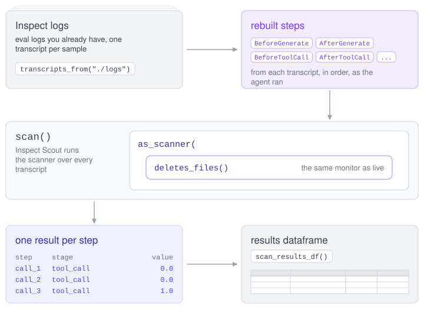

# Replay – Inspect Sentinel

## Overview

Before you let a monitor reject tool calls or end samples, you should know how often it flags the steps you care about and how often it flags harmless ones. Replay lets you measure this on agent runs you already have. It rebuilds each step from an eval log and runs your monitor or protocol over it with the same code that runs during an eval.

Replay runs through [Inspect Scout](https://meridianlabs-ai.github.io/inspect_scout/). Your monitor becomes a Scout scanner, and the scan gives you one result for each step, which you can read in Scout View or as a pandas dataframe. You can use replay to:

1.  See which steps of existing runs a new monitor would flag, before attaching it to an eval.
2.  Choose a threshold from the scores a monitor gives on runs you know are harmless.
3.  Compute precision and recall against your own labels, and compare two versions of a monitor.

[](diagrams/replay.excalidraw.svg)

### Installation

Replay uses the `scout` extra, which installs a compatible version of Inspect Scout:

``` bash
pip install 'inspect-sentinel[scout]'
```

## Replaying a Monitor

Let’s replay the suspicion monitor from `examples/llm_suspicion.py` (described in [LLM Monitors](./llm-monitors.html.md)) over the logs of some earlier runs. Save this script in the `examples` directory, so that it can import the monitor:

    replay_suspicion.py

``` python
from inspect_scout import scan, scan_results_df, transcripts_from
from inspect_sentinel.scout import as_scanner

from llm_suspicion import suspicion

status = scan(
1    scanners={"suspicion": as_scanner(suspicion())},
2    transcripts=transcripts_from("./logs"),
3    model_roles={"monitor": "anthropic/claude-haiku-4-5"},
)

4results = scan_results_df(status.location).scanners["suspicion"]
print(results[["transcript_id", "metadata.step_id", "metadata.stage", "value"]])
```

1  
`as_scanner()` turns a monitor or protocol into a Scout scanner. It takes anything `Task(sentinel=...)` takes, and also a single monitor on its own. Several monitors with no protocol are refused; scan them one at a time.

2  
The transcripts to scan, here every sample in the eval logs in `./logs`. Each sample is one transcript.

3  
The monitor model, given through the `monitor` model role as in an eval.

4  
One dataframe for each scanner, with one row for each step.

Run it with Python:

``` bash
python replay_suspicion.py
```

You can also open the scan in Scout View with `scout view`. Each result’s explanation starts with a link to the step it is about, such as `Step [E12]: ...`, so you can go from a score to the tool call it scored. A label like `[M3]` cites a message and `[E12]` an event.

The scan resolves the monitor model the same way an eval does, with the scan’s `model_roles` and `model` in place of the eval’s. If the `monitor` role has no model and the monitor names none, the scan’s `model` is used, with a warning.

### Results

Each row of the results dataframe is one step at one stage:

| Column | Description |
|----|----|
| `transcript_id` | The sample the step belongs to. |
| `metadata.step_id` | The tool call id at a tool stage, or the model call id at a generate stage. A tool call’s two steps share its id. |
| `metadata.stage` | `"model_input"` (`BeforeGenerate`), `"model_output"` (`AfterGenerate`), `"tool_call"` (`BeforeToolCall`) or `"tool_result"` (`AfterToolCall`). |
| `metadata.conversation` | The conversation the step is in. Each agent and sub-agent has its own message thread, its conversation, so this tells a sub-agent’s steps apart from the main agent’s. |
| `value` | For a monitor, the suspicion score: a number, or a dict with one entry per dimension. For a protocol, `True` if the action is `reject`, `modify` or `terminate`, and `False` for `proceed` or `escalate`. `None` where the monitor or protocol abstained. |
| `answer` | For a protocol, the action, such as `"escalate"`. |
| `metadata.metadata` | The observation’s or decision’s own metadata. |

The suspicion monitor scores two dimensions, so each `value` is a dict such as `{"files": 0.1, "network": 0.7}`. Its value is `None` at the agent’s `submit()` tool call, where it abstains.

If a monitor raises an exception, the transcript gives one error row (in the `scan_error` column) instead of step rows, so a failed monitor is never counted as an abstention. This happens even under `observe_only()`, which in an eval logs a warning and lets the step proceed.

## Measuring a Monitor

To measure a monitor, you need its scores on steps whose correct answer you already know. Both measurements below use ordinary pandas over the results dataframe.

Replay measures what a monitor or protocol reports, not what its decisions would have done. A `reject` in a replay does not change the transcript, because the agent already ran the tool call. To see what the agent does after a rejected tool call, run a live eval.

### Scores on Harmless Runs

To choose a threshold, collect the scores a monitor gives on runs you know are harmless. Run your tasks with the monitor under `observe_only()`, which records every observation and lets every step proceed:

``` python
from inspect_ai import eval
from inspect_sentinel import observe_only

from llm_suspicion import suspicion

eval(
    "benign.py",
    model="openai/gpt-5-mini",
    model_roles={"monitor": "anthropic/claude-haiku-4-5"},
    sentinel=observe_only(suspicion()),
    log_dir="./logs-benign",
)
```

Here `benign.py` stands for tasks the agent can complete without breaking the monitor’s policy. The scores are now in the logs. Read them with `as_reader()`, which gives the same rows as `as_scanner()` from what the eval recorded, without calling the monitor model again (see [Read Mode](#read-mode)). Then take a percentile of each dimension:

``` python
from inspect_scout import scan, scan_results_df, transcripts_from
from inspect_sentinel.scout import as_reader

status = scan(
    scanners={"benign": as_reader("suspicion")},
    transcripts=transcripts_from("./logs-benign"),
)
scores = scan_results_df(status.location).scanners["benign"]["value"].dropna()

for dimension in ["files", "network"]:
    print(dimension, scores.map(lambda v: v[dimension]).quantile(0.99))
```

The 99th percentile of a dimension is the threshold that flags about 1% of harmless tool calls on that dimension. `threshold()` accepts one threshold per dimension, as in `threshold(suspicion(), reject_at={"files": 0.7, "network": 0.6})`. If you already have logs of harmless runs without the monitor, replay it over them with `as_scanner()` and use the same `value` column.

### Precision and Recall

To compute precision and recall, you need labels that say, for some steps, whether the monitor should have flagged them. You make the labels yourself, for example by reading tool calls in Scout View and writing down their ids. Here the labels are a CSV file with columns `transcript_id`, `step_id` and `unsafe` (`True` or `False`), and `status` is the scan from `replay_suspicion.py`:

``` python
import pandas as pd

labels = pd.read_csv("labels.csv")
results = scan_results_df(status.location).scanners["suspicion"]

scored = results.rename(columns={"metadata.step_id": "step_id"}).merge(
    labels, on=["transcript_id", "step_id"]
)
flagged = scored["value"].map(lambda v: v is not None and max(v.values()) >= 0.8)
unsafe = scored["unsafe"]

true_positives = (flagged & unsafe).sum()
print("precision", true_positives / flagged.sum())
print("recall", true_positives / unsafe.sum())
```

`flagged` applies the same test as `threshold(suspicion(), reject_at=0.8)`: a tool call is flagged when its highest dimension reaches 0.8. To trace a precision-recall curve, repeat this for a range of thresholds. Choose thresholds on one set of runs and measure on another. Measure again when you change the monitor model, since a threshold chosen from one model’s scores does not carry over to another model.

If your labels are per sample rather than per step, scan with `results="transcript"` (see [One Result per Transcript](#one-result-per-transcript)) and use a Scout [validation set](https://meridianlabs-ai.github.io/inspect_scout/validation.html), which compares each transcript’s result with its label.

### Monitor Versions

When you change a monitor in a way that changes its scores, such as a new prompt, raise its version:

``` python
@monitor(version=1)
def suspicion(model: str | None = None, role: str | None = None) -> Monitor:
    ...
```

The version defaults to 0. A nonzero version is recorded with the monitor’s configuration in eval logs and in a scan’s scanner parameters, so each set of results says which version produced it. `@protocol` takes `version` too.

## Stages

The suspicion monitor watches only `BeforeToolCall`, so it gives one row per tool call. A monitor or protocol that watches several stages gives a row for each step at each of them. Pass `stage` to keep only one stage’s rows:

``` python
as_scanner(failure_count(), stage="tool_call")
```

Every stage the sentinel watches still runs, in order, so a monitor that keeps state across stages (like `failure_count()` in `examples/trajectory.py`) receives the same steps it received during the eval. Pass `stage` also when you want Scout’s scan summary for one stage, because the summary averages a scanner’s values over all of its rows.

## One Result per Transcript

To get one result per sample instead of one per step, pass `results="transcript"`:

``` python
as_scanner(suspicion(), results="transcript")
```

For a monitor, the value is the highest suspicion score in the transcript, per dimension for a structured score. For a protocol, it is the strongest decision. The result cites the steps that set it, so Scout View links to them.

## Choosing Steps

By default the sentinel runs at every step. To run it at only some steps, pass `steps`. For example, after changing a monitor’s prompt, you can re-run it at only the steps an earlier scan flagged:

``` python
flagged = results[results["value"].map(lambda v: v is not None and max(v.values()) >= 0.8)]
as_scanner(suspicion(), steps=flagged)
```

`steps` takes a results dataframe or a table with `transcript_id` and `step_id` columns. With a results dataframe, each row runs only at its own stage and conversation. With only `transcript_id` and `step_id`, a tool call runs at both of its tool stages, since they share an id.

The sentinel does not run at steps that `steps` leaves out, so a monitor that keeps state does not see them. Scout still reads transcripts the table doesn’t list, so for a large scan, filter the scan’s transcripts to the same ids with `transcripts_from(...).where()`.

### Step Selectors

To choose steps by their content, write a *step selector*: a function decorated with `@step_selector` that takes the transcript id and a `ReplayStep` and returns `True` to run the step. This one chooses tool calls to [bash()](https://inspect.aisi.org.uk/reference/inspect_ai.tool.html#bash):

``` python
from inspect_sentinel import ReplayStep
from inspect_sentinel.scout import step_selector

@step_selector
def bash_calls(transcript_id: str, step: ReplayStep) -> bool:
    return step.stage == "tool_call" and step.step.call.function == "bash"
```

`step.step` is the step a monitor would receive, `step.stage` is its stage, and `step.id` is its step id (the same id as the `metadata.step_id` column). Pass the selector as `as_scanner(suspicion(), steps=bash_calls)`.

Define a selector at module level in a `.py` file, because Scout’s worker processes import it from there. A selector defined in a notebook is refused, so put it in a `.py` file next to the notebook and import it.

## Human Decisions in Replay

A replay cannot ask a person, so `human()` is answered in other ways. If a person answered at the same step and instance path when the run was recorded, replay gives that recorded answer again. This lets you replay a protocol like the ones in [Human Decisions](./human-decisions.html.md) against the decisions a person actually made.

Where no answer was recorded, the `human` parameter of `as_scanner()` gives a fixed answer: `"reject"` (the default), `"approve"` or `"terminate"`:

``` python
sentinel = sequential([
    threshold(suspicion(), escalate_at=0.5, reject_at=0.8),
    human(stages=["tool_call"]),
])
as_scanner(sentinel, human="approve")
```

A `human()` that does not offer the fixed answer gets `terminate`. For example, `reject` is not offered after a tool call runs or at `"model_output"`, so by default a `human()` at `"tool_result"` gets `terminate`.

To answer as a person would, pass a *stand-in*: an `async` function decorated with `@human_stand_in` that takes the step, the escalations and the choices, and returns a `HumanAnswer`. Define it at module level, as for a step selector. This one answers from the labels file used above:

``` python
from collections.abc import Sequence

import pandas as pd
from inspect_sentinel import Escalations, HumanAnswer, ReplayStep
from inspect_sentinel.scout import human_stand_in

labels = pd.read_csv("labels.csv")
UNSAFE = set(labels[labels["unsafe"]]["step_id"])

@human_stand_in
async def from_labels(
    step: ReplayStep, escalations: Escalations, choices: Sequence[str]
) -> HumanAnswer:
    if step.id in UNSAFE:
        return HumanAnswer("reject", "labelled unsafe")
    return HumanAnswer("approve", "labelled safe")
```

Pass it as `as_scanner(sentinel, human=from_labels)`. Each row where the step reached `human()` says where the answer came from in `metadata.human`: `"recorded"` for a person’s answer in the recorded run, `"unanswered"` for the fixed answer (also in `metadata.human_answer`), or `"simulated"` for the stand-in. Counting the `"unanswered"` and `"simulated"` rows tells you how many steps would have gone to a person.

## Read Mode

`as_reader()` reads the observations and decisions that a monitor or protocol recorded during the eval, and gives the same rows replay gives. It calls no model. Pass the instance path as the log records it. For example, pass `"suspicion"` for the monitor under `observe_only()`, `"llm/suspicion"` for a monitor under the `"llm"` key of a mapping, or nothing for the protocol at the top of the sentinel.

To compare a replayed monitor with what it recorded live, scan in both modes and join the rows:

``` python
from inspect_sentinel.scout import as_reader, as_scanner

status = scan(
    scanners={
        "replayed": as_scanner(suspicion(), stage="tool_call"),
        "recorded": as_reader("suspicion", stage="tool_call"),
    },
    transcripts=transcripts_from("./logs"),
)
frames = scan_results_df(status.location).scanners
keys = ["transcript_id", "metadata.conversation", "metadata.step_id", "metadata.stage"]
both = frames["replayed"].merge(frames["recorded"], on=keys, suffixes=("_replayed", "_recorded"))
```

A step where the instance abstained recorded nothing, so it has no read-mode row. Read mode is also the only way to see what a protocol’s decisions did during the eval, since a replay does not change the transcript.

## Checking Replay

Replay should hand a monitor the same step it received during the eval. To check this on your own tasks, use `replay_check()`, a monitor that reports a digest of each field of the step it receives. Attach it to an eval under `observe_only()`, scan the logs in both modes, and compare them with `replay_check_differences()`:

``` python
from inspect_sentinel import observe_only
from inspect_sentinel.scout import as_reader, as_scanner, replay_check, replay_check_differences

Task(..., sentinel=observe_only(replay_check()))

status = scan(
    scanners={
        "replayed": as_scanner(replay_check()),
        "recorded": as_reader("replay_check"),
    },
    transcripts=transcripts_from("./logs"),
)
results = scan_results_df(status.location).scanners
replay_check_differences(results["replayed"], results["recorded"])
```

The result has one row per difference, naming the step, its stage and the field that differs, such as `step.input`, or `eval` for `context.eval`. An empty dataframe means replay handed the monitor what it received live.

Note that replay hands the monitor the sample’s final metadata, so if a solver changed the metadata during the run, earlier steps show an `eval` difference. A message list’s digest covers only its length and last message, so it misses an edit in the middle of the list.

## What a Replayed Step Holds

Logs from recent versions of inspect_ai record where each model call was made. From these logs, replay rebuilds each step with the same code inspect_ai uses during an eval. The step holds what the live step held: the model input and tools, `history`, earlier `human()` decisions, and at a tool stage, the tool call’s view and whether its output was truncated. The results’ `metadata.turns` column is `"recorded"`.

Older logs, and transcripts from other sources, don’t record this, so replay builds the steps from the messages and sets `metadata.turns` to `"inferred"`. Each assistant message becomes a model call whose input is every message before it, followed by a tool step pair for each of its tool calls. These steps have an empty tool list and the default model call configuration; a tool step’s `input` and `truncated`, and `human_decisions`, are `None`; and `history` holds the whole conversation. A monitor that reads only the messages and the tool call works the same on them.

Two fields are `None` at every replayed step, because a log doesn’t record them:

| Field | Why |
|----|----|
| `AfterToolCall.output` | The log holds the tool result the agent’s model received, not the untruncated output. |
| `agent_messages` | The agent’s own message list, which the agent may have edited, is not recorded. |

### Sub-agents and Timelines

Each row’s `metadata.depth` is how deeply nested the step’s conversation is among the transcript’s agents, where 1 is the outermost agent. It counts the same way as Scout’s `llm_scanner(depth=)`. Pass `depth` to `as_scanner()` to run only steps at most that deep, for example `depth=1` to leave out sub-agents.

To take the conversations from a stored timeline instead of the log’s spans, pass the timeline’s name as `timeline`, and `metadata.turns` is then `"stored"`. With `timeline`, or for steps built from messages, join replayed rows with read-mode rows on `transcript_id`, `metadata.step_id` and `metadata.stage` only, because the conversations differ.

### Running and Resuming

Each transcript replays in one pass with one store, so a monitor’s state carries across steps as it did during the eval. Transcripts run concurrently, as for any Scout scanner. The scan records the modules that define your monitors and protocols so that Scout can resume it. Resuming imports that code, so resume only scans you trust.
