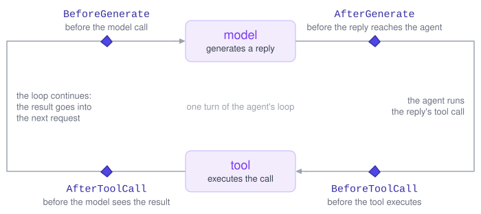

# Stages and Steps – Inspect Sentinel

## Overview

A sentinel runs at four points in each turn of the agent loop: before and after each call to the agent’s model, and before and after each tool call. These points are the *stages*. At each stage, a monitor or protocol receives a *step*: an object describing what is about to happen or what just happened, such as the tool call the agent is about to make.

The type annotation of a function’s `step` parameter sets the stage it runs at. A function that takes `step: BeforeToolCall` runs before every tool call, and one that takes `step: AfterGenerate` runs after every call to the agent’s model. There is no separate registration.

[](diagrams/stages.excalidraw.svg)

## The Four Stages

| Stage | When it runs | What the step holds | Actions a protocol may take |
|----|----|----|----|
| `BeforeGenerate` | Before the agent’s model is called | The request about to be sent (`input`, `tools`, `config`) | `proceed`, `escalate`, `terminate` |
| `AfterGenerate` | After the agent’s model replies, before the agent receives the reply | The model’s reply (`output`) | `proceed`, `escalate`, `terminate` |
| `BeforeToolCall` | Before a tool call runs | The tool call (`call`) | `proceed`, `reject`, `modify`, `escalate`, `terminate` |
| `AfterToolCall` | After a tool call runs, before the agent’s model sees its result | The tool call and its result (`call`, `result`) | `proceed`, `escalate`, `terminate` |

The guide calls `BeforeGenerate` and `AfterGenerate` the *generate stages*, and `BeforeToolCall` and `AfterToolCall` the *tool stages*.

Only `BeforeToolCall` allows `reject` and `modify`, since both act on a tool call that has not run yet. A protocol that returns either one at another stage raises an error. Monitors take no actions, so they can watch any stage.

## Choosing a Stage

Let’s look for the same commands at two stages. This monitor flags [bash()](https://inspect.aisi.org.uk/reference/inspect_ai.tool.html#bash) commands that delete files, before each tool call:

``` python
from inspect_sentinel import (
    BeforeToolCall,
    Context,
    Monitor,
    Observation,
    call_text,
    find_words,
    monitor,
)

DELETE_COMMANDS = ["rm", "shred", "-delete"]


@monitor
def deletes_files() -> Monitor:
    async def check(context: Context, step: BeforeToolCall) -> Observation | None:
        if step.call.function != "bash":
            return None
        found = find_words(call_text(step.call), DELETE_COMMANDS)
        if found:
            return Observation.flag(f"command uses {', '.join(found)}")
        return Observation.score(0.0)

    return check
```

A monitor can look for the same commands one stage earlier, after the model call that produced the tool calls. At `AfterGenerate` the step holds the reply from the agent’s model, which can contain several tool calls:

``` python
from inspect_sentinel import AfterGenerate


@monitor
def plans_deletes() -> Monitor:
    async def check(context: Context, step: AfterGenerate) -> Observation | None:
        if not step.output.choices:
            return None  # some providers return no choices
        calls = step.output.message.tool_calls or []
        found = [
            word
            for call in calls
            if call.function == "bash"
            for word in find_words(call_text(call), DELETE_COMMANDS)
        ]
        if found:
            return Observation.flag(f"reply calls bash with {', '.join(found)}")
        return Observation.score(0.0)

    return check
```

The stage limits what a protocol can do with the score. Before the tool call, `threshold(deletes_files(), reject_at=1.0)` rejects the command, and the agent can try something else. After the model call, `reject` is not allowed, so `threshold(plans_deletes(), terminate_at=1.0)` ends the sample instead. Passing `reject_at` raises a `TypeError` when you build the protocol if any of its monitors has a function that watches a stage other than `BeforeToolCall`.

## Running at Every Stage

A protocol can annotate `step` as `Step`, the union of all four stage types, to run at every stage. This rule lets you stop an eval from outside it: it ends each sample at its next step once a file named `STOP` exists in the directory the eval was started from.

``` python
from pathlib import Path

from inspect_sentinel import Context, Decision, Escalations, Protocol, Step, protocol


@protocol
def stop_file(path: str = "STOP") -> Protocol:
    async def decide(
        context: Context, step: Step, escalations: Escalations
    ) -> Decision | None:
        if Path(path).exists():
            return Decision.terminate(f"{path} exists")
        return None

    return decide
```

Because the rule runs at every stage, a sample ends at its next model call or tool call, whichever comes first. It can return `terminate` wherever it runs, because every stage allows it. The log records the `terminate` and its explanation on each sample it ended.

Monitors work differently. A monitor function watches exactly one stage, and annotating it with `Step` or any other union raises an error. To watch several stages, return a `MonitorGroup` with one function per stage (see [Monitor Groups](./monitors.html.md#monitor-groups)). A protocol function runs at one stage, or at all four if `step` is annotated `Step`. To run at some stages but not all, return a `ProtocolGroup`.

## Step Fields

Each stage has its own step type. This table lists every field and the stages that have it. Each agent and sub-agent has its own message thread, its *conversation*. A *compaction* is Inspect’s shortening of a long conversation to fit the context window (see [Compaction](https://inspect.aisi.org.uk/compaction.html)).

| Field | Stages | Description |
|----|----|----|
| `conversation` | All | Id of the agent’s conversation. It stays the same across compactions. |
| `input` | All | The messages the agent’s model was sent for this model call. At the tool stages, the input of the model call that produced the tool call. |
| `history` | All | Every message the agent has sent to its model so far, in the order sent. |
| `agent_messages` | All | The message list the agent function holds. |
| `tools` | All | The tool definitions the agent’s model was offered. |
| `tool_choice` | All | The tool choice the agent’s model was sent. |
| `human_decisions` | All | Decisions a person made through `human()` at earlier steps of this conversation. |
| `model` | Both generate stages | The model the request is for, as `provider/name`. |
| `config` | Both generate stages | The [GenerateConfig](https://inspect.aisi.org.uk/reference/inspect_ai.model.html#generateconfig) the agent’s model was sent. |
| `output` | `AfterGenerate` | The reply from the agent’s model, as a [ModelOutput](https://inspect.aisi.org.uk/reference/inspect_ai.model.html#modeloutput). |
| `call` | Both tool stages | The tool call, as a `ToolCall`. At `AfterToolCall`, as it ran, after any `modify`. |
| `message` | Both tool stages | The text of the assistant message that made the tool call. |
| `message_id` | Both tool stages | Id of the assistant message that made the tool call. |
| `view` | Both tool stages | A rendering of the tool call: the tool’s custom viewer if it has one, otherwise a Python-call rendering. |
| `result` | `AfterToolCall` | The tool result the agent’s model will see, as a [ChatMessageTool](https://inspect.aisi.org.uk/reference/inspect_ai.model.html#chatmessagetool). |
| `output` | `AfterToolCall` | The tool’s return value, before any truncation. |
| `truncated` | `AfterToolCall` | Whether Inspect cut the tool’s output before the agent’s model saw it. |

Note that `output` means different things at its two stages: the reply from the agent’s model at `AfterGenerate`, and the tool’s return value at `AfterToolCall`.

The lists on a step are shared with Inspect, not copied, so don’t modify them or the messages in them. Copy a list first if you need to change it. The sections below cover the fields that need care. See the [reference](./reference/index.html.md) for the complete type of each field.

### Input, History, and Agent Messages

A step has three message lists:

- `input` is what the agent’s model was sent for this one model call. Use it to score a step against what the agent’s model saw when it acted. After a compaction, it holds the compacted request.
- `history` is everything the agent has sent to its model so far, including messages a compaction later dropped. Use it to score the whole trajectory.
- `agent_messages` is the message list of the outermost running `@agent` function. The agent can leave messages out of it, such as hidden side-task instructions. Use it when the monitor should see only what the agent kept.

At `BeforeGenerate`, `history` does not yet include `input`. At the other stages it does. The reply from the agent’s model joins `history` when a later model call sends it back.

Check these fields for `None`, and abstain when the list a monitor needs is missing rather than fall back to another list:

- `agent_messages` is `None` when no `@agent` function is running (for example, a solver that calls [generate()](https://inspect.aisi.org.uk/reference/inspect_ai.solver.html#generate) directly), for agents run through Inspect’s [agent bridge](https://inspect.aisi.org.uk/agent-bridge.html), and in replay.
- At the tool stages, `input`, `tools`, and `tool_choice` are `None` when no model call produced the tool call, as with a pre-filled assistant message, and in replay from an older log’s messages.
- `history` is set in an eval and in replay, but its type allows `None`.

For what the sample asked the agent to do, use `context.eval.sample_input` (see [Context](./monitors.html.md#context)). To keep hidden instructions away from an LLM monitor, see [Hiding Side-Task Instructions](./llm-monitors.html.md#hiding-side-task-instructions).

### Tool Results and Truncation

At `AfterToolCall`, `result` is the tool message the agent’s model will see, and `output` is the tool’s full return value. They differ when the output was longer than Inspect’s output limit, because `result` then holds the truncated text. To score what the agent’s model saw, use `result`. If you use `output`, check it for `None`: replay sets it to `None`, because the log records only `result`.

`truncated` is a `Truncation` when Inspect cut the output, with its size in `original_bytes` and the limit in `limit_bytes`. It is `False` when the output was not cut, and `None` when no record is available, as in replay from an older log. Use this field rather than looking for Inspect’s “output was too long” notice in `result`, because a tool’s output can contain that text.

Output cut by a sandbox output limit or a timeout is not reported in `truncated`. Check `result.error` for those, with type `"limit"` or `"timeout"`.

### Human Decisions

`human_decisions` lists the decisions a person made through the `human()` protocol at earlier steps of the agent’s conversation, oldest first, and `human_decision_for(step, call_id)` returns the latest decision covering a tool call. The list is empty when there are no decisions, and `None` when replay builds steps from an older log’s messages. See [Marking Tool Calls a Person Reviewed](./llm-monitors.html.md#marking-tool-calls-a-person-reviewed) for how an LLM monitor uses it, and [Human Decisions](./human-decisions.html.md) for `human()`.

### Model Calls Without Generate Stages

`BeforeGenerate` and `AfterGenerate` run for the agent’s own model calls, including those of sub-agents and those answered from the cache. They don’t run for model calls made inside a tool, by a scorer, by an approver, for a compaction summary, or by a monitor.

A model call that a scaffold makes inside the agent loop, such as a summarizer, counts as an agent turn. It gets the generate stages and appears in `history`. To exclude it, wrap it in [model_origin()](https://inspect.aisi.org.uk/reference/inspect_ai.model.html#model_origin) from `inspect_ai.model`:

``` python
from inspect_ai.model import ChatMessage, get_model, model_origin


async def summarize(messages: list[ChatMessage]) -> str:
    with model_origin("helper"):
        output = await get_model(role="summarizer").generate(messages)
    return output.completion
```

Use `"environment"` in place of `"helper"` for model calls that are part of the setting being evaluated, such as a simulated user. The sentinel does not run at tool calls made inside a [model_origin()](https://inspect.aisi.org.uk/reference/inspect_ai.model.html#model_origin) block either.
